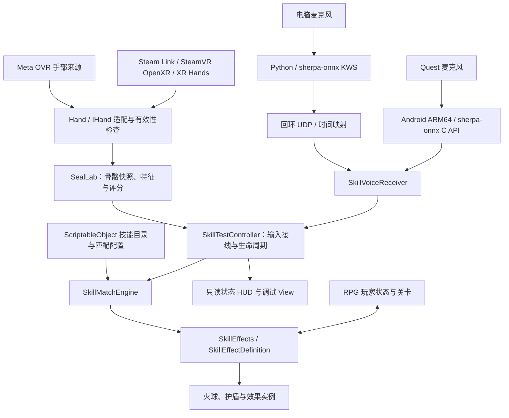

# unity-xr-multimodal-spellcasting

**Unity XR 多模态施法交互原型：手部骨骼识别 × 离线中文口令 × 数据驱动技能。**

《考工律度》的正式开场从设木格窗的试炼室开始。玩家练习打靶与防护、击败一具残机偶，随后走出外门，到校规庭取得第一枚方圆规印。[打开首章场景](Assets/Scene/Chapter01_Awakening.unity) · [关卡与接线说明](docs/guides/CHAPTER01_AWAKENING_ZH.md) · [外景全景与美术配置](docs/guides/CHAPTER01_EXTERIOR_VISUALS_ZH.md)

A Unity XR prototype combining skeletal hand gesture recognition and offline Chinese keyword spotting for configurable spellcasting, gesture locomotion, and a lightweight RPG demo.

项目探索无需手柄的 VR 技能交互：从实际追踪的双手骨骼提取特征，以可配置规则识别固定手势，再与中文口令进行时间窗口匹配，驱动护盾、手持火球和战斗演示。仓库包含采样录制、识别诊断、技能配置、编辑器工具及单机关卡原型。

> **当前状态：开发原型。** Quest / Steam Link 基础双手追踪链路已有实机观察；技能、玩家状态和关卡有自动检查记录。识别准确率、完整头显交互、舒适性和长期性能仍需专项验证。十二个手印资产不代表十二种手势均已完成标定。

## 功能概览

| 模块 | 当前实现 |
|---|---|
| 手部接入 | Meta OVR 与 OpenXR / XR Hands 两条输入路径；Steam Link → SteamVR → Unity 的 PC 调试路线 |
| 手势识别 | 骨骼快照、逐关节有效性与过期检查、手指/双手特征、模板加权评分、覆盖率、稳定保持和竞争姿态消歧 |
| 数据工具 | 倒计时采样、带标签 JSONL 录制、回放、模板草稿生成、骨骼与评分可视化 |
| 离线语音 | 编辑器使用 Python + sherpa-onnx 回环服务；Quest Android 包使用 ARM64 原生 KWS 与设备麦克风，统一口令白名单、采集时间与过期过滤 |
| 多模态配方 | 纯手势、纯口令、手势与口令组合；组合支持先手势后口令或相反顺序 |
| 技能系统 | ScriptableObject 配置、独立匹配器、效果定义与运行时生命周期；投射物、护盾、取消和冷却 |
| 移动与关卡 | 战斗视线选点传送、胸前快推后撤、探索视线行走、HP/MP、三阶段试炼、固定奖励、升级和版本化检查点 |
| 基础手形 | Meta官方状态引擎与默认阈值；左右手独立确认与失效撤销；[串流调试说明](docs/guides/OFFICIAL_HAND_POSES_ZH.md) |
| 腕饰教学卡 | 抬左腕＋右食指点腕饰开关，无需握拳；按钮高亮后轻捏即确认，松开重备；分页和独立放腕关闭策略。[操作与配置](docs/guides/WRIST_MENU_INTERACTION_DESIGN_ZH.md)。文字速查已实现，画符识别与完整课程未做 |
| 开发支持 | 中文 Inspector / HUD、模拟输入入口、配置冲突检查、场景生成与编辑/播放模式检查 |
| 天空原型 | 青灰底色与两层缓慢薄云、中文材质参数、独立预览；[使用与性能边界](docs/guides/THIN_CLOUD_SKY_ZH.md)，正式首章未应用 |

手势采用**特征与规则评分**；语音采用**关键词检测（KWS）**。本仓库没有训练通用手势分类模型，也不把关键词命中当作整句语义理解。

## 技术架构



### 手势与语音如何组合

- 手部快照携带有效性、数据版本与新鲜度；追踪丢失、关节无效或超时的数据不能继续作为有效识别证据。
- 默认保留最多 **10 秒 / 640 帧**的有界骨骼与评分缓存，默认组合窗口为 **8 秒**。时间和容量可配置，必须满足采样率及语音延迟预算。
- 匹配器负责保持、歧义处理、输入消费与重新准备，避免一直保持同一手势造成重复施法。
- 语音事件使用映射后的词尾时间估计参与匹配，不能直接把 UDP 到达时刻当作说话时刻。
- 条件满足后激活技能；火球生成到手与发射分开。当前 RPG 采用头向瞄准，手部动作触发发射；有效同印可配新口令重新就绪。见[火球配置与算法](docs/guides/FIREBALL_TUNING_ZH.md)。
- 战斗选点、探索行走与腕部仲裁见[移动指南](docs/guides/ENCOUNTER_LOCOMOTION_ZH.md)；点腕、子卡射线轻捏、三维拖动与跟随见[腕饰指南](docs/guides/WRIST_MENU_INTERACTION_DESIGN_ZH.md)。

### 最近一次串流与下一版操作

已验证：火球抬腕显示预测线，三种手势只负责发射；寅印可配合新的口令再次施法。Steam 串流中记录到 8 发成功发射，其中一次侧甩命中；也记录到一次玩家未主动操作菜单却被判为腕部独占。该次测试使用旧射线导航（手指 98%、距离 2%）。

已接入线性 RPG：靠近腕饰或悬停只提示，不打断施法。战斗时左食指启用视线为主的节点传送，空手右手胸前快推触发向后滑退；探索时左食指沿水平视线走，收指即停，无闪避。见[战斗／探索移动与腕部仲裁](docs/guides/ENCOUNTER_LOCOMOTION_ZH.md)，包含实际默认参数、Debug 操作和真机验收步骤。2026-11-01 的既有报告记录 531 项编辑模式检查及 Play Mode 集成通过；报告时间与边界见[验证说明](docs/guides/VALIDATION_ZH.md)，本次文档整理未重跑这些检查。

### 本轮串流操作

1. **菜单**：左腕抬到胸前，不要求握拳。右食指从腕饰外靠近并轻点；退开约 10 厘米，再点一次关闭小菜单。放下左腕也能收起入口。
2. **子面板**：指向按钮看到高亮后轻捏；子面板只使用射线轻捏，主菜单保留近按。确认发生在捏下时；松开才能再次点击。结印/咒语卡默认放腕保留，用卡片关闭键关闭；画符预览默认随腕收起。
3. **移动冲突**：仅靠近腕饰或悬停教学卡不取消结印、口令或选点；确认打开主菜单、点按钮或拖动才占用输入。单纯抬腕/握拳不再自动弹出菜单；已生成的手持技能优先。
4. **投掷**：火球在手上后先握住或捏住，支持原有甩手松开、后拉约5厘米再快速前送约9厘米、主动伸手后稳定保持约0.45秒。绿色只表示握持确认；前送需动作分62及运动/追踪/碰撞门槛，伸手保持走独立距离和时长条件。生成时已远伸不能直接等到自动发射。见[评分算法、操作与日志](docs/guides/FIREBALL_TUNING_ZH.md)。
5. **诊断**：进入Play自动记录投掷动作；右侧“投掷动作评分与发射诊断”实时显示分数、保持进度、各项数值和拒绝原因。日志位于 `Logs/throw-captures/throw-score-*.jsonl`，默认15分钟/64MB上限，可停止或开始新文件，无需腾手点击录制。电脑 Game 窗口右侧的结印、语音和投掷分区支持鼠标滚动及折叠，已展开的分区每秒更新10次。世界调试面板默认隐藏，可从电脑按钮切换；点腕前不再弹文字提示，关闭说明留在已打开的菜单里。

在“左腕术式菜单与教学卡”的中文 Inspector 调整接触半径、腕饰偏移、轻捏距离与子面板策略；在“效果_fireball”调整投掷门槛。不要在手印模板里调这些基础操作。旧自动抬拳模式保留作对照，默认使用点腕模式。桌面合成检查不能代替本轮头显手感验收。

Hierarchy 中的“腕部界面 · 自有世界根”是程序生成的 UI 容器，内部包含腕饰、小菜单、独立教学卡与指针，运行时每个菜单 View 只有一套。正常编辑状态没有这类临时根；它们不保存到场景。2026-10-31 修复编辑预览销毁后残留、隐藏操作意外创建和脚本重载清理问题；无需手动复制这些节点。

### 配置与运行状态分离

| 资产 / 模块 | 职责 |
|---|---|
| `SealProfile` | 手势特征范围、权重、覆盖率与保持时间 |
| `SkillDefinition` | 技能 ID、输入模式、单印、口令、窗口、冷却与效果引用 |
| `SkillCatalog` | 当前场景的可用技能、共享匹配规则与取消口令 |
| `ProjectileEffectDefinition` / `ShieldEffectDefinition` | 投射物或护盾的数值与基础视觉 |
| `SkillMatchEngine` | 输入缓存、配方匹配与消费，不创建场景物体 |
| `SkillEffects` / 效果实例 | 激活、更新、命中和资源清理 |
| `TeachingCatalog` / 腕匣教学 | 内容、配方分组与展示，独立于技能解锁 |
| `SkillProgression` / 物品与商店模块 | 技能知识、永久解锁、物品奖励和配置商品交易 |
| `RpgChapterFlow` / `TrainingTargetGroup` | 章节目标与授权；独立训练设施 |
| `RuntimeSkillCatalog` | 玩家独立技能副本，按各自技能 ID 应用等级 |
| `RpgProgressData` / `RpgSaveStore` | 纯进度数据、v2 检查点保存和失败重试 |

会话开始时复制匹配配置，施法时复制效果参数；共享 ScriptableObject 不保存玩家剩余 HP、运行对象或效果剩余时间。新增同类型技能可通过复制配置资产并加入目录完成；新增机制需实现新的效果定义。详细步骤见[配置与扩展指南](docs/guides/CONFIGURATION_GUIDE_ZH.md)和[成长职责划分](docs/architecture/PROGRESSION_RESPONSIBILITIES_ZH.md)。

## 开发环境

| 依赖 | 工程锁定版本 |
|---|---|
| Unity | `6000.3.10f1` |
| Universal RP | `17.3.0` |
| OpenXR Plugin | `1.15.1` |
| XR Hands | `1.7.2` |
| Input System | `1.18.0` |
| Meta XR Core / Interaction / Interaction OVR | `207.0.1` |
| PC 语音服务 | Python、`sherpa-onnx==2.0.1`、`sounddevice==0.5.6`、`numpy==2.4.4` |
| Quest 原生口令 | `sherpa-onnx 2.0.1` C API、官方 Android ARM64 运行库、随包 3M KWS 模型 |

以 [manifest.json](Packages/manifest.json)、[ProjectVersion.txt](ProjectSettings/ProjectVersion.txt) 和 [requirements.txt](Tools/SkillVoice/requirements.txt) 为准。语音依赖需要使用兼容这些固定版本的 Python 环境。

P1 程序试炼使用独立靶场，集中测试命中特效复用、语音避让和触觉反馈。[场景与验收说明](docs/guides/P1_TRIAL_ZH.md)。

## 快速开始

### 1. 获取工程

```bash
git clone https://github.com/lphahapl/unity-xr-multimodal-spellcasting.git
```

在 Unity Hub 中添加克隆目录，使用上述 Unity 版本打开，等待 Package Manager 还原依赖。工程保留 `Assets`、`Packages`、`ProjectSettings` 及 Unity `.meta`；Quest 语音运行库在 `Assets/Plugins`，随包模型在 `Assets/StreamingAssets/SkillVoice`。缓存、构建产物和电脑语音虚拟环境不作为运行资产分发。

代码命名空间、部分菜单及历史文档仍保留原名 **`NarutoVR`**。这是现有工具入口，和仓库名称不同；本次展示名称调整未批量重命名序列化类型或场景引用。

### 2. 接通手部追踪

1. 电脑启动 Steam / SteamVR，Quest 打开 Steam Link 并连接电脑。
2. 将 SteamVR 设为当前 OpenXR Runtime；Unity 的 PC OpenXR Play Mode Runtime 使用 SteamVR 或相应的系统默认值。
3. 在 Unity 选择 Windows 开发目标，使用 **Tools → NarutoVR → Steam Link → 打开独立实验场景**。
4. 进入 Play，放下控制器，检查左右手追踪、关节版本、骨骼线和实际 Runtime。

具体设置、质量标记和原生路线说明见 [Steam Link 开发指南](docs/guides/STEAM_LINK_DEVELOPMENT_ZH.md)。系统菜单能用轻捏点击，不代表应用已经收到有效关节数据。

### 3. 选择演示场景

| 场景 | 路径 | 观察重点 |
|---|---|---|
| 手部实验台 | `Assets/Scene/SealLabSteamLink.unity` | 原始追踪、录制、特征和评分 |
| 基础技能测试 | `Assets/Scene/SkillTest.unity` | 三种配方与最小接线 |
| 火球靶场 | `Assets/Scene/FireballRange.unity` | 手持生成、前推发射、命中与遮挡 |
| 护盾试炼 | `Assets/Scene/ShieldTrial.unity` | 自身加持与有限伤害演示 |
| 组合施法 | `Assets/Scene/ComboSanctum.unity` | 两种输入顺序、超时与取消 |
| 线性 RPG | `Assets/Scene/LinearRpgTest.unity` | 玩家资源、导航、闪避、关卡、升级与检查点 |

默认训练配方示例：**子印 → 护盾**、**“护体咒” → 护盾**、**寅印 + “火球术” → 火球**。RPG 场景使用独立目录和取消规则，按[运行指南](docs/guides/LINEAR_RPG_QUICKSTART_ZH.md)配置。电脑调试入口可模拟口令；火球等依赖手锚的效果仍需要有效手姿，模拟输入不代表真实识别成功。

### 4. 启动离线中文口令（可选）

先在 Unity 使用 **Tools → NarutoVR → 技能配置 → 导出当前场景语音配置**，让服务词表与场景保持一致。在工程根目录的 PowerShell 中分别执行：

```powershell
# 首次安装：创建本地虚拟环境、下载官方模型并运行自检
& './Tools/SkillVoice/Setup.ps1' -Python 'python'

# 列出音频设备；确认头显麦克风对应的输入设备
& './Tools/SkillVoice/.venv/Scripts/python.exe' -X utf8 './Tools/SkillVoice/skill_voice.py' --list-devices

# 使用默认输入；需要指定设备时给 Start.ps1 传入 -Device <设备ID>
& './Tools/SkillVoice/Start.ps1'

# 测试结束后停止服务
& './Tools/SkillVoice/Stop.ps1'
```

以上步骤用于电脑编辑器，使用 IPv4 loopback UDP。Quest 独立 Android 包自动使用设备内原生识别，模型随 APK 提供，无需启动电脑服务；首次使用需允许麦克风。构建、权限恢复、实测状态及来源校验见[语音接入说明](docs/guides/SKILL_VOICE_SETUP_ZH.md)。代码接入不等于头显真人与性能验收。

## 代码目录

```text
Assets/
├── scripts/                 # 项目脚本，命名空间保持稳定
│   ├── ui/                 # 视图、面板、反馈与 UI 编辑器
│   ├── logic/              # 战斗、技能、交互、移动与 Editor 工具/回归
│   └── data/               # SO 类型、状态、配置与数据编辑器
├── Scene/                  # 正式场景、实验台与隔离测试场景
├── ScriptableObjects/      # 每种 SO 单独放进中文“××配置”；同名版本再分默认、历史、迁移
├── Art/                    # 角色、道具与贴图
├── Audio/                  # 游戏音频
├── Materials/ · Meshes/ · Prefabs/ · Shaders/
├── Configuration/          # 非 SO 配置、语音 JSON 与导航数据
├── SealLab/                # 实验台美术和 Resources 字体/参数
└── XR/                     # XR Loader 与平台配置
Tools/SkillVoice/            # 离线 KWS 服务、下载器与测试
Packages/                    # 包依赖与锁文件
ProjectSettings/             # Unity 工程设置
docs/                        # guides / architecture / research / world / 模型交火
```

## 验证方式与边界

修改配置后可在 Unity 运行 **Tools → NarutoVR → 技能配置 → 验证当前场景 / 运行架构检查**。RPG 的场景检查与独立存档播放检查位于 **Tools → NarutoVR → 线性RPG**。

安装语音依赖后，可单独检查配置契约和实际模型的合成音样本：

```powershell
& './Tools/SkillVoice/.venv/Scripts/python.exe' -X utf8 -m unittest discover -s './Tools/SkillVoice' -p 'test_configuration.py' -v
& './Tools/SkillVoice/.venv/Scripts/python.exe' -X utf8 './Tools/SkillVoice/verify_fixtures.py'
```

验证入口、报告时间和覆盖范围见[验证说明](docs/guides/VALIDATION_ZH.md)。既有报告不代表后续版本自动通过；原始日志、录音和本机备份不随仓库上传。

当前限制：

- 手势评分是相似度，不是经过校准的正确概率；XR Hands 的派生质量标记也不等同于 Meta 原生置信度。
- KWS 不理解否定语义，“不要释放火球术”仍可能命中“火球术”；合成音检查不能替代真人误报/漏检测试。
- 基础双手追踪已观察可用，新增导航、闪避和完整玩法仍需头显实测与舒适性调参。
- 当前只实现单印配方；多印序列、画符、领域、完整敌人 AI、头显交互式商店与剧情尚未完成。
- PICO、MR 空间能力、多人和独立观众镜头属于后续设计；XR Hands 接入仍包含 Meta 类型依赖，不能据此宣称跨设备即插即用。

## 文档导航

- [文档总索引](docs/README.md)：当前操作、架构设计、世界观和资料来源。
- [配置与扩展](docs/guides/CONFIGURATION_GUIDE_ZH.md) · [RPG 场景与存档](docs/guides/LINEAR_RPG_QUICKSTART_ZH.md)。
- [手势录制与标定](docs/guides/SEAL_LAB_QUICKSTART_ZH.md) · [中文口令](docs/guides/SKILL_VOICE_SETUP_ZH.md)。
- [画符设计](docs/architecture/GLYPH_DESIGN_ZH.md)：战斗外抓笔进入，期间不结印/攻击，P2，尚未实现运行时。
- [模型交火规则](docs/模型交火/README.md)：代码审阅、需求变更和世界观变更统一追加交接，逐项记录模型、时间及文件改动。

## 第三方资源与许可

Unity 和 Meta SDK 由 Package Manager 获取，遵循各自条款；仓库不包含它们的包缓存或头显应用安装包。中文字体保留 [Noto 字体说明](Assets/SealLab/Resources/Fonts/NOTICE.txt)与 [SIL Open Font License](Assets/SealLab/Resources/Fonts/OFL.txt)。语音模型由下载器从 sherpa-onnx 官方发布获取，来源、校验与许可证处理见语音文档及下载脚本。项目自身尚未指定开源许可证，第三方许可证不自动适用于全部项目代码。

追踪、语音与环境故障：[排障指南](docs/guides/TRACKING_TROUBLESHOOTING_ZH.md)。

施法故障排查与自动日志：[通用施法调试链条](docs/guides/SKILL_CAST_TRACE_ZH.md)。

扩展与调试接口：[保持行为的结构重构说明](docs/architecture/EXTENSION_INTERFACES_ZH.md)。

火球储存与三种发射调参：[配置与算法说明](docs/guides/FIREBALL_TUNING_ZH.md)。
