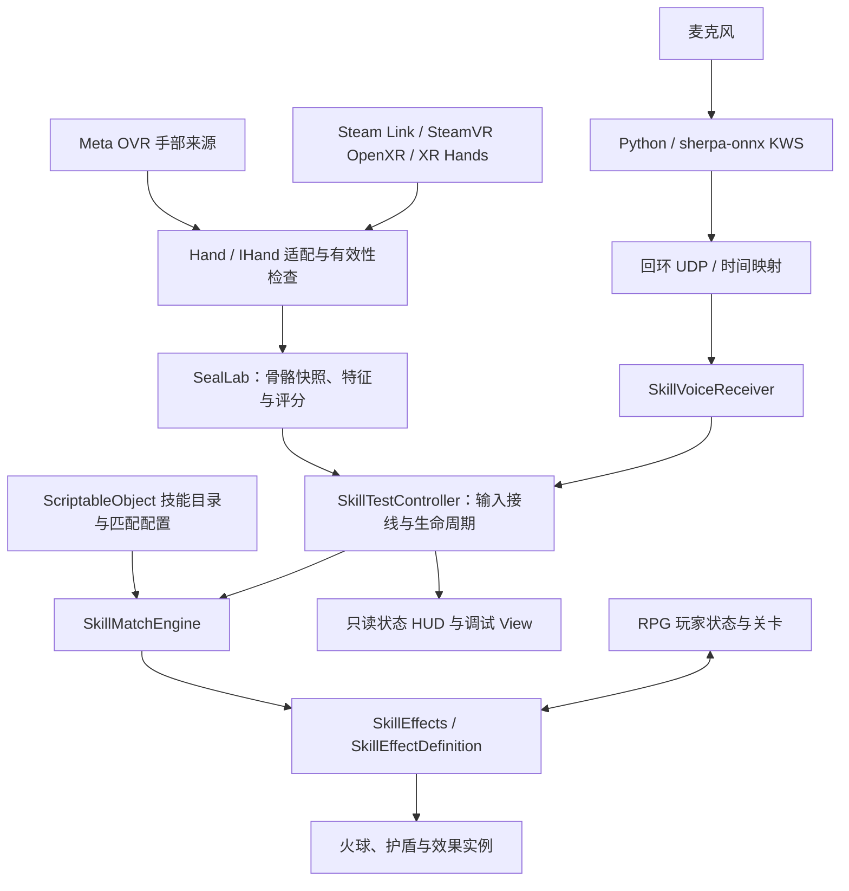

# unity-xr-multimodal-spellcasting

**Unity XR 多模态施法交互原型：手部骨骼识别 × 离线中文口令 × 数据驱动技能。**

A Unity XR prototype combining skeletal hand gesture recognition and offline Chinese keyword spotting for configurable spellcasting, gesture locomotion, and a lightweight RPG demo.

项目探索无需手柄的 VR 技能交互：从实际追踪的双手骨骼提取特征，以可配置规则识别固定手势，再与中文口令进行时间窗口匹配，驱动护盾、手持火球和战斗演示。仓库包含采样录制、识别诊断、技能配置、编辑器工具及单机关卡原型。

> **当前状态：开发原型。** Quest / Steam Link 基础双手追踪链路已有实机观察；技能、玩家状态和关卡有自动检查记录。识别准确率、完整头显交互、舒适性和长期性能仍需专项验证。十二个手印资产不代表十二种手势均已完成标定。

## 功能概览

| 模块 | 当前实现 |
|---|---|
| 手部接入 | Meta OVR 与 OpenXR / XR Hands 两条输入路径；Steam Link → SteamVR → Unity 的 PC 调试路线 |
| 手势识别 | 骨骼快照、逐关节有效性与过期检查、手指/双手特征、模板加权评分、覆盖率、稳定保持和竞争姿态消歧 |
| 数据工具 | 倒计时采样、带标签 JSONL 录制、回放、模板草稿生成、骨骼与评分可视化 |
| 离线语音 | Python + sherpa-onnx 中文关键词检测，本机回环 UDP、心跳、时钟映射与过期事件过滤 |
| 多模态配方 | 纯手势、纯口令、手势与口令组合；组合支持先手势后口令或相反顺序 |
| 技能系统 | ScriptableObject 配置、独立匹配器、效果定义与运行时生命周期；投射物、护盾、取消和冷却 |
| 移动与关卡 | 手势节点导航、方向闪避、HP/MP、三阶段试炼、固定奖励、升级和版本化检查点 |
| 开发支持 | 中文 Inspector / HUD、模拟输入入口、配置冲突检查、场景生成与编辑/播放模式检查 |

手势采用**特征与规则评分**；语音采用**关键词检测（KWS）**。本仓库没有训练通用手势分类模型，也不把关键词命中当作整句语义理解。

## 技术架构



### 手势与语音如何组合

- 手部快照携带有效性、数据版本与新鲜度；追踪丢失、关节无效或超时的数据不能继续作为有效识别证据。
- 默认保留最多 **10 秒 / 640 帧**的有界骨骼与评分缓存，默认组合窗口为 **8 秒**。时间和容量可配置，必须满足采样率及语音延迟预算。
- 匹配器负责保持、歧义处理、输入消费与重新准备，避免一直保持同一手势造成重复施法。
- 语音事件使用映射后的词尾时间估计参与匹配，不能直接把 UDP 到达时刻当作说话时刻。
- 条件满足后激活技能；火球的“生成到手上”和“向前轻推发射”是两个阶段。

### 配置与运行状态分离

| 资产 / 模块 | 职责 |
|---|---|
| `SealProfile` | 手势特征范围、权重、覆盖率与保持时间 |
| `SkillDefinition` | 技能 ID、输入模式、单印、口令、窗口、冷却与效果引用 |
| `SkillCatalog` | 当前场景的可用技能、共享匹配规则与取消口令 |
| `ProjectileEffectDefinition` / `ShieldEffectDefinition` | 投射物或护盾的数值与基础视觉 |
| `SkillMatchEngine` | 输入缓存、配方匹配与消费，不创建场景物体 |
| `SkillEffects` / 效果实例 | 激活、更新、命中和资源清理 |
| `Rpg/Data` | 玩家运行状态、成长、进度和检查点存档 |

会话开始时复制匹配配置，施法时复制效果参数；共享 ScriptableObject 不保存玩家剩余 HP、运行对象或效果剩余时间。新增同类型技能可通过复制配置资产并加入目录完成；新增机制需实现新的效果定义。详细步骤见[配置与扩展指南](docs/CONFIGURATION_GUIDE_ZH.md)。

## 开发环境

| 依赖 | 工程锁定版本 |
|---|---|
| Unity | `6000.3.10f1` |
| Universal RP | `17.3.0` |
| OpenXR Plugin | `1.15.1` |
| XR Hands | `1.7.2` |
| Input System | `1.18.0` |
| Meta XR Core / Interaction / Interaction OVR | `207.0.1` |
| PC 语音服务 | Python、`sherpa-onnx==2.0.1`、`sounddevice==0.5.6`、`numpy==2.4.4` |

以 [manifest.json](Packages/manifest.json)、[ProjectVersion.txt](ProjectSettings/ProjectVersion.txt) 和 [requirements.txt](Tools/SkillVoice/requirements.txt) 为准。语音依赖需要使用兼容这些固定版本的 Python 环境。

## 快速开始

### 1. 获取工程

```bash
git clone https://github.com/lphahapl/unity-xr-multimodal-spellcasting.git
```

在 Unity Hub 中添加克隆目录，使用上述 Unity 版本打开，等待 Package Manager 还原依赖。仓库保留 `Assets`、`Packages`、`ProjectSettings` 及 Unity `.meta`；缓存、构建产物、语音虚拟环境和下载模型不随仓库分发。

代码命名空间、部分菜单及历史文档仍保留原名 **`NarutoVR`**。这是现有工具入口，和仓库名称不同；本次展示名称调整未批量重命名序列化类型或场景引用。

### 2. 接通手部追踪

1. 电脑启动 Steam / SteamVR，Quest 打开 Steam Link 并连接电脑。
2. 将 SteamVR 设为当前 OpenXR Runtime；Unity 的 PC OpenXR Play Mode Runtime 使用 SteamVR 或相应的系统默认值。
3. 在 Unity 选择 Windows 开发目标，使用 **Tools → NarutoVR → Steam Link → 打开独立实验场景**。
4. 进入 Play，放下控制器，检查左右手追踪、关节版本、骨骼线和实际 Runtime。

具体设置、质量标记和原生路线说明见 [Steam Link 开发指南](docs/STEAM_LINK_DEVELOPMENT_ZH.md)。系统菜单能用轻捏点击，不代表应用已经收到有效关节数据。

### 3. 选择演示场景

| 场景 | 路径 | 观察重点 |
|---|---|---|
| 手部实验台 | `Assets/SealLab/Scenes/SealLabSteamLink.unity` | 原始追踪、录制、特征和评分 |
| 基础技能测试 | `Assets/SealCombat/Scenes/SkillTest.unity` | 三种配方与最小接线 |
| 火球靶场 | `Assets/SealCombat/Scenes/FireballRange.unity` | 手持生成、前推发射、命中与遮挡 |
| 护盾试炼 | `Assets/SealCombat/Scenes/ShieldTrial.unity` | 自身加持与有限伤害演示 |
| 组合施法 | `Assets/SealCombat/Scenes/ComboSanctum.unity` | 两种输入顺序、超时与取消 |
| 线性 RPG | `Assets/SealCombat/Scenes/LinearRpgTest.unity` | 玩家资源、导航、闪避、关卡、升级与检查点 |

默认训练配方示例：**子印 → 护盾**、**“护体咒” → 护盾**、**寅印 + “火球术” → 火球**。RPG 场景使用独立目录和取消规则，按[运行指南](docs/LINEAR_RPG_QUICKSTART_ZH.md)配置。电脑调试入口可模拟口令；火球等依赖手锚的效果仍需要有效手姿，模拟输入不代表真实识别成功。

### 4. 启动离线中文口令（可选）

先在 Unity 使用 **Tools → NarutoVR → 技能配置 → 导出当前场景语音配置**，让服务词表与场景保持一致。在工程根目录的 PowerShell 中分别执行：

```powershell
# 首次安装：创建本地虚拟环境、下载官方模型并运行自检
& './Tools/SkillVoice/Setup.ps1' -Python 'python'

# 列出音频设备；确认头显麦克风对应的输入设备
& './Tools/SkillVoice/.venv/Scripts/python.exe' -X utf8 './Tools/SkillVoice/skill_voice.py' --list-devices

# 使用默认输入；需要指定设备时给 Start.ps1 传入 -Device <设备ID>
& './Tools/SkillVoice/Start.ps1'

# 测试结束后停止服务
& './Tools/SkillVoice/Stop.ps1'
```

推理在电脑本地运行，正式接线使用 IPv4 loopback UDP。当前 PC 服务不能直接供独立 Quest Android 包使用。下载模型的来源及校验、麦克风选择、词表与时钟协议见[语音接入说明](docs/SKILL_VOICE_SETUP_ZH.md)。

## 代码目录

```text
Assets/
├── SealLab/                 # 追踪适配、采样、特征、模板、识别和诊断
├── SealCombat/
│   ├── Runtime/Core/        # 技能定义、目录、配置校验和匹配器
│   ├── Runtime/Voice/       # 本机语音事件接收
│   ├── Runtime/Effects/     # 火球、护盾及效果生命周期
│   ├── Runtime/Locomotion/  # 手势导航与闪避
│   ├── Runtime/Rpg/         # 玩家数据、关卡与检查点
│   ├── Configuration/      # ScriptableObject 技能/效果/关卡资产
│   ├── Scenes/             # 单机演示场景
│   └── Editor/             # 配置、场景工具和回归检查
└── XR/                      # XR Loader 与平台配置
Tools/SkillVoice/            # 离线 KWS 服务、下载器与测试
Packages/                    # 包依赖与锁文件
ProjectSettings/             # Unity 工程设置
docs/                        # 操作、架构、设计与历史验收说明
```

## 验证方式与边界

修改配置后可在 Unity 运行 **Tools → NarutoVR → 技能配置 → 验证当前场景 / 运行架构检查**。RPG 的场景检查与独立存档播放检查位于 **Tools → NarutoVR → 线性RPG**。

安装语音依赖后，可单独检查配置契约和实际模型的合成音样本：

```powershell
& './Tools/SkillVoice/.venv/Scripts/python.exe' -X utf8 -m unittest discover -s './Tools/SkillVoice' -p 'test_configuration.py' -v
& './Tools/SkillVoice/.venv/Scripts/python.exe' -X utf8 './Tools/SkillVoice/verify_fixtures.py'
```

[架构重构记录](docs/ARCHITECTURE_REFACTOR_QA_ZH.md)和 [RPG 验收摘要](docs/LINEAR_RPG_QA_2026-10-30_ZH.md)记录了对应开发阶段的检查结果。历史结果不代表后续版本自动通过；原始日志、录音和本机备份不随仓库上传。

当前限制：

- 手势评分是相似度，不是经过校准的正确概率；XR Hands 的派生质量标记也不等同于 Meta 原生置信度。
- KWS 不理解否定语义，“不要释放火球术”仍可能命中“火球术”；合成音检查不能替代真人误报/漏检测试。
- 基础双手追踪已观察可用，新增导航、闪避和完整玩法仍需头显实测与舒适性调参。
- 当前只实现单印配方；多印序列、画符、领域、完整敌人 AI、头显交互式商店与剧情尚未完成。
- PICO、MR 空间能力、多人和独立观众镜头属于后续设计；XR Hands 接入仍包含 Meta 类型依赖，不能据此宣称跨设备即插即用。

## 文档导航

- [配置与扩展指南](docs/CONFIGURATION_GUIDE_ZH.md)：技能资产、效果扩展、缓存、语音与详细操作。
- [技术与开发索引](docs/TECHNICAL_DEVELOPMENT_INDEX_ZH.md)：当前实现、设计提案和后续顺序。
- [手势采样与标定](docs/SEAL_LAB_QUICKSTART_ZH.md) / [识别测试](docs/RECOGNITION_TEST_ZH.md)。
- [Steam Link 开发](docs/STEAM_LINK_DEVELOPMENT_ZH.md) / [中文语音](docs/SKILL_VOICE_SETUP_ZH.md)。
- [试炼场景](docs/SKILL_SHOWCASES_ZH.md) / [线性 RPG 运行](docs/LINEAR_RPG_QUICKSTART_ZH.md)。
- [技能架构](docs/SKILL_FRAMEWORK_AND_INTERACTION_ZH.md) / [玩家数据设计](docs/PLAYER_DATA_DESIGN_ZH.md)。

## 第三方资源与许可

Unity 和 Meta SDK 由 Package Manager 获取，遵循各自条款；仓库不包含它们的包缓存或头显应用安装包。中文字体保留 [Noto 字体说明](Assets/SealLab/Resources/Fonts/NOTICE.txt)与 [SIL Open Font License](Assets/SealLab/Resources/Fonts/OFL.txt)。语音模型由下载器从 sherpa-onnx 官方发布获取，来源、校验与许可证处理见语音文档及下载脚本。项目自身尚未指定开源许可证，第三方许可证不自动适用于全部项目代码。
