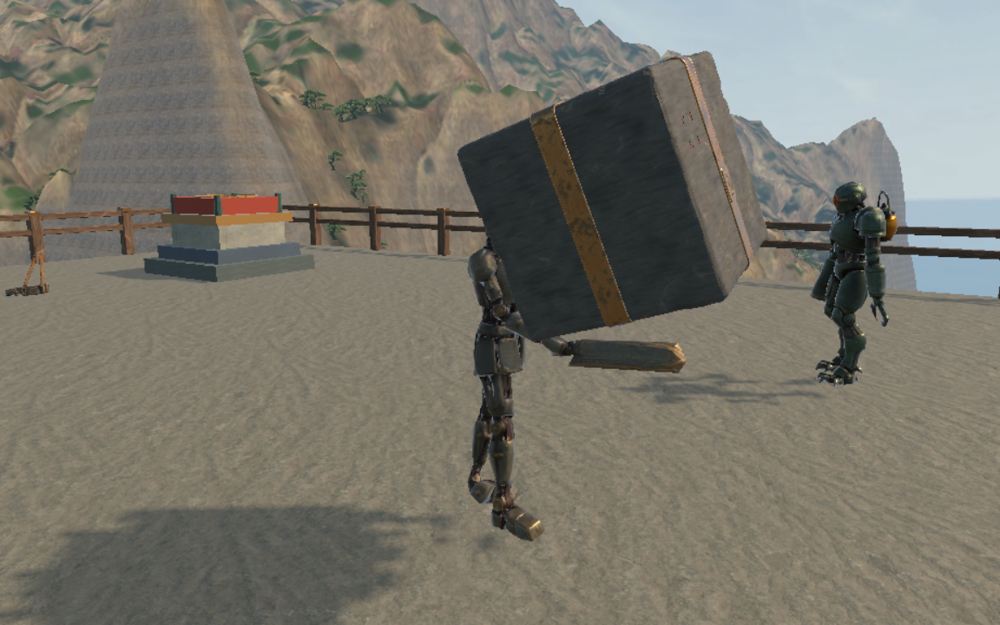
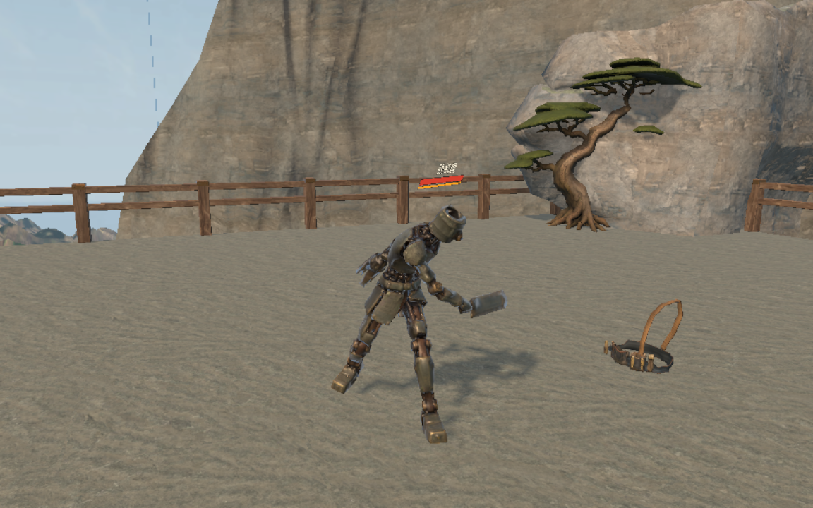
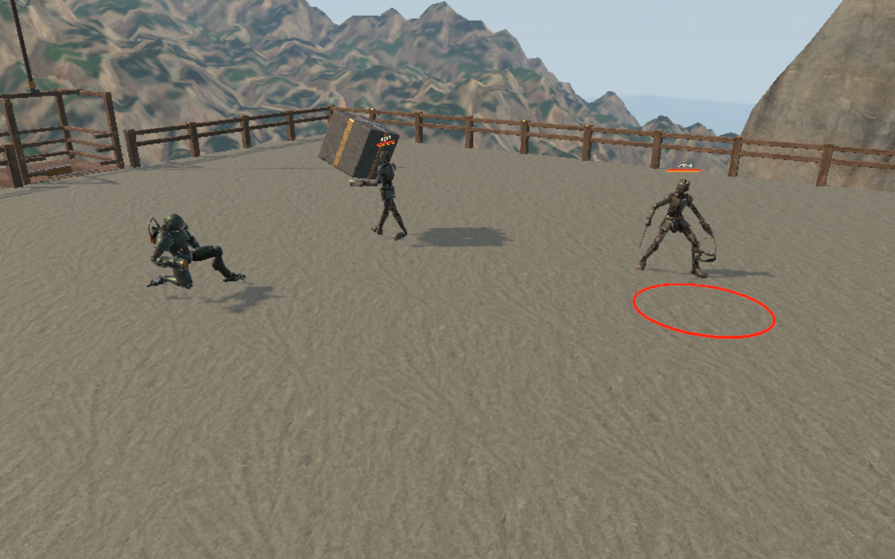
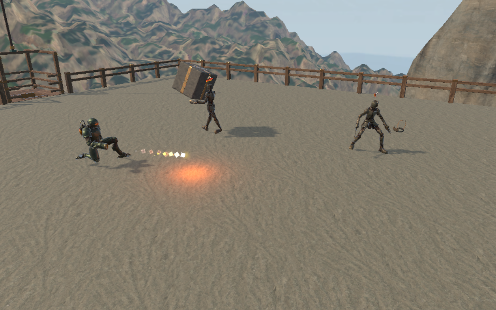

# 二章祭坛三敌实景行为

2026-11-26，Codex（GPT-6 系列），Unity 6000.3.10f1。试验使用正式二章场景 `e7aeb66b` 的独立副本，在其中运行场景负责人的三敌安装器。真实玩家 Rig 进入祭坛接敌区后，原 `CombatRoomEncounter` 经原 `EnemyManager` 一次生成三个正式租约。三只均为普通敌人，目标均为同一个 RPG 玩家的头部节点。

| 对象 | 触发与可观测结果 |
| --- | --- |
| 背石工奴 | 在正式巡逻路线上移动 0.713 m，最高 0.850 m/s。搬运剪辑实际归一化相位从 0.0058 前进至 0.3140，54/54 个采样中石根与该相位的持姿表吻合。原石为同一背载实例，八个网格与 Renderer 均活动。用 `EnemyObj.ReceiveHit` 发起一次 1 点非致命命中，生命 50→49。工奴带同一石撤离，距攻击者从 5.713 m 增至 6.073 m |
| 近战残机偶 | 从 3.606 m 外由自身视野发现玩家，在真实导航面上追击 2.033 m，至 1.572 m 发起第 0 招。半径 2.1 m，生效进度 0.55～0.70。收到 `onAttackContact` 和同攻击 ID 的 `EnemyEvents.DamageAccepted`，接收方是实际 `RpgDamageReceiver`，生命由 100 降至 92 |
| 掷火残机 | 由自身视野发现玩家，在 8.062 m 发起投射。警示圈先出现，在动画进度 0.5547 锁定原脚下点。将同一个玩家横移 1.45 m，发射前瞄点与警示圈仍固定。进度 0.71094 已观测到原炮口生成的 `ZhiHuoFireCore(Clone)`，实测锁点方向误差 0.144°，同一火核在后续 55 帧飞行 5.500 m，速度 6 m/s。随后敌人转入射位选择，累计位移 0.367 m、朝向较起点改变 39.11° |

上表取第一次 Play 的逐帧记录。剪辑为 `CanJiOu_WalkCarryingPerson.fbx`，SHA-256 `5477a0519ec6bf3d2dcabeb2776368fb057a8c92aa1c687df31af97ed8d6c909`，0–86 帧循环、时长 2.8667 s。对应 87 个样本的 `A4镇石搬运持姿.asset` SHA-256 为 `408baf739b8647b057ffa8f3a2a72933cdc4a4016332b0f9115ed9eb923012da`。巡逻/撤离速度配置分别为 0.85/2.10 m/s。外侧动画组另行制作的负重慢走需在正式更新后复验。

## 地点与试验控制

- 现场祭坛导航资产哈希 `8701c5813dd0d8b770d8ad78f1c9d9cfb61db3d7106a7d029317b37ec5e710a6`，在原点挂载。三点的实际 NavMesh 世界采样为工奴 `(-9.1214,80.0833,35.0000)`、近战 `(-12.1214,80.0833,38.0000)`、远程 `(-5.1214,80.0833,33.0000)`。玩家起始足点为 `(-9.1214,80,40)`，头高 1.2 m，远程锁点后移至 `(-10.5714,80,40)`。
- 采用桌面 Play 和每秒 60 帧的固定时间步。用脚本移动真实玩家 Rig 到房间及躲避位置。为逐一归因，三只都由房间生成后，用原 `SetSuspended` 暂停另外两只；被测敌人的 Update、Animator、导航、碰撞、伤害和投射都由原组件执行。探针只读私有锁定值与火核所有者，用警示圈、同实例位移及实际扣血交叉验证。
- 此处覆盖战斗行动；三敌同时行动、击杀顺序、离开重入及清场，见同批 [Encounter](../Encounter) 的独立试验。本组未运行头显。两次批处理各记录一条 Unity Editor 搜索索引 `SearchDatabase.EnumerateAll` 异常，堆栈指向编辑器索引。两轮敌人行为分别通过 18 项。

## 回放依据

[18 项断言与关键时间点](actions.txt) · [逐帧坐标、朝向、生命与动画进度](actions.csv) · [53 个行为资产及脚本哈希](behavior-hashes.json) · [二章场景与依赖镜像清单](asset-hashes.txt) · [独立探针](AltarTrioActions.cs)

复跑应在独占副本中打开正式二章场景。把探针与 [场景安装器](../SceneHandoff/Chapter02AltarTrioInstaller.cs) 放入副本的 `Assets/Editor`，`ALTAR_TRIO_ACTIONS` 指向独立的证据目录，以 `-executeMethod AltarTrioActions.Run` 运行。入口会检查独立工程路径，执行已复制的安装器，设置临时专用存档，再进入 Play。探针保留运行时随机选招；不同轮次的攻击编号和伤害可随选中的真实招式变化。

## 最终安装器实景复跑

独立工程用最终安装器 `b76b5b22…` 重新打开原始 `e7aeb66b` 场景，Direct3D 11 实景 Play 同样通过 18 项。工奴持姿 54/54、玩家生命 100→92、火核飞行 5.500 m；本轮远程转身 39.05°。场景原灯光与材质均参与渲染。四张图使用副本中临时旁观相机，在同一次 Play 的对应帧直接截取。

| 工奴带石巡逻 | 近战命中 |
| --- | --- |
|  |  |
| **远程锁定，地面红圈可见** | **实际火核飞行中** |
|  |  |

[第二次回读全文](VisualRun/actions.txt) · [逐帧坐标](VisualRun/actions.csv) · [最终探针、安装器与剪辑哈希](VisualRun/play-hashes.json) · [编辑器日志摘录](VisualRun/unity-log-extract.txt)