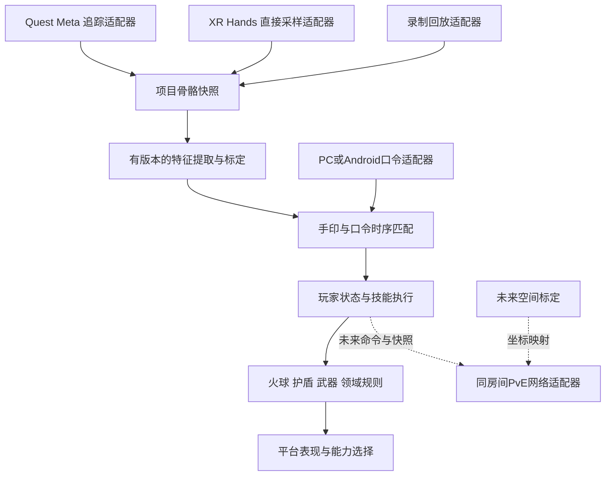

# Quest 优先开发与 PICO 兼容设计

> **2026-10-30 玩法方向更新：** 当前按[线性关卡＋轻量 RPG](LINEAR_RPG_DESIGN_ZH.md)推进，首个全虚拟 VR 切片正在实现/集成，待验收。Quest 优先、PICO 设计预留保持不变；MR 透视/遮罩放在后续，不作为首版玩法前提。
>
> 新导航与闪避只改变虚拟玩家根节点，不改变真实头姿，不自动平滑镜头，也不等于同房现实空间重标定。`OnNode/OffNode` 是玩法位置状态；未来空间映射仍需独立坐标/对齐契约。下文“环境/装备/领域”等是长期扩展，不应排在首个节点移动＋玩家数值＋火球护盾切片之前。

日期：2026-10-29。状态：**调研与设计，本文接口尚未写入运行代码。** 最新约束：先做好 Quest 各系统，PICO 为后续比赛适配目标；多人暂定同房间 PvE，目前只预留契约。官方事实见 [来源核对](QUEST_PICO_COMPATIBILITY_SOURCES_ZH.md)。

## 1. 决定与开发优先级

保持现有 Quest/Meta/OpenXR 方案，用项目自己的输入数据和技能规则隔离设备差异。后续 PICO 首选经过验证的 Unity OpenXR 接入模式，确需专有能力时增加 PICO 适配实现。**现在不安装 PICO/网络 SDK，不替换 Rig，不重录或覆盖现有印模板。**

开发顺序为：Quest 输入与录制稳定 → 玩家生命/能量/护盾账本和施法事务 → 敌人、伤害、装备/存档 → 环境与移动规则、原生语音及性能 → PICO 验证 → 同房间 PvE。网络框架暂定 NGO＋UTP；它不应成为单机系统开发的前置条件。

不能把“先 Quest”理解成所有玩法继续直接调用 OVR：以后新增系统只接手姿态、口令、玩家状态和环境能力契约。也不一次性给所有类加接口；优先隔离已经存在 Meta/XR Hands 两种实现的输入来源。

## 2. 当前工程距离跨平台还差什么

| 已有工作 | 后续要处理的具体问题 |
|---|---|
| Meta 直接追踪和 XR Hands 两条输入路径 | XR Hands 路径仍经过 Meta 数据源，采样类和骨骼 DTO 仍引用厂商类型 |
| 原始骨骼快照、有效性、时效、双手时间偏差保护 | 新 DTO 要明确关节语义、坐标/单位、数据质量来源、原点代次；保留现有保护 |
| SDK 手指特征＋自定义双手特征 | Meta FingerShapes 的数值不能直接替换成另一个公式后沿用旧范围 |
| 子/丑/寅与十二印配置资产 | 设备/提取器/标定版本尚未成为模板兼容条件；不能承诺复制到 PICO 即准确 |
| 技能 Catalog、效果 SO、独立 View | 效果还直接访问唯一 lab、相机和 Meta 腕索引；应逐步改成按 Actor 取姿态 |
| PC 中文 KWS | 原生 Android 音频采集和推理桥接未做；PC 成功不是一体机验收 |
| 火球、护盾和试炼靶 | PlayerRuntime、领域规则、移动约束、网络和空间对齐仍未实现 |

这些是从当前源代码得出的工程判断，不是 PICO 或 Quest 的硬件性能排名。

## 3. 模块划分与最小契约



| 契约（拟建） | 对调用方提供什么 | 实现与落地时机 |
|---|---|---|
| `IHandFrameSource` | 最新冻结双手帧、左右独立序号/采样状态；无数据也能表达丢失 | 先封装现有 Meta 采样，再做直接 XR Hands 和回放；不返回 `IHand` |
| `ISealFeatureExtractor` | 带固定版本和单位的特征集合，声明每项所需关节/质量 | MetaLegacy 保持旧结果；GeometryV1 并行验证，不能偷偷替代 |
| `IVoiceCommandSource` | 带会话、序号、输入代次、采样时间依据的口令事件 | 先包装现有 PC 接收器；Android 原生桥在后续实现 |
| `IActorPoseSource` | 本地角色头/腕姿态、有效性、空间 ID 与原点代次 | 与多人文档共用同一契约，避免重复新增一套手腕接口 |
| 能力快照＋`IEnvironmentPresentation` | 能力支持/可用/失效原因；申请和释放环境表现句柄 | 先简单 VR 表现，再做 Meta/PICO 透视/遮罩实现；逻辑不持有厂商对象 |

`ILocomotionConstraints` 管游戏允许的移动，`IWorldFrameMapper` 管坐标，未来 `ISpatialAlignmentProvider` 管同房间标定。这三件事不合成一个巨大的 XRManager。会话、命令、状态、时钟和伤害沿用 [多人契约](MULTIPLAYER_LAN_PLAN_ZH.md)，当前只设计，在各单机系统真正需要时接入本地实现。

## 4. 骨骼数据契约：项目拥有格式，设备提供证据

拟定 `HandFrameV2`，采用项目自己的 26 关节语义：Palm、Wrist、拇指四关节、其余每指五关节。**逐项显式映射，不直接把任何厂商 enum 转 int 当协议。** 保存 `skeletonSchema`、`providerId`、`mappingVersion`，未知格式拒绝读取。旧录制继续按原格式读取，不能仅把 schema 数字改成 2。

| 数据组 | 要保存的语义 |
|---|---|
| 帧身份 | sourceSession、左右手 sampleSequence、inputEpoch、originRevision；左右数据不能假装同时更新 |
| 时间 | 本地单调接收/观测时间；若设备提供源时间则另存及其时间域；未知源时间不伪造成摄像头曝光时间 |
| 空间 | tracking-local 坐标、米、Unity 坐标约定、空间 ID；转换只做一次，Rig 与录制原点缩放为 1 |
| 关节值 | position/orientation 及其有效位；不支持、暂时丢失、陈旧与仅用于渲染的推断值应可区分 |
| 质量 | native confidence、provider validity、unknown 等来源；可选原生数值保留其定义，不能把 bool 转成“100%正确” |
| 尺度 | 真实米制骨骼保持不缩放；手长估计、方法和有效性独立保存；归一化在特征层处理 |

世界坐标轴转换和每个关节局部旋转轴校正是两件事：新规范须定义关节局部轴，适配器分别处理基变换与局部轴偏移。不能只对齐位置就沿用不一致的腕部旋转，更不能随意取反四元数分量处理镜像。左右掌法线和腕偏移要有镜像/旋转对照样本。

有的 provider 只提供整 Pose 有效位：适配器只能据此同时标记位置/旋转，不能声称获得更细的有效性或直接可见性。底层 SDK 可能本身使用估计；我们能保证不额外拿动画补帧、合成抓取手或过期姿态作为识别证据，不能保证所有 valid 关节都被相机直接看到。

缓存保存深拷贝或有明确所有权的不可变帧；不要存 `XRHand` 对底层缓冲的引用。识别用 Dynamic 更新得到的新采样；渲染 BeforeRender/插值不额外计作识别命中。左右任一新帧都不能给另一只旧手刷新 observedAt。

同一手的关节、有效位、序号和时间必须原子发布自同一采样批次。当前 XR Hands 有效性门控和 Meta 姿态读取是两条路径；后续封装要验证其批次对应关系，直接 XR Hands 适配器则在同一次回调里复制全部数据。本轮仅指出时序风险，未实测到或修复跨批次错误。当前 `ApplyValidity` 将关节完整性映射为 `highConfidence`，新契约应保留其“派生可用性”含义，不能换个字段名后继续当原生置信度参与评分。

**特征按其实际所需关节检查质量。** 指尖距离不应因为无关的无名指失效就必然拒绝；手腕局部旋转特征则必须要求对应旋转有效。保留双手时差与过期阈值，并记录阈值的设备标定依据。

## 5. 特征、权重与录制模板如何平滑迁移

先保留 `MetaLegacy` 提取器和原 `SealProfile` 的计算结果，用旧录制回放比较逐特征值、score、coverage、拒绝原因和最终时序事件。新增几何提取器使用新的版本/命名空间；例如指节几何弯曲角与 SDK Curl 即使都叫“弯曲”，也不是同一量。

优先候选为外露指尖间距、两掌法线夹角、主要手指方向、双腕相对关系及少量稳定弯曲量。掌法线通过腕/食指根/小指根计算，三点退化或遮挡即标无效；不宣称法线一定比所有指节可靠。距离按米或指定手长归一化，单位不同必须换特征 ID/版本。

建议分开两类资产：`SealDefinition` 表达印的稳定语义 ID；`SealCalibrationProfile` 表达 extractorVersion、mappingVersion、设备/运行方式标定族、各特征权重范围、覆盖率、保持时间和来源录制。技能配方引用印 ID，玩家档案只保存标定引用/版本，不嵌入厂商关节或原始录音。

迁移规则：

1. 原资产保持可读，不自动重写已确认模板；子印禁用中指伸直的决定保留。
2. 先生成新标定草稿，与原资产并排测试；格式迁移成功不等于数值标定成功。
3. 同一版本的缺失特征权重仍留在固定分母中，覆盖率、必需特征、保持和消歧继续生效；不能为了 PICO 可用而运行时删失效项、降低分母。
4. 若设备需要更精简的特征集合，创建单独验证过的标定族，使用正例、近似印、过渡动作和自然手势负例重新确定阈值。无匹配标定时显示“未标定”，不悄悄加载 Quest 模板。
5. 除跨设备外，同一设备的原生/串流 provider 变化也要做分布对照。型号/版本不必逐补丁都独立建档，但只有回归证据支持时才合并为兼容族。

兼容检查必须由加载器执行，核对特征 ID、单位、算法/映射版本及尺度策略；不依赖开发者记忆。旧文件缺少来源时标记“来源待确认”，不能凭文件名补写“已跨平台标定”。

HUD 后续增加：来源/provider、关节缺失与陈旧原因、特征版本/标定族、每项分数和覆盖率。继续将加权 score 显示成“匹配分”，不改称统计置信概率。

## 6. 平台能力、构建与语音

设备能力用 `Unknown / Unsupported / SupportedUnavailable / Available` 加原因表达，区分“硬件不支持”“权限未给”“运行时未提供”“暂时追踪丢失”。配方/场景在启动时声明所需能力，运行时失效要撤销自己的表现句柄、停用依赖它的输入，并显示中文原因。

| 模块 | 共享部分 | 平台适配/降级 |
|---|---|---|
| 手印/咒语/施法 | 时序、冷却、取消、配置与玩家规则 | 设备输入与本地语音来源 |
| 火球/护盾/武器 | 伤害、生命周期、归属、资源和碰撞规则 | 手模型、手锚、材质粒子质量档 |
| 领域 | 区域、受影响角色、效果 token、持续时间 | VR 天空/雾/边缘反馈；可用时透视和真实遮挡 |
| 场景几何 | 玩法自己的环境查询/碰撞语义 | 原生扫描、人工搭建试炼场；没有网格不能假造真实墙碰撞 |
| 同房间模式 | 共享会话坐标和标定状态 | 同品牌共享锚或跨品牌标定；对齐不可用时不进入同房协作 |

视觉上可以有纯 VR 试炼回退，但**同房间参与者、现实障碍与边界提示不能被大面积特效遮掉**；设备缺少场景要求的能力时应阻止该模式，不把自动降级冒充完整 MR 兼容。虚拟移动限制只管游戏移动/传送，不能冻结头显或强拉真实头部。

代码上拟分共享 Core、MetaAdapter、XRHandsAdapter、可选 PicoAdapter 和各平台场景装配；用 asmdef/平台配置控制引用，不把 `#if PICO` 散布进评分器和玩家规则。当前仍有 Unity/SO 类型，目标是厂商独立，并非要求整项目完全脱离 Unity。

构建配置分 Quest Android、PICO Android、PC OpenXR。**Unity Build Profile 本身不等于自动隔离 Packages 或厂商构建处理器。** PICO 首次接入放在独立验证工程/隔离副本，记录 manifest/lock、Loader/Features、Gradle/AndroidManifest、图形 API、权限和 Shader；确认两家包能共存且未产生构建副作用后再决定共用工程方式。不升级主工程来追逐 latest。

语音保持 `IVoiceCommandSource` 事件协议；后续优先评估 sherpa-onnx Android ARM64 原生库＋C#/JNI 桥接。要保留会话、序号、取消代次和事件时效，麦克风/重采样/权限/后台恢复单独验收。当前“不要释放火球术”会命中关键词的限制未解决，下一步应在 Quest 单机先解决口令确认/否定策略和 UI 反馈，再迁移。

同房间还会有另一个人的喊话被本机麦克风听到的问题。事件标记 actorId 不能证明声音来自该玩家；未来需验证施法意图门控、组合手印/按住说话或明确的纯咒模式规则。说话人验证是可选后续工作，不默认为已有能力。

## 7. 同房间 PvE：现在只定义坐标契约

未来目标更新为两人同房间 PvE，再看四人和混合品牌。网络连上与现实坐标对齐是两个状态。`ISpatialAlignmentProvider` 应输出状态、`sessionFromTracking` 刚体变换、校准 revision、质量/残差依据和失效原因；准备/重试/取消及状态通知的具体 C# 形式等实现时定。`IWorldFrameMapper` 消费它，技能逻辑只使用稳定会话空间。

状态流程：`Unaligned → Calibrating → Aligned`，运行中可到 `Relocalizing/Lost`。共享锚加载完成不等于已定位；定位完成也需要现场对照检查才能准备战斗。

跨品牌的初步候选是**共同物理标记的人工采样标定**：两端对同一固定原点和方向标记采样；若重力/地面方向可靠，用地面平面投影求 yaw＋平移；否则使用不少于三个不共线对应点拟合无缩放、无镜像的刚体变换。控制器接触点偏移或指尖估计偏差必须校准，不能直接把手柄中心当触碰点。

设 `T_S_A` 为公共参考标记 A 到会话空间 S 的变换，`T_L_A` 为该标记到本机 tracking 空间 L 的测量，则：

```text
T_S_L = T_S_A × inverse(T_L_A)
p_S   = T_S_L × p_L
```

仅一个位置不能确定朝向；拟合使用的点还需用额外检查点验证。启动时报告平移误差、角度误差和重复标定波动；运行中复查固定参考，测量误差随距离增加的影响。人工方案不自动具备持续防漂移能力，本轮不承诺“若干厘米就是安全阈值”；验收标准要按场地、道具尺寸与玩法制定。

重定中心/重新定位后更新本机映射与 revision，失效旧手势组合和轻推历史；共享火球、敌人、靶和领域仍留在会话空间，不随某个玩家原点重置移动。拒绝旧 revision 姿态，不能跨 revision 求速度。网络 actor/连接身份和设备空间 ID 不能混用。

对齐丢失时停止该玩家空间施法并通知会话；未来同房 PvE 默认进入协调暂停/重新标定流程，保留本地真实头部追踪和现实可见性。此暂停是显式房间规则，区别于一人普通菜单暂停。没有可信对齐时，不能继续宣称远端角色位置可代表现实同伴位置。

同品牌可选 Meta/PICO 共享锚改善流程；它们只产出相同的坐标契约。锚 UUID 带 provider 命名空间，PICO 不直接加载 Meta UUID。纯 LAN 验收必须把锚服务的公网依赖单独列出。

## 8. 实施关卡与验收

| 顺序 | 做什么 | 完成证据 |
|---|---|---|
| 当前设计 | 本文、来源记录、多人与玩家文档同步 | 没有更改 SDK/场景/录制/运行代码 |
| Quest 输入收口 | 包装现有来源/口令，版本化快照和回放，效果改用 Actor 姿态 | 原模板与匹配/取消事件回放一致；切来源、失效、左右时差、重定中心不误触发 |
| Quest 单机系统 | 玩家数值/效果账本/事务、敌人、装备存档、领域规则 | 按玩家设计逐项验收，不引入网络依赖；UI/Inspector 全中文 |
| 原生与性能 | Quest 原生 KWS、权限/恢复、粒子质量档与真机帧耗 | 真实麦克风正负例、持续运行、遮挡和串流/原生对照 |
| PICO 技术样机 | 独立构建探针：头手、关节质量、手模型、录制、语音、必要 MR 能力 | 记录实际型号/地区/固件/SDK/provider，先能采样再做标定，不先搬全部复杂场景 |
| PICO 玩法验证 | 逐印重标定，三种模式、取消、生成手、火球护盾、存档与领域回退 | 按人/录制会话划分数据；误报次数/分钟、混淆矩阵、漏检、延迟分位数、有效覆盖率与性能 |
| 未来多人 | 单机系统稳定后才接 NGO/UTP，再做同房间标定/漂移和双人 PvE | 两端数值一致＋真实空间对齐均通过，才扩四人/混合设备 |

PICO 探针进入前再确认比赛实际设备与是否必须纯一体机、断网、MR。现在不用让用户为尚未确定的比赛购买特定型号。原生通过与 PC 串流通过分别记录，不能互相替代。

测试必须覆盖：只失去无关手指、必需特征缺失、左右更新不同步、停止更新但保留最后姿态、切回来源、手长归一化失败、左右镜像、原点旋转/重置、旧模板版本拒绝、一个人的口令被另一个麦克风拾取。跨设备评估按人/会话切分，不能把相邻帧随机分到训练和测试后宣称泛化。

本文没有承诺 PICO 精度、帧率、发布可用性或同房空间安全。现阶段可继续开发 Quest，后续通过明确的数据与能力适配减少迁移范围。

## 9. 独立审查与本次验收边界

使用 [chatgpt-account-api Skill](C:/Users/鲁迅/.agents/skills/chatgpt-account-api/SKILL.md) 调用用户确认的 `second` 账号、`gpt-6-astra`、`high`。第一次请求网络/TLS 失败；用户明确授权一次重试，重新读取额度后重试返回 `completed`。该完成结果用量为输入 6,961、输出 3,380、合计 10,341 tokens；这不是两次请求的套餐总消耗保证。原始结果保存在 `Logs/pico-compat-research/astra-result-retry.json`。

Astra 只收到本任务必要的代码片段和父代理已核验的来源摘要，负责文本架构审查，没有本机工具，也未独立浏览或实测。父代理逐项审核后采纳了显式关节/局部轴映射、原子采样、质量语义分离、强制模板兼容检查、对齐失效和 revision 隔离；没有把其建议的实验误差数字设成产品安全阈值。

本次只写 README 与设计/来源文档，未修改 Unity 运行代码、场景、模板或包配置。文档修改前备份路径记录于 `Logs/pico-compat-research/backup-path.txt`；链接检查与受保护文件哈希结果也在该目录。PICO 实机、Android 语音、网络与同房间测试仍待各自实施阶段完成。
