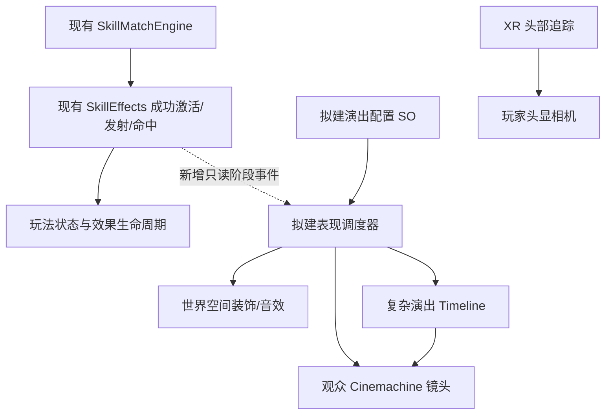

# 镜头与技能演出：Cinemachine 3＋Timeline 方案

> 文档定位：架构基线与设计约束；文内早期方案不是自动实施指令。当前操作以[移动指南](../guides/ENCOUNTER_LOCOMOTION_ZH.md)、[火球指南](../guides/FIREBALL_TUNING_ZH.md)和[腕饰指南](../guides/WRIST_MENU_INTERACTION_DESIGN_ZH.md)为准；功能是否完成须核对源码、场景与带版本的验收。

更新于 2026-11-02。**Unity 包管理器已解析 Cinemachine 3.1.7，沿用 Timeline 1.8.10。** 运行时演出调度器和正式场景机位仍处于设计阶段。总体状态见[开发索引](../README.md)。

## 1. 选型结论

建议采用 **Cinemachine 3 管观众镜头，Timeline 编排复杂演出，项目自己的表现调度器管理触发与清理**。玩家头显继续由 XR 追踪驱动；技能照常执行，演出观察已经发生的玩法结果。

| 组件 | 工程现状 | 本项目用法 |
|---|---|---|
| Unity 6000.3.10f1＋URP 17.3.0 | 已使用 | 保留现有渲染与追踪管线 |
| Cinemachine 3.1.7 | 已安装并锁定 | 独立观众相机的跟随、构图、切镜和混合 |
| Timeline 1.8.10 | manifest 已安装 | 领域登场、Boss 入场等有镜头、音效、装饰 VFX 的编排 |
| Unity Recorder | 未安装，可选 | 编辑器内制作展示视频，不作为头显原生录像模块 |
| 表现调度器及配置资产 | 尚未实现 | 接收技能阶段事件，仲裁镜头，维护独立句柄 |

Unity 6000.3 的官方包表把 Cinemachine 3.1.7 标为 released，本项目据此选定该版本；这不等于当前 Meta/OpenXR/URP 组合已完成实际测试。采用 3.x 文档与组件，不照搬 2.x 教程里的类名和接线。[Unity 6000.3 Cinemachine 包信息](https://docs.unity.com/en-us/engine/6000.3/manual/packages-list/packages-all/pack-safe/com-unity-cinemachine)。

### 可参考的 XR 案例（2026-11-02 核查）

- Meta 的 Quest VR 作品 **North Star** 在项目清单里同时声明了 Timeline 1.8.9、Meta XR 和 OpenXR 1.15.1。这个案例支持用 Timeline 编排 Quest 项目的内容。其清单未声明 Cinemachine。[项目](https://github.com/oculus-samples/Unity-NorthStar) · [原始包清单](https://raw.githubusercontent.com/oculus-samples/Unity-NorthStar/main/Packages/manifest.json)
- Unity 的 **VR Spectator Sample** 演示了电脑观众与头显玩家拥有独立视角。它是较早的项目，适合参考相机职责。本工程验证 Cinemachine 3 的 Timeline 轨道，供后续观众演出使用。[VR 样例](https://github.com/Unity-Technologies/VR-Spectator-Sample) · [Unity 的镜头编排示例与教程](https://github.com/Unity-Technologies/com.unity.cinemachine/blob/main/com.unity.cinemachine/Documentation~/samples-tutorials.md)
- 第一版绑定规则：头部锚点继续服务双眼显示、瞄准和导航。单独创建观众 Camera，设置单目输出到指定 RenderTexture，避免 MainCamera 标签及 AudioListener 重复。仅观众相机挂 CinemachineBrain，Timeline 镜头轨绑定此 Brain。Quest MR 中让世界空间角色、阵法和声音参与 Timeline，保留 XR 相机透视合成、现实锚点和追踪原点。头显上第二路输出默认关闭，需要展示录像时再测 GPU 预算。

## 2. 玩家、观众和录像分别看到什么

| 观看者 | 建议效果 | 控制范围 |
|---|---|---|
| 戴头显的玩家 | 手上聚火、护腕展开、场景阵法扩散、角色登场、空间音效；领域围绕玩家变化 | 继续自由转头。首版不对 XR 头相机做环绕、强制转向、滚转、镜头抖动或 FOV 拉伸，也不为过场移动 Rig |
| 电脑观众/比赛评委 | 火球准备特写、发射跟拍、命中镜头、领域全景、Boss 入场 | 独立单目相机，Cinemachine 控制；允许可关闭的冲击抖动与切镜 |
| 需要看预制剧情的玩家 | 可选世界空间屏幕播放短片；玩家仍能看向四周 | 屏幕尺寸、位置、关闭操作单独配置；不把整段移动镜头硬塞进头部第一视角 |
| 编辑器录制者 | 指定观众相机/RenderTexture，录制镜头与声音 | 可加 Recorder；高质量录制性能单独测，不作为实时头显帧率依据 |

这是项目的舒适性决策，并非声称 Cinemachine 技术上不能用于 XR。Meta 建议避免不自然的相机运动，以及大范围遮住透视的固定头锁内容；强制运镜与真实头动不一致会增加不适风险。[Meta 舒适性指南](https://developers.meta.com/vr/design/comfort/)。

例如“领域展开”：玩家眼前出现地面阵法、边界、光照与声音变化；电脑镜头可以后退到全景，再切施法者特写。两者共享技能成功事实，但使用不同表现，不要求玩家跟随导演镜头旋转。

## 3. 接入现有代码的位置

当前 `SkillTestController` 把 `Engine.TryActivate` 接到 `SkillEffects.TryActivate`，返回值为同步 `bool`。**目前没有通用 `SkillCommitted` 等结构化表现事件。** `SkillEffects.Message` 只是诊断字符串，不能解析“火球已发射”等中文日志来驱动演出。

首次接入可在成功激活后记录一次结构化事实，再从 `Launch`、`OnTargetHit`、`OnProjectileFinished` 等实际状态转换处补充发射、命中、结束事件。当前回调没有完整的施法身份，适配器需要为本次施法分配并向其效果传播同一个 `castId`，不能每个阶段重新生成。状态转换完成后写入只读事件队列，在本次技能调用栈完成后再由表现层消费，避免同步订阅者在冷却尚未写完时重入施法。命中事实来自真实命中，不在动画播到某帧时假定发生。未来玩家事务完成后，激活事实改由 `AbilityRuntime` 成功提交统一产生。

表现层不调用技能扣费、伤害或退款接口。Timeline 的 Signal 可以触发装饰音效/粒子，不负责权威结算；跳过、关闭或加载演出失败，不能改变技能是否成功。表现订阅者异常需要隔离，不能让已经生效的技能因镜头失败而返回激活失败。

### 已有代码需要先改的接线

| 当前事实 | 新增演出时的必要处理 |
|---|---|
| `SkillEffects.Awake` 在未显式设置 `head` 时读取 `Camera.main`；`GetAimPoint` 使用该头部朝向 | 显式绑定玩家头锚、玩家根与瞄准来源。观众相机不标 `MainCamera`；不得因切镜改变施法方向 |
| `SkillTestSceneSetup` 用 `Single(c => c.enabled)` 找相机 | 改为按玩家角色/明确引用查找并验证；加第二相机前移除“只有一个启用相机”的假设 |
| `SkillEffects`、`SkillProjectile` 等在 `Time.timeScale <= 0` 时清理效果；RPG 已注入 `GameTime`，旧场景缺省仍用 realtime | 不用全局暂停或慢放做演出/普通菜单。镜头和装饰动画有自己的播放节奏；原有战斗时钟保持不变 |
| Editor 已有临时单目相机截图与视觉预览工具 | 只能复用部分捕获思路，不能把它们算作已实现观众镜头 |

相关文件：[效果执行器](../../Assets/scripts/logic/Skills/Effects/SkillEffects.cs)、[火球](../../Assets/scripts/logic/Skills/Effects/SkillProjectile.cs)、[控制器](../../Assets/scripts/logic/Skills/SkillTestController.cs)、[场景工具](../../Assets/scripts/logic/Editor/Skills/Setup/SkillTestSceneSetup.cs)。

## 4. 相机与输出结构

拟采用一个独立的 **URP Base Camera＋CinemachineBrain** 渲染观众画面，不加入头显的 Overlay Camera Stack。观众相机输出 RenderTexture，使用单目且关闭 XR 输出；安装后在对应 URP/OpenXR 版本验证这些设置确实生效。Unity 文档提供 Base Camera 的输出纹理设置，Target Eye 为 None 时禁用该相机的 XR 渲染。[URP Camera 设置](https://docs.unity.com/en-us/engine/6000.3/manual/cameras/urp/camera-components-reference/camera-component-reference)。

玩家相机保留原有 XR 驱动和唯一主监听器。观众相机不加第二个 AudioListener，不改变 XR 相机的父物体、投影或跟踪原点。头部锚点是输入事实，任何演出相机都不能成为它的数据来源。

三个配置维度分别管理：

- **Cinemachine 输出通道**：观众 Brain 只选择属于观众通道的虚拟镜头；这是镜头归属。Cinemachine 官方多相机方案以 Channel 和 Brain Mask 分流。[多相机与通道](https://docs.unity3d.com/Packages/com.unity.cinemachine@3.1/manual/CinemachineMultipleCameras.html)。
- **Unity Culling Mask / Volume Layer Mask**：管理世界物体、调试 HUD 和后处理的可见性；观众专属内容不泄漏到头显。
- **Impulse 通道/监听过滤**：冲击震动只作用观众镜头。不能仅靠前两项就假定 Impulse 已隔离。[Impulse Source](https://docs.unity3d.com/Packages/com.unity.cinemachine@3.1/manual/CinemachineImpulseSource.html)。

还要明确 RenderTexture 的**桌面显示出口**：编辑器预览窗口、指定显示屏或桌面输出模块分别验证。XR 的默认镜像窗口不会仅因创建 RT 就自动变成观众画面；初版可以先用独立编辑器预览，后续再做 PC Player 的输出。

多台 CinemachineCamera 是镜头定义，不代表每台都独立渲染；新增真实 Unity Camera 才会增加一轮场景渲染成本。建议 PC 首轮以 1280×720、30 次/秒观众更新作为待测起点，实际实现须控制渲染调度，而非只写一个目标帧率字段。测 CPU/GPU 与头显帧率差值，再调整阴影、后处理、分辨率和更新频率。原生一体机默认关闭额外观众渲染，验证预算后再开放；不承诺 90 Hz 或具体耗时。

## 5. 镜头调度、配置与中断

初版只建一个表现协调组件和一种 `SkillPresentationProfile` 资产；只在确需替换实现的位置保留 `IPresentationPlayer`，不为每个字段新增接口。以下类型和字段均为拟定设计，UI/Header/Tooltip 使用中文。

| 配置组 | 内容 |
|---|---|
| 身份与触发 | 演出 ID、技能 ID、触发阶段：持握生成/发射/命中/加持成功/领域阶段 |
| 受众与目标 | 玩家世界表现/观众；施法者、手持物、投射物或目标的绑定方式与失效回退 |
| 编排 | Cinemachine 镜头或可选 Timeline、进入/退出混合；简单跟拍不必配置 Timeline |
| 仲裁 | 优先级、最小触发间隔、最长时长、抢占/丢弃策略；实时跟拍默认不积压过时事件 |
| 生命周期 | 可跳过、效果结束时停止、目标销毁时回退、失焦/卸载时清理 |
| 平台质量 | PC/一体机开关、观众分辨率与更新频率、后处理档位；不修改识别阈值 |

每次播放产生独立句柄，携带 `cueId`、本次 `castId`、`effectId`、场景/会话代次和阶段序号。静态 SO 只存配置；不能把本次目标物体、剩余时间和 Director 实例写回共享资产。去重依据一次事件身份，不按技能名去重，否则连续两次同技能会错误合并。

同一输出在同一时刻只有一个调度所有者。优先级抢占停止旧句柄，旧句柄晚到的完成回调不得覆盖新镜头；需要所有权代次检查。目标销毁时使用事件中捕获的最后有效位置或默认全景，不继续访问失效 Transform，也不把旧对象引用用于对象池复用后的新火球。

正常结束、玩家跳过、抢占、场景卸载、失焦和组件禁用都必须经过幂等清理：归还自己的虚拟镜头、Director、装饰对象、轨道绑定、音效和 Volume 覆盖，恢复当前应当生效的默认观众镜头。只清理自己拥有的资源，不调用战斗 `ClearAll()`，也不覆盖较新演出接管的状态。

**取消技能、关闭菜单和跳过演出是不同操作。** 新 RPG 普通取消只清待施法和未发射物，保留护盾/飞行物；旧训练场的持续效果取消仅作兼容。演出监听效果事实决定是否结束，跳过镜头不冒充取消口令，也不让 Esc 同时触发两个互相矛盾的处理。应用暂停/失焦是另一种生命周期事件，当前单机可能清理效果；演出只收尾自己的资源，不试图恢复已经结束的技能。未来联网的本地失焦不能据此删除房主共享效果。

## 6. 何时需要 Timeline

单次火球跟拍、目标构图和普通切镜，用 Cinemachine 配合阶段状态即可；简单固定镜头序列还可选 Sequencer。领域或 Boss 登场需要多个镜头与装饰动画、音效配合时再使用 Timeline。Timeline 驱动 Cinemachine 时会覆盖普通 Brain 优先级，因此不能同时放任多套 Director 争抢同一观众输出。[Cinemachine 与 Timeline](https://docs.unity3d.com/Packages/com.unity.cinemachine@3.1/manual/concept-timeline.html)、[Sequencer Camera](https://docs.unity3d.com/Packages/com.unity.cinemachine@3.1/manual/CinemachineSequencerCamera.html)。

火球什么时候撞击由物理和玩法决定；不能用“第 2 秒命中”这样的固定片段替代真实事件。领域边界、伤害、buff、移动权限由技能运行态维护，Timeline 仅呈现这些阶段。若以后剧情确实要暂停操作，需要独立的游戏模式与输入挂起契约，不能靠停 Camera 或改全局 timeScale 顺带实现。

实现时明确演出采用的时钟和暂停策略，首次切片与实时战斗同速。所谓慢镜头先用于独立展示或录制素材；不要把实时目标拖慢、改变碰撞体速度，或用混合 scaled/unscaled 时间造成演出没结束而效果已过期。

## 7. PICO、同房间 PvE 与 MR 录像边界

Cinemachine 和 Timeline 的配置可以复用到设备适配层之上，但设备性能、URP 支持项和 MR 环境合成仍需单独验证。它们不负责手部追踪、空间锚或房间对齐，也不能让 Meta 透视层自动出现在第三人称 RenderTexture 中。需要拍到真实房间/玩家的 MR 合成视频时，另做平台 MRC/拍摄机位方案；首版观众输出限定为 Unity 可渲染的虚拟场景。镜头也不会自动补出玩家全身模型：当前首个切片可拍手部、火球和靶场，完整施法者特写需以后增加角色表示或真人合成。

未来同房间 PvE 由玩法权威发布技能与命中事实，各客户端自行选择本地镜头。房主的演出不强制转动其他玩家的头显相机；网络也不复制观众 Camera Transform 当作角色头姿。领域游戏规则是否限制移动由玩法定义，不能通过画面接管限制现实身体。相关契约沿用[兼容设计](QUEST_PICO_COMPATIBILITY_PLAN_ZH.md)与[多人方案](MULTIPLAYER_LAN_PLAN_ZH.md)。

Unity Recorder 适合编辑器 Play 下采集镜头/视频，但官方明确它不用于独立 Player 或构建包；因此不把它作为 Quest/PICO 原生录屏库。[Recorder 手册](https://docs.unity3d.com/Packages/com.unity.recorder@5.1/manual/index.html)。现有 10 秒骨骼缓存也不足以重建敌人、投射物、伤害与场景状态；真正的战斗回放需要另行记录世界状态/事件。

## 8. 最小落地切片与验收

建议下一次实现时，从火球靶场增加独立观众镜头开始，不改当前玩家视角。先显式绑定玩家相机/头锚并修正单相机验证假设，再增加事件和可停止句柄。先做发射跟拍＋命中后回到全景，通过后再做 Timeline 领域样片。领域玩法未实现时，样片须标注“视觉演示”。

验收至少包含：

1. **头部追踪和瞄准**：快速转头、俯身、重定中心时保持正确；切换观众镜头不改变头相机、手部有效性、准星射线和命中结果。
2. **战斗一致性**：同一输入/随机种子在演出开关前后产生相同激活、冷却、伤害和取消结果；演出异常不得使已成功效果被当作失败。
3. **生命周期**：连续同技能、多个技能抢占、目标销毁/池复用、跳过、失焦、禁用和卸载均无悬挂对象、声音、绑定或遗留镜头；旧回调不能抢回控制。
4. **输出隔离**：HMD 双眼、PC 预览与录制出口逐一验证；观众 HUD、后处理、Impulse 不进入头显，无双 AudioListener；可关闭全部观众输出。
5. **性能与舒适性**：分别记录未开启/开启的 CPU、GPU、头显掉帧及观众帧率；真人验证视野遮挡、亮度和粒子密度。通过 PC 验证不自动视为原生 Android 验收。
6. **资产可配置性**：错误技能 ID、空目标、空 Timeline、非法时长/频率有中文诊断；换技能/镜头可从配置完成，核心匹配器不引用 Cinemachine 类型。

2026-11-02 使用 Unity 6000.3.10f1 批处理运行完整编辑模式回归，533 项通过。新增临时场景测试在两段 Timeline 镜头中核对观众相机的实际位置、URP 的单目设置及模拟头部对象的姿态。正式游戏场景尚未加入观众机位。现场验收仍需分别覆盖 PC 串流、Quest 原生和 MR 透视。
