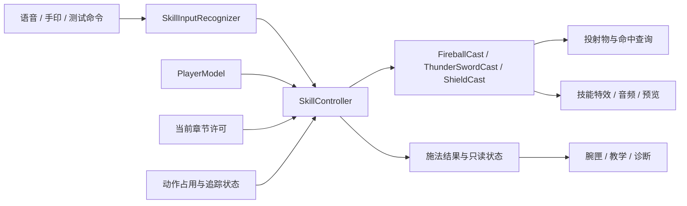
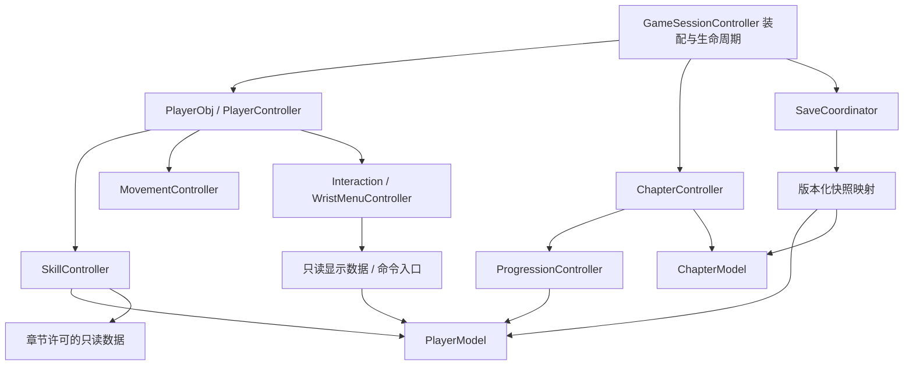
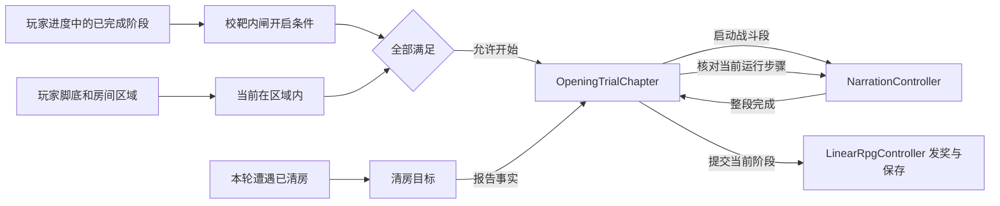
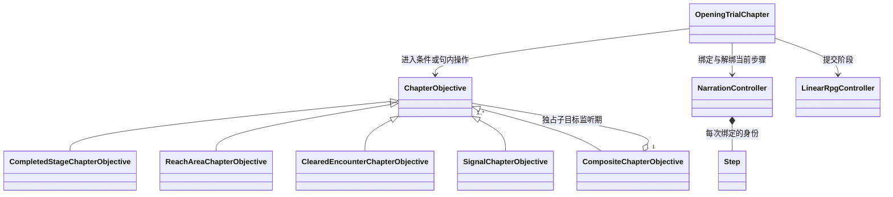

# 全模块 MVC 重构方案：统一玩家数据与行为归属

**实施进度（2026-11-10）**　玩家模型、输入、三类施法、章节、敌人池及保存协调已接入正式场景。第 9 节区分已有桌面证据和设备待验项。类名与实际持有关系见[模块图与类图](TARGET_ARCHITECTURE_20261110_ZH.md)。

本稿保留原方案的目标，修订施工顺序、施法准备协议、程序集依赖及状态恢复约束。审阅发现与源码证据见[二次审阅与优化取舍](MVC_REFACTOR_REVIEW_20261109_ZH.md)。248 文件表是范围清单，不代表每个文件都必须重写。

原方案依据 NarutoVR 源码及 `D:/UnityTraining/ShimmeringChronicle`。2026-11-10 的实施顺序先接首章资源装配，再将 P4 中的目标与旁白绑定前移，处理正式场景门外提前播放的问题。下表及本节后的图注明首批接线范围。

## 1. 建议采用的结构

**每个玩家只有一个 `PlayerModel`，由 `PlayerObj` 持有。`SkillController` 统一接收施法请求，协调扣费、冷却、执行器和清场。技能实例管理持握与发射，目标实体结算伤害与护盾，表现组件播放对应的粒子和声音。`PlayerObj` 负责玩家自身的移动反馈、脚步、受击表现及生命周期接线。**

按业务模块组织 MVC：玩家、技能、章节、交互、UI、敌人、音频各自保持职责完整。Model 保存状态和规则，Controller 接受意图并提交变化，View 显示结果；XR、碰撞、导航、文件系统属于 Unity/平台适配，不强塞进纯 View。

这次重构的完成标准是：修改某一规则时，能在它所属模块完成；外部只需调用少量明确入口。文件数量、类名是否带 MVC、单文件行数都不作为单独验收标准。

### 对用户指出的三个问题的处理

| 问题 | 重构后的决定 |
|---|---|
| 玩家脚步为什么由别处管理 | `PlayerObj` 绑定移动完成事件并协调自己的 `FootstepPlayer`。步距、片段选择和空间播放保留为玩家内部实现；关卡音频组件不再创建或驱动玩家脚步。 |
| 玩家技能为什么在 `RpgProgressData` | 运行时由 `PlayerModel` 提供 `IsDiscovered`、`IsUnlocked`、`SkillLevel` 查询，冷却由该玩家的 `Vitals` 持有。持久层在保存与加载时映射 v2 字段，UI 通过只读接口取得显示数据。 |
| 技能控制器为什么不管理释放和特效 | 正式场景和训练场都通过 `SkillController.Cast` 取得施法结果。布尔入口 `TryCast` 转调它。控制器协调准备、扣费、冷却、发布和清场，火球、护盾及雷光剑执行器持有各自的运行实例。 |

玩家数据按业务统一，保存按恢复需求选取快照。生命、技能、背包属于同一玩家；章节进度属于本次冒险；JSON 字段布局不再决定业务对象的归属。

## 2. 实施前的工程问题

本轮盘点 `Assets/scripts` 下 247 个 C# 文件：148 个非 Editor 路径文件、99 个 Editor 文件，共 37,238 行。另发现自有 `WaterAudio.cs` 位于美术目录，共纳入 **248 个源文件的去向清单**。非 Editor 路径计数包含实验台/诊断文件，不等于正式运行时都在执行。外部 SDK、导入特效包、模型/贴图不整体重写；自有 Shader、原生语音、Tools 和场景接线纳入相关模块迁移。

这些是本次磁盘快照的统计；源码调查覆盖核心调用链和各模块代表实现，未声称对 248 个文件逐行形式化验证。

| 现状 | 影响及源码依据 |
|---|---|
| `PlayerObj` 拥有 `RpgPlayerState`，`LinearRpgController` 另持 `RpgProgressData` | 玩家技能、物品和货币需绕到会话主控，运行数据的领域归属被保存格式分割。[PlayerObj:19](D:/UnityProjects/NarutoVR/Assets/scripts/logic/Rpg/PlayerObj.cs:19)、[LinearRpgController:48](D:/UnityProjects/NarutoVR/Assets/scripts/logic/Rpg/LinearRpgController.cs:48) |
| 主控同时做保存重试、腕匣输入、移动接线、技能准入和死亡反馈 | 任一模块改动容易触及同一主类；目前单文件 702 行，问题在职责跨度。[初始化:124](D:/UnityProjects/NarutoVR/Assets/scripts/logic/Rpg/LinearRpgController.cs:124)、[逐帧流程:200](D:/UnityProjects/NarutoVR/Assets/scripts/logic/Rpg/LinearRpgController.cs:200)、[施法:261](D:/UnityProjects/NarutoVR/Assets/scripts/logic/Rpg/LinearRpgController.cs:261) |
| `RpgPlayerState.TryActivate` 接收执行效果的回调 | 数据规则反向执行世界副作用；扣费回滚与对象生成的失败边界混在一起。[RpgPlayerState:58](D:/UnityProjects/NarutoVR/Assets/scripts/Core/RpgPlayerState.cs) |
| `PlayerObj.TryReceiveDamage` 直接接受 `SkillEffects` | 玩家伤害依赖具体技能表现/执行大类，护盾数值也在效果层。[PlayerObj:43](D:/UnityProjects/NarutoVR/Assets/scripts/logic/Rpg/PlayerObj.cs:43) |
| `RpgProgressData` 虽是 DTO，却直接作为运行态被持有，列表公开可写 | 私有 setter 无法阻止外部修改内部 List；物品、商店、成长规则反复传递整个进度草稿。[RpgProgressData:40](D:/UnityProjects/NarutoVR/Assets/scripts/Persistence/RpgProgressData.cs)、[提交入口:73](D:/UnityProjects/NarutoVR/Assets/scripts/logic/Rpg/LinearRpgController.cs:73) |
| 玩家脚步接线位于 `P1AudioManager` | 玩家自身声音依赖关卡音乐组件；移动事实先经过关卡音频再到脚步播放器。[P1AudioManager:68](D:/UnityProjects/NarutoVR/Assets/scripts/logic/Rpg/P1AudioManager.cs:68)、[ReportTravel:83](D:/UnityProjects/NarutoVR/Assets/scripts/logic/Locomotion/FootstepPlayer.cs:83) |
| 技能、腕匣、章节存在大范围对象图访问 | `SkillEffects.cs` 1061 行、`WristMenuView.cs` 1053 行只是信号；真正要切断的是 View→完整 RPG→技能/进度/移动，以及效果→输入/准入的往返访问。具体证据见审查附录。 |
| 文件夹已有 data/logic/ui，编译依赖未隔离 | 当前 `Assets/scripts` 下没有 asmdef；文件位置不能阻止 Model 调用 Unity 执行、UI 访问整个游戏。先明确归属再加编译约束，不能只搬目录。 |

现有独立识别算法、投掷状态机、幂等奖励、原子存档、敌人池租约和特效回收都有价值。将它们迁入明确拥有者，保留已验证行为；不以“重构”名义删掉故障处理。

## 3. 从 ShimmeringChronicle 借鉴什么

| 参考实现 | 采用方式 | 本工程要补齐的约束 |
|---|---|---|
| `PlayerSO.CreateData` / `FillExtra` 创建独立运行数据 | 沿用 SO 初值→独立 `PlayerModel`→`PlayerObj` 的单向初始化；配置资产保持只读 | 不把 HP、CD 或成长写回 SO，不共享运行集合。[参考 PlayerSO:34](D:/UnityTraining/ShimmeringChronicle/Assets/Scripts/SO/PlayerSO.cs:34) |
| `PlayerObj.Data` 集中表示玩家 | 玩家技能、属性、物品、货币从一个模型入口读取 | 集合不对外公开写入；章节和磁盘职责不挤进实体。[参考 PlayerObj:64](D:/UnityTraining/ShimmeringChronicle/Assets/Scripts/Logic/PlayerObj.cs:64) |
| 实体修改数据后通知血条等表现 | 先完成结算，再发有明确 payload 的变化通知；UI 首次绑定也主动刷新 | 命令使用方法调用与结果，事件用于已发生事实；监听异常不得撤销成功结算。[参考受伤:182](D:/UnityTraining/ShimmeringChronicle/Assets/Scripts/Logic/PlayerObj.cs:182)、[血条:69](D:/UnityTraining/ShimmeringChronicle/Assets/Scripts/UI/PlayerHPBar.cs:69) |
| 物品容器提供查询和操作能力 | 背包/物品 UI 用物品 ID、槽位和只读数据绑定 | UI 类型不得进入模型或事件；暂不引入本项目尚无的完整装备/箱子玩法。 |

参考工程也有需要规避的耦合：`PlayerObj` 保存 `ItemSlot` UI 引用并扫描交互；`PlayerController` 同时读取键鼠、UI 和动画；全局事件包含 UI 类型。其全局双声源 AudioManager 也不适合替代本项目已有空间技能音频。这里吸取数据与实体的组织方式，保留本项目 VR 所需的追踪、动作互斥、空间声源和暂停规则。[完整参考审查](D:/UnityProjects/NarutoVR/Logs/architecture-mvc-20261109/reference-audit.md)

## 4. 先重构数据：唯一拥有者与写入入口

### 4.1 目标数据组织

```text
PlayerObj                         每个实体拥有一份，禁止另建并行玩家状态
└─ PlayerModel                    普通 C# 对象
   ├─ Vitals                      HP / MP / 上限 / 回蓝时序 / 生死
   ├─ Skills                      知识 / 永久解锁 / 等级 / 冷却组状态
   ├─ Inventory                   收集与激活记录
   ├─ Wallet                      货币
   ├─ Combat                      当前护盾等数值状态、命中去重
   └─ RewardReceipts               已领一次性奖励记录

ChapterController
└─ ChapterModel                   当前章节、阶段、步骤、目标事实、完成阶段

GameSessionController
└─ SessionState                   准备/运行/暂停/死亡/卸载、游戏时钟、当前检查点

SaveCoordinator → SaveSnapshotV2   捕获以上所需字段；只在保存/加载路径出现
                → RpgSaveStore    校验、备份、原子写入
```

`Vitals/Skills/...` 表示模型内的内聚部分，不要求各自新增 MonoBehaviour、接口和三套 MVC 文件。先保留必要规则，按修改频率决定一个文件还是内部类型。`PlayerModel` 对 UI 暴露只读属性、只读集合视图和变化通知；修改通过控制器对应的明确命令，模型自身维护约束。只读入口不能只是可变 Model 的 get-only 属性：UI 程序集仅能引用读模型契约，集合元素也必须只读；领域修改能力只给对应命令实现。HP 高频变化与技能/背包低频变化分别按修订号刷新，避免每帧重建全部展示数据。

### 4.2 数据与行为归属表

| 数据 | 唯一拥有者 | 修改入口 | 保存策略 |
|---|---|---|---|
| 初始生命、回蓝参数、技能基础值 | Player/Skill 配置 SO | 编辑器配置，运行中不写 | 保存稳定 ID 与恢复数据，不保存 SO 实例 |
| 当前 HP/MP、回蓝等待、生死 | `PlayerModel.Vitals` | 玩家受伤/恢复及技能资源提交 | 按当前检查点语义保存 |
| 技能知识、永久解锁、等级 | `PlayerModel.Skills` | 成长/奖励命令，由模型检查重复与合法 ID | 保存，维持原已了解/已解锁区分 |
| 冷却组与剩余时间 | `PlayerModel.Skills` | `SkillController` 成功提交施法时设置 | 保存剩余时长，恢复时换算到当前游戏时钟 |
| 本阶段临时技能许可 | `ChapterModel` 当前许可 | `ChapterController` 切段时更新 | 从当前阶段重建，不写成永久解锁 |
| 铜叶等收集/激活状态、货币 | `PlayerModel.Inventory/Wallet` | 物品/购买/奖励用例一次提交 | 保存；拒绝不发生半笔修改 |
| 已领阶段奖励记录 | `PlayerModel.RewardReceipts` | 阶段完成用例 | 与章节完成状态同一快照提交，禁止重复领奖 |
| 章节/目标/当前步骤 | `ChapterModel` | 章节控制器消费完成事实 | 维持现有阶段/检查点恢复粒度，暂不新增逐句恢复 |
| 护盾剩余量、有效期 | `PlayerModel.Combat` | 技能成功施放、伤害结算、到期 | 本轮保持临时状态，不擅自加入存档 |
| 场景中的剑、火球、波、技能声音 | `SkillController` 内部施法实例 | 对应技能执行器 | 不保存 Unity 引用或在途技能 |
| UI 面板状态、手部占用、动作缓存 | 对应 UI/Input/Interaction 模块 | 各模块命令 | 不保存；读档、切场景按规则清理 |
| 设备关节、原生语音句柄、资源租约 | Platform/资源适配器 | 其生命周期入口 | 不保存 |

**模型不能调用效果回调、AudioSource、GameObject、UI 或文件系统。** “数值合法”在模型检查；“当下是否允许这个动作”在控制器结合场景状态检查；文件版本/格式在保存模块检查。每条约束有明确所属位置，禁止多层复制同一套中文判断。

SO 属于 Unity 作者配置，表中的“配置/Model”不意味着把 ScriptableObject 放进纯 C# Model 程序集。运行规则读取由配置解析的数值规格与稳定 ID；资产引用留在 Unity 运行层。`SkillEffectDefinition.TryActivate(SkillEffects, ...)` 这类配置反调执行器的方法迁到技能执行器注册处，配置不再反向依赖 Controller。每玩家等级参数由自己的技能模块缓存，保留共享资产只读和升级不累乘。

阶段完成涉及玩家奖励和章节两个模型，需有一个章节完成用例：**同时预校验两边的目标、奖励ID、容量和额度；在主线程、无外部回调的提交区间内一次应用奖励收据/货币/技能与阶段完成状态；随后发布事实并捕获同一保存快照。** 校验失败两边都不变；通知异常隔离，不中断已提交状态；写盘失败保留两边成功状态，SaveCoordinator仅重试最新快照。快照一致性不能替代内存提交一致性。

### 4.3 处理旧 PlayerState / ProgressData

1. 把 `RpgPlayerState` 的数值规则迁入 `PlayerModel`，把技能成长规则从 DTO 参数改成模型内部状态。
2. 把 `RpgProgressData` 限定为兼容旧 v2 文件的快照 DTO，可在迁移后改名为 `SaveSnapshotV2`。它不再是 `LinearRpgController.Progress` 这种公共业务对象。
3. 采用映射 `Capture(player, chapter, checkpoint)` / `Restore(validatedSnapshot)`；临时允许旧读取接口返回只读投影，不新建第二份可写状态。
4. 保留旧 DTO 类型名也完全可行；改名没有独立架构收益，不列为必做。默认保持 v2 JSON 字段、现有 profileId 和三个场景文件名。内部类名与归属变化不自动升级存档格式。确需改格式时另做显式迁移与备份，禁止换文件名让所有玩家从零开始掩盖迁移问题。
5. `PlayerSO : RpgPlayerDefinition` 当前为空继承壳。先保留现有资产 GUID 和字段；最终确定一个配置类型。确认全场景迁移、无引用后再删兼容壳，不新增 BasePlayerSO 等下一层别名。

生命周期也保持单一：本场景由 PlayerObj 持有唯一活动 PlayerModel；新场景建立实体前，退出流程冻结命令并捕获转移快照，清理旧实体/技能/订阅后，才允许新实体恢复。进程内转移使用最新已提交状态，包括待保存状态，不强制重读较旧磁盘；同时不得让两个实体持有可写副本。当前尚未启用的传送门不因本方案自动启用。

上述转移不能直接复用磁盘 v2 快照代替全部会话状态。磁盘只恢复检查点；进程内同一会话的换实体还须由会话保留命中/请求去重账本和命令代次，禁止刷新实体绕过去重上限。`SessionId` 在新游戏会话变化，恢复/重绑定使 `Generation` 递增以拒绝旧回调，二者不混用。具体载体保持最小，只存确实需要跨实体延续的数据；临时技能按现有退出规则清理。

恢复分为校验、准备落点、提交和通知。先验证整份快照、模型约束、章节与可用落点；准备失败保持旧位置和状态；提交区间冻结输入并失效旧回调，协调落点、模型及临时效果清理，失败恢复已准备的旧位置/状态。无法可靠撤销的场景激活采用失败留在加载门控的策略，不能返回正常运行的半恢复状态。验证必须覆盖“落点准备成功、模型恢复拒绝”和重复恢复。

## 5. PlayerObj、PlayerController 与 SkillController

### 5.1 玩家实体

`PlayerObj` 是玩家在 Unity 场景中的实体和生命周期入口，拥有 Model，绑定头手锚点、移动执行、技能控制器与自身表现。它负责初始化、启停、受伤入口，以及脚步/受击/死亡的表现协调；具体的播放和材质实现继续封装。

建议外部入口保持在这些用例内：`Initialize`、`ReceiveHit`、`ApplyRestore`、只读 `Model`、必要的玩家局部事件。统一 tick 调度只运行一次；不能既由会话 tick 又由实体 Update 重复恢复能量。

脚步目标链：

```text
MovementController 提交真实位移
  → PlayerObj 接收 MovementResult
  → 按移动类型决定 ReportTravel / ResetTracking
  → FootstepPlayer 累计步距并播放空间声音
```

`MovementResult` 区分探索步行、闪避滑移、传送/恢复、重定位。脚步基于实际成功位移；撞墙、头部抖动、平台带动和传送不冒充走路。移走 P1 的订阅和 PlayerObj 的新订阅在同一迁移提交完成，保证只有一个驱动。全局混音仍能给它增益，移除音乐组件时玩家仍可走出脚步。

`PlayerController` 负责把玩家意图送到移动、交互或技能入口，并协调输入占用；不计算伤害、不持有第二份技能表，也不选具体特效预制体。

### 5.2 技能模块



技能控制器对外提供 `TryCast(request)`、玩家取消、按原因清场及只读持握状态。会话装配时选定取消策略，正式 RPG 收起未发射的持物，旧训练场沿用“持球→最新扩展→盾”的取消顺序。Tick 由绑定的更新入口驱动一次。升级命令按玩家与技能 ID 重算参数，施法者和 UI 通过命令或查询访问。

配方、效果配置和施法实例各有不同的使用范围。正式目录里的 `buff.zi` 与 `buff.voice` 用各自的技能 ID 判断了解和许可，共用同一护盾配置与 `shield` 冷却组。按效果配置选取执行器，普通数值或输入变体沿用已有行为。旧资产只有 `effectKind` 时，在配置装配处映射现有火球或护盾。具体参考和源码依据见[技能与效果职责调研](../research/SKILL_EFFECT_OWNERSHIP_20261109_ZH.md)。

| 技能 | 谁负责执行与结束 | 谁负责状态与反馈 |
|---|---|---|
| 火球 | 成形时提交 MP/CD，持握阶段读手势。发射时释放手，投射物自行查询碰撞和结束，仍登记到本玩家的清场范围 | 墙面接触可触发爆散。目标接受伤害后才通知命中教学。发射、接触和成功命中分别报告 |
| 护盾 | 施法成功后把容量、到期时刻写入玩家战斗模型，施法动作可立即结束 | 玩家受击入口去重、吸收并结算剩余伤害。盾光和声音读取结算结果，普通 RPG 取消后盾继续有效 |
| 雷光剑 | 复用已有的 ThunderSwordCast。收剑释放手与近战采样，已发出的波继续结算。完整清场才终止波 | 同一挥动的剑刃和剑波共享直击账本。落雷触发间隔归施法者，跨两次召剑生效，独立于存档中的施法 CD。刃轨、闪电粒子依结果播放 |

扩展行为通过装配时的配置类型→执行器注册加入。已有自定义效果的生命周期也是迁移范围。注册成功才转交更新与清理责任，拒绝时由创建者处理新资源，重复注册不转移既有所有权。本次激活失败只撤销本次接管的对象。自然结束、更新异常和全清场各自触发一次释放。P3 迁移时把已有扩展测试探针接到新入口，验证第四种效果可以运行。

现有 `SkillEffects` 的职责拆回对应执行器，完成接线迁移后删除其总控角色和跨模块公开表面。`SkillTestController` 中识别接线合入 Player/Input，场景模拟按钮成为独立测试入口，正式与训练场调用同一 SkillController。原识别器内置冷却仅作为兼容过渡，最终正式/训练均只认 `PlayerModel.Skills` 一份冷却。旧独立 SkillTest/四展示场景原本可能没有 PlayerModel 或章节，迁移时先装配明确的训练 PlayerModel、训练许可和时钟，保留原取消策略及资源规则，再在同一批次切换冷却权威；“免资源”不是跳过时钟、许可和生命周期。未迁场景继续走旧权威，单个场景不能双CD或无CD。

### 5.3 一次施法的提交顺序

1. 输入识别产生带新鲜度/代次的请求，消费这次输入；禁止失败后靠旧输入自动补发。
2. SkillController 检查配置、章节许可、生命、资源/CD、追踪和动作占用，返回稳定的失败码及上下文。
3. 对应执行器显式 `TryPrepare` 返回仅供技能模块内部持有的本次准备句柄；句柄记录创建对象、池租约、占用申请及取消清理，释放幂等。准备阶段无伤害、无播放、无对外成功事件，资源不足或准备失败可完整清理。火球/剑的必要执行对象与可选视觉、声音分别列出，不能因装饰粒子失败把已生效护盾改成施法失败。
4. 在禁止重入、禁止发布玩法事件的同步区间内提交本次 MP/CD 和占用，调用准备句柄的显式 `TryArm` 并检查其就绪结果。不能用 SetActive 返回或“没有捕获到异常”代替就绪协议。自有伤害/成功通知入口在确认前统一受门控，准备句柄确认前不注册到 Tick/命中查询；导入视觉须审计自动播放、音源及自运行脚本，不能假设一个业务标记会约束第三方组件。若失败，撤销本次资源/CD/占用并清理新对象；刷新护盾等已有状态时，还须恢复旧护盾容量/到期时间，而非清空原技能。输入代次仍消费，不回滚为可重放请求。
5. 就绪后一次确认 CastAccepted/Prepared，再允许技能逻辑运行、发声和教学通知。确认后即使某个表现监听异常，也不得退款重发；只处理该表现失败。持球准备成功时已经扣费/CD，后续 ProjectileLaunched 是另一事实，不再次扣费。成功后的主动取消不退款；取消待匹配/未发射持物、清场销毁全部、死亡清理分别有明确命令。

火球**发射**还要单独验证通知顺序。当前 `Launch` 先通知发射再调用 `SkillProjectile.Initialize`，而初始化会立即查询重叠并可能当场命中。迁移时先登记可运行的飞行物和释放结果，隔离发射监听异常，再执行同帧初始碰撞查询。分别验证贴靶发射、墙靶重叠和发射监听抛错，保证教学先看到发射，受阻的目标不计命中，飞行物可完成或回收。

准备句柄是内部实现，不暴露给 UI/输入，也不为所有技能建立额外公共事务框架。确认事件可通知监听者，但监听者发出的新玩法命令统一排到下一命令阶段；恢复、死亡及阶段切换不得同步嵌入本次结算。确认前失败保留模型修订号/旧 CD/旧护盾，确认后失败只清理故障表现。

这是现有三类技能的局部提交协议，不先建设通用分布式事务框架。准备/启用边界必须用失败注入证明，不能只改方法名就宣称原子性。现有保护：生成失败不扣费、不启 CD；追踪丢失不等于取消；已发出的波按当前取消规则继续飞行，全部保留。

### 5.4 伤害与护盾

命中查询只产生 `HitRequest`；伤害规则提交到目标实体的唯一入口。玩家护盾数值归 PlayerModel.Combat，护盾粒子归技能表现，两者用状态变化同步。实体不再接受一个具体 `SkillEffects` 参数来扣盾。

当前 PlayerObj 与 RpgPlayerState 有两个不同覆盖范围的命中账本：前者包含全吸收，后者记录实际生命结算。迁移时将这两层语义收敛到一次玩家伤害结算中，必须先证明全吸收、部分吸收、重生后旧命中、同挥剑/波去重均保持；不能直接删掉其中一套。敌人与玩家只共享真正相同的命中协议，不强制继承一个包含动画、VR、背包的巨型角色基类。

## 6. 全模块目标职责

| 模块 | Model | Controller / 实体入口 | View / Unity、平台适配 | 旧实现主要去向 |
|---|---|---|---|---|
| 会话与装配 | SessionState、时钟状态 | GameSessionController：初始化、暂停、恢复、退出 | 场景引用绑定、资源预热 | LinearRpgController 会话部分；现 GameManager 预热流程并入初始化，保留 generation/取消保护 |
| 玩家 | PlayerModel 及内部状态 | PlayerObj、PlayerController | 自身脚步、受击遮罩、玩家空间反馈 | RpgPlayerState、PlayerObj、RpgDamageReceiver；P1 的玩家脚步接线迁入 |
| 技能与战斗 | 技能定义、等级参数、冷却/战斗状态 | SkillController、各技能执行器；命中结算入口 | 粒子/网格、音频、近战与投射物物理查询 | SkillTestController、SkillEffects、各 Cast/Projectile/Strike |
| 追踪和输入识别 | Hand/InputFrame、识别缓存 | PlayerController、Seal/Voice 识别器 | Meta/XR Hands、PC UDP、Android NativeVoice | 从主控抽出关节/坐标转换，保留识别算法 |
| 输入占用与取消 | 当前动作占用、请求代次 | PlayerController 内部统一协调 | UI/导航/持握提供事实，设备仅采样 | 主控多条 Func 接线、Wrist/Skills/Locomotion 分散判断收敛 |
| 移动与导航 | 导航候选、移动模式、动作状态 | MovementController | 节点/碰撞查询、Rig 移动 | RpgLocomotionController、Encounter、scoring/smoother/gesture |
| 章节与目标 | ChapterModel、步骤定义与条件 | ChapterController、首章/训练具体流程 | 门、靶、引导标记、场景目标绑定 | RpgChapterFlow、OpeningTrialChapter、Objective/TrainingChapterFlow |
| 物品、奖励、商店 | PlayerModel 的物品/货币/奖励记录 | ProgressionController 的收集/激活/购买/领奖命令 | 物品实体、商店面板 | 合并静态成长函数与跨主控草稿转发；保留交易原子规则 |
| 铜叶及机关 | 盘角/解锁条件、当前握持状态 | 具体机关控制器 | 盖子/铜叶视图、SnapZone/SnapItem | OpeningLeafPuzzle 拆规则和场景驱动，通用吸附继续独立 |
| 腕匣和教学 UI | 页面/课程/选择等 UI 状态，只读玩家展示数据 | WristMenuController、教学用例 | WristMenuView、Gauge、ZhunwangWristDisplay、实体按钮 | 清除 View→完整 LinearRpgController 访问；视图不授予技能 |
| 旁白与字幕 | 步骤 ID、音频/操作完成状态 | NarrationController | NarrationPlayer、字幕 | 把播放与步骤规则分开，保留 AudioAndOperation 和重听语义 |
| 敌人 | EnemyCombatState、攻击定义 | EnemyController 决策，EnemyObj 实体/生命周期 | Animator、NavMesh、感知/命中、血条与声音 | 保留有效状态/AI拆分，消除 Obj↔Controller 的伤害循环调度 |
| 遭遇与生成 | EncounterState、生成计划 | EncounterController、EnemyManager | EnemyLease、Addressables/对象池 | CombatRoomEncounter、Spawning、CourtyardPatrol、TrainingTargetGroup |
| 音频与触觉 | 混音状态、声音配置 | AudioMixController、各实体/技能声音拥有者 | BGM/环境播放器、SkillAudioPlayer、触觉适配 | P1AudioManager 留混音/避让，剥离玩家业务；HapticFeedbackService 归平台反馈 |
| 环境与场景传送 | 门目标/触发配置、环境参数 | SceneTravelGate 等局部控制 | 水声、天空/水 Shader、天仪动画、LOD | WaterAudio 归环境模块，改显式混音引用；模型/贴图不重制 |
| 存档 | SaveSnapshotV2、schema 规则 | SaveCoordinator | RpgSaveStore 磁盘实现 | 主控的草稿/队列/重试/恢复迁出；业务不再改 DTO |
| 事件与诊断 | 明确结果码、不可变事件 payload | 模块局部事件，必要的会话事件域 | Trace/开发面板、日志写出 | 复用已存在 EventHub；逐步移除全局静态业务依赖 |
| 实验台与编辑器工具 | 测试输入/预期、录制配置 | 测试驱动、构建/迁移命令 | 桌面模拟、录制/可视化、设备后端 | SealLab/SkillTest 等只作为生产模块消费者；去除生产类的测试专属静态存档钩子 |

这是全部业务模块的职责表；逐文件清单见[248 文件去向表](REFACTOR_MVC_SOURCE_MAP_20261109.csv)。同目录多个数学/识别类可按清单原样保留，不为填满 MVC 三层强行重写。

## 7. 模块之间怎样通信

### 7.1 依赖原则



- 需要结果的操作用明确命令：购买、入匣激活、施法、恢复检查点。不要经全局事件广播“谁都可以响应”来完成业务提交。
- 已发生的事实用局部事件：生命改变、一次施法成功、物品激活完成、旁白步骤完成。跨模块广播用会话 EventHub，事件带身份与结果，不带 UI 控件或整份主控制器。事实附带会话/代次和来源修订号，消费者忽略旧代次；异步结果经主线程接入后再核对当前代次。同步监听可刷新表现，发起新玩法命令则排到下一命令阶段。
- UI 从绑定时读取的只读显示数据和后续通知刷新；绝不通过 `rpg.skills.effects...` 找内部状态。只读快照按变化刷新，避免每帧复制全部技能/背包。
- 只在实际存在差异的地方设接口：手追后端、语音后端、章节实现、存档测试适配。普通内部类不一律造 `IXXX` 和转发包装。
- 全项目运行主循环明确顺序：采样→输入占用/意图→命令与模型提交→运动/效果执行→反馈→必要的快照保存。物理固定帧、原生音频线程仍按其现有时序进入主线程事实队列，不能从后台直接写模型。

这里的“时钟”包含两条已存在的时间语义：手追新鲜度、UDP/原生语音词尾、输入代次使用单调实时时间；技能寿命、MP恢复、CD使用可暂停游戏时间。不能为了统一接口把两者混成 Time.time。记录当前执行顺序与同帧取消/出波行为，再在迁移后逐例证明等价。

### 7.2 输入占用必须保留的区别

腕匣“可见”、教学卡“打开”和“当前手指正在操作 UI”是三个状态。教学卡放下腕部后继续存在，仅明确关闭才关；不能因卡仍显示而永久禁止全部动作。导航准备、已提交移动、持铜叶、持法宝、结印也分别上报状态。统一协调者给出 `CanMove/CanCast/CanInteract/CanCancel` 及原因，每个请求仍做最后一次检查。

手部动作占用由 PlayerController 内一个运行态拥有者仲裁，技能和抓取在提交前申请、结束时释放；它不再另存技能或物品详情，只有占用者与作用域。技能执行器仍拥有实际剑/火球，机关拥有实际叶片。由此防止同帧抓叶和召剑各自通过检查。语音传输校验、匹配代次校验、提交时动作复验处于不同时间与信任边界，保留这些必要检查，合并其数据来源与错误表达。

取消独立于新施法：新鲜取消口令可收起未发射持物；追踪丢失不伪装成“放下双手”；旧时间戳不能在恢复后重新触发。这里统一归属，保持现有经确认的产品规则。

## 8. 目录、资源与工具治理

建议目录以业务为第一层；下面仅表达落点，不要求每层都建空文件夹。

```text
Assets/Game/
  Player/        Model / Controller / Presentation
  Skills/        Model / Controller / Casts / Presentation
  Input/         Recognition / Tracking / Voice
  Locomotion/    Model / Controller / Unity
  Progression/   Model / Controller
  Chapters/      Model / Controller / Scenes
  Interaction/   Puzzles / Snapping
  UI/            Wrist / Teaching / HUD / Desktop
  Enemies/       Model / Controller / Presentation / Spawning
  Audio/         Mixing / Playback
  Environment/   Animation / Audio / Travel
  Persistence/   Schema / Mapping / Store
  Shared/        已证明复用的值类型、事件与时钟
  Editor/        Migration / Validation / Authoring / Build
  Tests/         EditMode / PlayMode / Fixtures
```

编译边界分阶段建立：先形成最少可用依赖：`Game.Core`（领域模型、规则和值；无 Unity 引用）← `Game.Persistence`（v2 DTO/校验/映射/磁盘），`Game.Runtime` 引用两者装配；UI 只引用读模型契约和命令契约，不引用可写模型实现。Editor 和测试独立，待迁依赖闭合后才启用对应 asmdef。

当前 `RpgDataRules` 同时含领域范围/ID和接收 v2 DTO 的 `ValidateCheckpoint`，必须按职责拆开；Core 不接收 `RpgCheckpointData`。领域恢复使用自己的资源/冷却值，由 Persistence 映射到 v2，避免 Core 反向依赖 Persistence。现有 EventHub 含 Unity owner 和日志依赖，留在 Runtime；纯模型若需要通知，返回变化结果或使用纯契约，不能直接引用该 EventHub。平台适配先用模块目录约束，只有 SDK 引用或可选平台确需隔离时再拆程序集。检查所有 Meta/XR/URP/Addressables 实际引用及 Editor-only 代码后迁移；不一次建立几十个互相引用的 asmdef。

迁移 Unity 脚本保留 `.meta` GUID，逐场景验证序列化脚本、字段、事件接线和 Prefab 覆盖；改文件名、命名空间、程序集都不能凭“编译通过”判定引用安全。新增字段迁移脚本必须输出 before/after 与未映射项；旧组件同一迁移批次退役，禁止新旧两个 Update 同时驱动。

`Tools/SkillVoice` 的 PC 服务、Android 原生桥、配置导出及词表契约属于 Input/Voice 模块，保持协议兼容。`Tools/Environment` 是制作/验证工具，保留历史产物与复现入口，不搬入正式运行程序集。现有 Shader/模型/音频资产保持引用和预算；全模块重构不默认附带重新生成美术或升级 SDK。

Editor 验证按业务入口测试，保留有价值的断言。原依赖私有反射/特定类名的夹具随对应阶段调整，不写一套照抄实现的测试。诊断日志只读结果；没有测试指令时不启动录制/构建/桥接副作用。测试用独立工程/唯一存档路径，并显式绑定场景上下文。

### 8.1 全局异步资源目录与玩家装配

**首章已接入。** 新玩家先从清单取得技能 ID 和冷却组白名单并读 v2 快照，再取得正式目录五份配方及其效果引用。完整词表、跨技能冲突检查和当前章节规则都准备好后，提交玩家状态并开放输入。按阶段只取部分配方还需要拆开词表和效果依赖。现有 P1 和训练场继续使用各自目录。新增 Unity 资产按玩法含义命名，稳定 ID 和 Addressables 地址作为独立字段维护。配置步骤见[正式技能清单](../guides/CONFIGURATION_GUIDE_ZH.md#首章技能资源清单)。

建议全游戏共用一个资源加载器。业务模块按**资源类型和稳定的字符串 ID** 申请定义，在玩家或场景装配时拿到引用。加载器负责目录解析、并发加载合并、故障报告和释放。玩家拥有等级、冷却和物品状态，章节拥有试用许可，技能模块拥有施法实例。已经就绪的技能从本玩家的引用表直接执行。

**参考工程的取舍。** ShimmeringChronicle 在启动时按标签批量加载物品、敌人、任务 SO，建分类字典后按 ID 取定义。它的玩家通过序列化的 PlayerSO 创建数据。这里借用分类目录，并把玩家恢复扩展为显式的异步装配。该参考实现有三个加载句柄，销毁逻辑只释放物品句柄。NarutoVR 的敌人模块已有共享加载任务、单个等待者取消、失败重试及实例销毁后释放的实现，更适合作为加载器的起点。[参考 GameManager](D:/UnityTraining/ShimmeringChronicle/Assets/Scripts/Logic/GameManager.cs:71) · [参考 PlayerObj](D:/UnityTraining/ShimmeringChronicle/Assets/Scripts/Logic/PlayerObj.cs:75) · [本工程 EnemyManager](../../Assets/scripts/logic/Enemies/Spawning/EnemyManager.cs)

**ID 契约。** 存档沿用 `fireball`、`thunder.sword` 等业务 ID，HP、MP、等级及剩余冷却保留现有数值类型。物理地址/GUID 在内容目录中映射。例如敌人 ID `canjiou` 对应地址 `enemies/canjiou`。冷却组、检查点、奖励收据等字符串由各自的业务表解释。编辑器可继续用对象选择器配置资源和 Prefab 内部依赖，构建时生成、校验显式的轻量目录。

当前资源树有四份 `skillId = fireball` 的配方，分属正式、默认、迁移和历史配置。会话在装配时先选定适用目录，调用方在这个目录里按类型和 ID 查找。同一有效目录内重名、类型不符或必需地址缺失应报出具体条目，禁止由扫描顺序决定胜者。资源换目录或重命名只更新映射，确需改业务 ID 时提供显式旧值迁移。全局共享缓存按解析后的资源键和类型合并，防止同名训练配置污染正式玩法，也允许多个配方引用同一个效果。

**玩家恢复顺序**

1. 建立本会话的内容目录和场景接线。备妥完整的技能/冷却组白名单、玩家数值上限、章节和检查点规则。目录元数据保留输入配方所需的字段，沿用语音词表和冲突检查。可并行读取 v2 字节，语义校验在元数据就绪后执行。[当前启动与校验接线](../../Assets/scripts/logic/Rpg/LinearRpgController.cs:142) · [v2 校验](../../Assets/scripts/Persistence/RpgSaveStore.cs)
2. 从有效快照恢复玩家持有的技能、物品 ID 与数值，从章节恢复当前试用 ID。实际施法资格沿用“本阶段试用，或永久解锁且本阶段允许”。根据当前章节、可用技能和所需显示内容选出资源，分别预取必要玩法内容和可延迟的图标/预览。目录存在、资源在内存、玩家有许可是三个独立判断。[章节许可](../../Assets/scripts/logic/Rpg/OpeningTrialChapter.cs:228)
3. 玩家装配方通过绑定到当前目录的入口申请，例如 `AcquireAsync<SkillDefinition>("thunder.sword", token)`。成功返回带只读原型及释放责任的租约。根据等级生成玩家专属参数，保留现有从原始配置重算的语义。核对玩家和阶段仍有效后，一次绑定所需引用，再开放该玩家输入。切段和获得新技能时增量准备，施法提交期间使用已就绪引用。[玩家技能副本](../../Assets/scripts/logic/Rpg/RuntimeSkillCatalog.cs:16)
4. 必需资源暂不可用时保持准备失败状态，可重试，保护既有存档。已就绪目录中的未知 ID 进入既有存档兼容/拒绝流程。切场、换玩家或取消时撤销该调用方的等待，迟到结果归还租约。玩家、在途效果和敌人池依各自寿命持有资源，最后一个使用者结束才释放底层句柄。场景内头手锚点、检查点 Transform 和敌人出生实例分别由当前场景绑定或池管理。[敌人实例清理](../../Assets/scripts/logic/Enemies/Spawning/EnemyManager.cs:358) · [Unity Addressables 资源内存管理](https://docs.unity3d.com/Packages/com.unity.addressables@2.9/manual/memory-assets.html)

**迁移与验收。** P0 先对照正式、训练和历史目录，跟踪硬引用与实际构建包依赖。仍由场景或 SO 直接引用的重型资源可能随父资产载入。P1 用“旧档仅了解雷光剑 → 首章试用并加载 → 离开授权上下文”走通恢复。切到无许可上下文后即使缓存命中也应拒绝，旧档永久列表不变。正式场景在第一次异步等待前关闭施法入口，装配完成时绑定策略、建立匹配器并丢弃准备期间的输入。当前匹配器在 Start 确定冷却权威，缺少玩法策略时有训练场回退。故意延迟一帧并注入口令，验证零提前施法、就绪后零补发。[现有回退与初始化](../../Assets/scripts/logic/Skills/SkillInputController.cs)

另验加载中切场、两个消费者请求同键后一个取消、必要资源加载失败再重试。P5 再将敌人预制体加载接入同一底层，保留场景池及出生租约，避免双重计数。以 Quest 冷启动、切场峰值和首次施法帧耗时对照 P0 后，决定其余资源的预热范围。

## 9. 迁移顺序与每阶段退出条件

| 阶段 | 实际交付 | 退出条件 |
|---|---|---|
| P0 基线冻结 | 源/场景/配置/存档样本清单、现有行为用例、性能基线；隔离验证环境 | 能重现当前正式首章、P1、LinearRpgTest 行为；记录既有失败，不混为重构故障 |
| P4 前移部分 · 首章目标与旁白绑定 | 接在首章按 ID 异步装配之后，先改运行绑定与目标契约，再把正式试炼间接入段入口与句内目标，最后核对旧场景和既有章节 | 门外、跨门、清房、同句重听、同序号读档、异步旧回调、重复通知、连续条件由真变假，分别验收 |
| P1 玩家数据纵向切片 | 先以技能知识/等级/物品/货币为一片，迁模型、成长命令、保存映射及全部直接读写消费者；旧章节仅作明确适配。再接 HP/MP/CD 的唯一状态，保留旧技能执行回调直到 P3；不在 P1 承诺已分离全部效果 | 每个字段有唯一写入者和消费者列表；旧入口转发同一状态，不返回可写 DTO 或第二份状态；v2 往返及写盘失败通过；运行态切换与相应消费者同一提交完成 |
| P2 玩家实体与输入/移动 | PlayerObj 接脚步/受击；PlayerController 仲裁占用；MovementResult；生命周期与代次契约 | 无音乐管理器也有脚步、不双播；腕扣/卡片/追踪/导航取消通过；同帧抓叶/召剑仅一方占用；旧代次回调无效 |
| P3 技能统一执行 | 先迁一个火球闭环：请求→准备/提交→持握/发射→命中→回收；同批迁其 UI/章节事实消费者与训练入口；再迁护盾和雷光剑 | 准备/就绪失败不泄漏、不扣费；确认后异常不退款；刷新失败保留旧盾；同帧取消/死亡优先级等价；单场景只有一个 Tick、CD 和伤害权威 |
| P4 后续 · 章节、机关与 UI | 按实际使用继续迁移其它章节目标、机关及 UI。奖励与章节状态仍由同一个阶段完成用例提交 | 首章20段、插叶及一次激活/奖励，提前命中、恢复、写盘失败与通知重入 |
| P5 敌人、遭遇、音频与场景 | 只迁存在跨模块访问或重复权威的部分；稳定算法/池租约原样保留；音频混音与生命周期接入 | AI/韧性/落雷去重、异步取消、空间音频/避让和卸载清理通过；每个拆分有实际调用方简化或独立测试收益 |
| P6 移除兼容与正式接线 | 每个切片验收即删除无消费者的兼容表面；本阶段处理剩余目录/asmdef/Editor及文档，不集中承担第一次接线验证 | 每次字段/命名空间/程序集迁移时即无Missing Script/失效事件/丢Prefab覆盖；最终无旧表面引用；完整功能与性能回归通过 |

每阶段先冻结输入版本，精确发布验收过的文件，保存该阶段回滚包。每个纵向切片的发布清单必须同时列出字段权威、写入入口、读取/事件消费者、旧路径转发目标、验证入口和回滚范围。回滚包包含匹配代码/场景/配置及测试存档；先停会话再整体恢复，不回滚代码后继续使用不匹配内存状态，也不覆盖用户之后产生的正式存档。兼容入口只保留到它的全部消费者迁完，不能变成长期第二套架构。遇到行为冲突在该阶段说明证据和建议，不顺手改变世界观、技能数值或新添玩法。

范围是全模块，施工采用上述可验证阶段。实施工时需 P0 基线、实际引用图和每阶段迁移结果才能估算；此时不给没有依据的“几天全改完”。

### 实施记录与回滚边界

| 阶段 | 实际落点及验证范围 | 回滚时需要一同还原 |
|---|---|---|
| P0 | 固定 `b0afcda` 加实施前的未提交差异与未跟踪资产。首章、P1、线性训练场各采 90 个桌面 Editor 帧，P1 原池检查 45 项 | 隔离工程副本与独立存档。原始差异和资产包在 `Logs/mvc-integration-20261110/` |
| P1 | 玩家实体持有 `PlayerModel`，章节事实、扣伤、成长命令、v2 映射和失败重试已贯通。腕匣及 HUD 读取 `IPlayerReadModel` | Core、Persistence、JSON 适配、会话内调用、物品/商店及 UI 投影。磁盘格式仍用 v2 |
| P2 | `PlayerInputController` 按占用人和代次处理请求，真实移动结果驱动玩家脚步。首章三份脚步资源留在玩家，撤掉混音器仍可播放 | 输入采样与匹配器接线、机关手部声明、移动报告、实体反馈、脚步序列化参数 |
| P3 | `SkillInputController` 与匹配器识别请求。`SkillController` 选择配置对应的执行器，先准备、再确认 MP/CD、再公布事实。扩展和在途物按生命周期回收 | 七个场景的脚本身份、匹配器、玩家结算和三个执行器应成组还原。旧目录由兼容转换入口解析 |
| P4 | 试炼间门槛、四个室外入口及到达操作已接目标。双盘与 Unity 手势分开。首章各段、奖励、已取得/激活的铜叶及末态都经正式恢复入口核对 | 章节/旁白绑定、场景目标引用、双盘规则和 HUD 投影。同一阶段的方式与目标须配套还原 |
| P5 | 敌人原型接共享加载，出生仍由场景池分配。两个池共享原型、退出重入、真实遭遇、伤害去重、空间混音及触觉驱动有桌面断言 | 敌人目录、池、实体/控制器反应绑定，水声脚本与首章混音引用按对应功能一起还原 |
| P6 | Core、Persistence、Runtime 和 Editor 有明确编译边界。Runtime 显式引用前两者，前两者均无 Unity 引用。UI 与运行场景控制器保留在同一个 Runtime，UI 读取玩家只读契约。两种正式技能组件沿用原 MonoScript GUID，旧空壳玩家配置与运行时测试存档字段已移除。测试工具在进入 Play 前生成隔离场景 | asmdef 与同目录源码、Editor 工具、脚本 GUID/序列化标签、场景资源覆盖应成组还原 |

桌面验收命令及设备边界见[验证指南](../guides/VALIDATION_ZH.md)。真实手势、双目显示、麦克风环境和首次施法耗时需要在目标设备上补测。

### 首批实施的章节模块图



### 首批实施的章节类图



入口按当时的事实求值。首章第九段要求已完成开内闸的前段、玩家脚底位于试炼间。跨门后 `FT01` 开始警告，`FT02` 才等待清房。已完成阶段按存档 ID 读取，离开区域会使位置条件立即失效，清房状态由本轮遭遇提供。每个来源各有寿命，组合的 AND / OR 直接读取子项。

台词的作者 ID 用于配置和跨次识别，列表序号加一用于显示。运行中的完成通知绑定到特定控制器的特定步骤实例。换句先释放旧绑定，新句先订阅再读当前状态。物体报告完成，章节检查身份并协调副作用，旁白按音频或操作的推进方式判断何时离开本句。既有 v2 继续以阶段和检查点作为恢复边界。详见[章节配置](../guides/CHAPTER_FLOW_ZH.md)和[旁白运行契约](../guides/NARRATION_FLOW_ZH.md)。

## 10. 验收矩阵

| 类别 | 必须证明 |
|---|---|
| 依赖/数据 | Model无Unity/UI/磁盘依赖；UI拿不到可写存档列表；玩家技能和数值只有一个来源；重复初始化不重置状态 |
| 保存/恢复 | 真实v2样本完整往返；损坏主档恢复备份；未来版本/别的profile不覆盖；写盘失败PendingSave保持成功交互，最新快照重试不回滚 |
| 技能 | 成功一次扣费/CD；准备失败/异常不留新物体；注入“暂扣后启用抛异常”确认无命中/退款一次；确认后的表现异常不退款；旧输入不补发；取消/死亡/暂停各自清理；火球、护盾、雷光剑都走同一正式入口；训练上下文无双CD/无CD |
| 雷光剑近期修复 | 明确横竖挥、轻摆/推手拒绝；弧口向自己、预览一致；近战刃轨独立可见；追踪恢复无幽灵攻击；保留当前参数 |
| 技能职责迁移 | 两种护盾配方的许可可独立、施法 CD 共享。火球同帧贴靶先发射后命中，贴墙只报接触。收剑后旧波仍可命中，同一施法者重召不会刷新落雷间隔。死亡清除玩法状态并允许已触发的破盾余光自然结束。扩展探针注册失败、更新抛错及重复清场均正确释放，无重复扣费 |
| 铜叶与章节 | 近槽自然释放、短失追、真UI占用、握住不抢吸；三点完成后一次激活/保存；当前20段雷光剑临时权限和基础术式门控保留 |
| UI/输入 | 实体扣可靠唤出；教学卡只显式关闭；卡可见与输入占用分开；重绑定/禁用无重复监听；暂停和过期语音不漏入 |
| 玩家反馈/伤害 | 完全吸收也去重；生命只扣一次；受击遮罩/声音只播一次；恢复不重放旧命中；脚步仅来自真实移动 |
| 敌人/资源 | 感知/攻击/硬直/死亡/回收；租约失效/异步完成不能跨场景复活；池对象不带上次玩家/碰撞/事件状态 |
| 音频/旁白 | 同一技能声音不双播；持握循环随手、one-shot留世界；麦克风/旁白避让和暂停继续；音频完成+操作完成按旧规则推进 |
| 场景/资产 | 首章、P1、LinearRpgTest及现有技能/手印实验场景均可加载；不丢Prefab覆盖/脚本GUID/UnityEvent；场景卸载无残留对象/监听 |
| Quest/PICO | 同机/同包设置/同路径/同手势前后对照CPU/GPU/内存/GC/DrawCall；72Hz目标预算13.89ms；稳态玩法不新增持续GC分配，施法/切场景记录峰值；无PICO设备时明确待验 |

性能验收先建立本轮基线，不用历史外景帧率代替带技能/UI/音频的全玩法表现。采用最新快照缓存、固定容量采样、局部事件和已有池化；不引入每帧全模型序列化、反射扫描、LINQ全目录刷新或每个数据字段一个MonoBehaviour。

上表是验收清单。第 9 节记录各阶段的实际覆盖。桌面已验证三类技能的准备、确认、命中与清理，首章 20 个阶段及通关状态的 v2 恢复，以及 P1 遭遇的进入、退出和重置。存档专项另覆盖通知内嵌套命令、监听者抛错和未知版本文件下的临时角色复活。头显操作和设备性能仍待实测。

## 11. 审批内容与开放项

用户已授权按 P0–P6 的纵向切片实施。施工与验收范围以第 9 节实施记录为准，248 文件表保留为实施前盘点。

以下不在本轮重构中默认新增：完整装备系统、联网权威、PICO SDK替换、通用ECS/事件溯源、全套依赖注入框架、世界观改名、技能平衡和美术重制。它们可在稳定模块上另立需求。

实施期间使用独立工程与唯一存档，真机部分按设备可用性另验。

当前模型、成长、技能框架、扩展接口与图示已随实际代码更新。历史交接通过追加记录关联本轮实施。

审查材料：[参考实现](D:/UnityProjects/NarutoVR/Logs/architecture-mvc-20261109/reference-audit.md)、[技能链路](D:/UnityProjects/NarutoVR/Logs/architecture-mvc-20261109/skills-audit.md)、[其余模块](D:/UnityProjects/NarutoVR/Logs/architecture-mvc-20261109/modules-audit.md)、[来源统计](D:/UnityProjects/NarutoVR/Logs/architecture-mvc-20261109/source-inventory.json)。父代理负责最终取舍；子代理调查不构成实施授权。

## 12. 按实体收拢职责的实施顺序

**2026-11-11 规划，待实施。** 本节承接第 9 节已经接线的 P0–P6。一次受击由玩家结算，一次持球由该次火球维护，一个房间只描述自己的遭遇。更改某条规则时，应能找到唯一负责决定结果的实体。输入、表现、存档各取自己需要的事实。问题编号及源码证据见[本轮审阅](../模型交火/代码审阅交接.md#cohesion-mvc-20261111-code)。

### 第一批：三个可独立交付的改动

建议依次做护盾、检查点、输入。护盾已有可重复的数值分歧，适合先验证这套方法。恢复会切换玩家和输入状态，先把成功、失败和重试的语义定下来，再迁移依赖这些时点的手部采样。每项在原有入口走通后单独提交。

| 改动 | 在现有实体内怎样改 | 完成的判据 |
|---|---|---|
| **1. 玩家护盾与受击 · CM-01** | 由 `PlayerObj` 持有的 `RpgPlayerState` 统一解释护盾有效期和吸收量，以该玩家的游戏时钟为准，到期边界为 `now >= expiresAt`。先统一读取与结算，再将只读玩家接口、效果器和 HUD 接到同一结果。教学弹通过现有会话伤害门控取得**本次命中**的 `PlayerDamageResult.Absorbed`。施法继续在确认时应用新盾，特效根据实际到期、击破或取消原因收尾。 | 用已有失败用例起步。25 点盾、到期时刻 1 秒，推进至 2 秒，视效尚未更新时读数与可吸收量均为 0。再核对到期前、恰好到期、刷新被拒保留旧盾、部分及完全吸收、同一命中 ID 去重。正式首章防御教学和旧护盾展示场景都能完成原有操作。 |
| **2. 检查点恢复 · CM-02** | `LinearRpgController` 的启动和手动恢复走同一内部流程。准备时检查 v2、阶段、玩家数值和可落脚位置；提交时在同一命令保护内完成定位、采用快照、清理旧输入/临时效果及重绑阶段。移动通知可能同步重入，发布恢复完成时各方应已能读取同一状态。首次落地拥有独立的尝试和重试入口；首次开放行动须等恢复成功。保留手动失败时的当前会话，以及资源重装保留位置和进度的行为。 | 给已有后段 v2 的落点加障碍。冷启动须保持不可行动、可重试，手动恢复须保留原位置、阶段和资源；两者都保护原档。移走障碍后重试只落地、绑定和通知一次。再测未知版本原档逐字节保留、临时角色复活和回调内再次保存。失败夹具应能观察“等待落地”，避免只等 `CanAct` 而超时。 |
| **3. 玩家手部输入 · CM-03** | 由已有 `PlayerInputController` 接受场景绑定的实际手追来源，在同一帧产生带观测时间、有效性、坐标和来源的手部数据。腕匣、机关、移动和施法使用这份观测；菜单决定点击，机关决定抓取和松手，玩家输入统一维护占用者、代次及动作门控。先接新读取路径，再移除机关、提示对 `wristMenu.LatestInput` 和菜单阈值的依赖。把当前有效阈值迁到各自行为，保持原手感。 | 保持当前 LateUpdate 顺序：采样 200、会话与腕扣仲裁 300、机关 330、技能输入 400。缺少腕匣视图时仍能转盘、拾叶和释放占用。腕扣可中断尚未确认的导航；持物、追踪短断、暂停、切换来源及旧语音到达时维持各自语义。分别用真实手势入口的模拟帧和桌面命令验证共用规则，头显另验抓放手感。 |

施工入口见[玩家数值](../../Assets/scripts/Core/RpgPlayerState.cs)、[防御教学](../../Assets/scripts/logic/Rpg/OpeningDefenseDrill.cs)、[会话装配与恢复](../../Assets/scripts/logic/Rpg/LinearRpgController.cs)、[导航落地](../../Assets/scripts/logic/Locomotion/RpgLocomotionController.cs)、[玩家输入](../../Assets/scripts/logic/Rpg/PlayerInputController.cs)、[铜叶机关](../../Assets/scripts/logic/Rpg/OpeningLeafPuzzle.cs)。

### 后续批次与依赖

每一行都可独立验收。技能和关卡优先级变化时，可调整没有前置依赖的行。

| 何时处理 | 职责归属与具体变更 | 关键验收 |
|---|---|---|
| 技能入口 · CM-04，可独立施工 | `SkillInputController` 校验正式配方；桌面模拟键的验证、禁用与提示由 `SkillTestView` 负责。正式场景显式装配视图，旧展示场景保留有效键位、取消和模拟口令。 | 向关闭桌面控制的场景放入失效键，正式匹配器仍能启动；旧场景的合法键正常派发，重复键能在配置检查中定位。 |
| 火球 · CM-05 | 先让预览和实弹共用已有 `SkillHitTarget` 的分类及相关碰撞过滤，再把从持握到发射或取消的状态和时序归回既有 `FireballCast`。玩家手槽与扣费/CD 仲裁留在 `SkillController`；离手后由 `SkillProjectile` 管飞行，场景卸载由宿主回收。持握部分接在玩家输入迁移后。 | 敌人身体、训练靶、弱点触发器和墙分别对照预览与首次接触；短失追恢复、三种正式发射手势、旧展示前推、同帧发射先于命中、取消后在途球仍能结算。 |
| 成长与奖励 · CM-08，接在恢复之后 | 玩家模型负责购买、物品状态和唯一奖励收据规则，现有成长入口调用它。章节负责证明目标完成，会话协调落点、阶段与奖励的一次提交；存档映射处理 v2。先把写档和读档中的业务约束指向同一规则，再移除重复的收据拼装。 | 重复领奖只给一次，独占物品来源不可绕过，交易拒绝不扣款，写盘失败后内存交易仍生效且仅重试最新快照；既有 v2 可往返。 |
| HUD · CM-09，接在相关读取入口稳定后 | 玩家展示沿用 `IPlayerReadModel`，持物、目标及预警由各自拥有方提供必要的只读值。逐处替换普通 HUD 对 `skills.effects` 的穿透和对训练章节的强转，保留开发面板的诊断信息。 | 首章、普通训练章各自显示正确的持球、目标和预警；替换具体章节时通用 HUD 可以复用。 |
| 战斗房 · CM-06，可独立施工 | 房间只提交或撤销自己的战斗请求。现有玩家会话汇总活动房间、章节教学和训练来源，只向移动器提交一次最终模式变化。按来源清理禁用、重置及过期的异步请求。 | A 房战斗时，B 房退出、禁用或迟到失败均不会打断 A。互换更新顺序结果相同；最后一个来源退出后恢复探索。保留首章后撤教学、训练阶段切换和房间准备期。 |
| 敌人 · CM-07，可独立施工 | 沿用现有敌人实体和战斗状态。把残机偶的动画状态名及必要映射放到其配置，敌人控制器按游戏时钟推进韧性，仍服从死亡和遭遇暂停。近战生效窗口继续读取动画进度。 | 用首招名不同的第二套映射检验生成；临时停用 Animator 时独立检查韧性推进和攻击窗口关闭，覆盖低帧跨窗、死亡动画结束回池及租约失效。 |
| 首章配置 · CM-10，分两次迁移 | 先将正式首章有效步速 **1.25 米/秒** 写入移动器，删除章节启动覆写。另一次按稳定阶段 ID 对齐检查点、教学段和靶生命，阶段顺序由同一张表持有；迁移时对照当前 20 段。 | 编辑移动器即可生效。阶段配置缺行、重复或错配时指出对应 ID；比较各阶段和通关态恢复结果。若未来改变已经发布的阶段顺序，再提供旧档前缀迁移。 |
| 首章旁白 · CM-11，可独立施工 | `NarrationController` 记录当前句的播放失败原因，章节重试同一阶段、同一台词并核对代次。一次操作的完成状态在重试时连续；重听、停止和整段重启各自沿用原契约。 | 对 FT02 在绑定前及开始后注入音频故障。声源恢复后仍需音频与清房都完成才推进；不重复刷怪、领奖或推进。换句、读档后的旧回调失效；覆盖 P1 与旧台词 ID 回退。 |

### 验证入口与回退

实施前记录当前工作树的脚本、场景、配置和 v2 样本，含未提交及未跟踪内容。用同一候选工程在改前、改后跑相同用例。现有隔离运行器接受 `--unity`、`--clone`、`--baseline-ref` 和 `--phases`；`--clone` 指向系统临时目录下的专用工程。Git 基点与当轮工作树快照应分别记录。运行 `candidate` 需事先提供 v2 样本：在同一次运行中先跑 `baseline` 生成样本，或以 `--baseline-save` 指定已有样本。[隔离运行器](../../Tools/Validation/run_skill_assembly.py)

- 护盾复用 `candidate` 中的 PlayerObjChecks，用 `fight-entry` 验正式教学，`legacy` 验线性训练场。另在 `ShieldTrial` 经原有输入完成一次施放、刷新及到期核对。在现有夹具补齐到期边界与无视效更新的断言。
- 恢复扩充 `checkpoint-recovery` 的阻挡及重试用例。手部、铜叶和章节复用 `objective-binding`、`fight-entry`、`mvc-opening`，再核对 `mvc-p1`、`mvc-training`。成长和敌人另有 `progression`、`enemy-hit`、`enemy-animation`；四个旧技能展示场景分别核对原有键位和施法。上述为拟执行入口，本节没有新的 Play 或设备通过记录。
- 每次把同一行为的负责方、所有调用方及关联测试成组提交。涉及场景字段时，同批保留原序列化值、脚本 GUID、Prefab 覆盖和对应迁移。回归时只回退该组及依赖它的后续组；存档使用隔离副本。设备验收重点为腕扣抢占、短失追后的铜叶抓放、护盾反馈与投掷预览。
