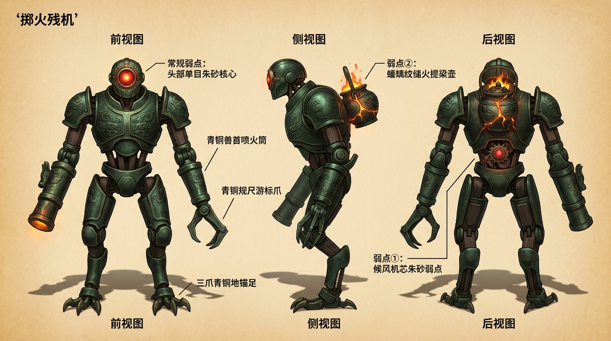

# 《考工律度》远程高台小怪【掷火残机】模型与机制设计方案

> **文件标识**：`MONSTER_DESIGN_ZHIHUO_ZH.md`  
> **版本**：`V1.0` | 2026-11-21  
> **所属模块**：战斗系统 / 怪物生态 / 3D 美术资产规范  
> **运行平台**：Meta Quest 一体机 (VR 72/90fps) / Unity 6000.3.10f1 URP  
> **关联文档**：[`docs/world/考工律度_世界观设定白皮书.md`](../world/考工律度_世界观设定白皮书.md) · [`docs/architecture/MONSTER_DESIGN_CANJIOU_ZH.md`](MONSTER_DESIGN_CANJIOU_ZH.md) · [`docs/architecture/AUDIO_VFX_SPECIFICATION_ZH.md`](AUDIO_VFX_SPECIFICATION_ZH.md)

---

## 1. 世界观渊源与生态定位

### 1.1 前世与异化：司衡外库的高台守御者
在天地大脱扣之前，**【掷火残机】（Zhi Huo Can Ji / Igniter Automaton）**是天工司司衡外库、渡槽与高耸梁枋间的**高空安防与熔铸机偶**：
- **原本职责**：背负耐压炼火胆，使用右臂铜铳向高炉精准喷射引火药核，或在梁枋上清除渡槽结冰与积垢；
- **动力来源**：体内安装高密度的青铜双螺旋发条，配合胸膛小型的“地动火胆”提供增压动力；
- **失度异化**：大脱扣后，机芯擒纵机构断裂卡死，内部排气减压阀失灵，使其处于持续的“高压过热”暴走状态。单目镜变为警示的炽红光圈，将一切地面行走的非机偶目标判定为侵入仓库的失度异物，不断居高临下倾泻燃烧火核。

### 1.2 战术协同：立体高低压制（白皮书幕三设定）
正如《考工律度_世界观设定白皮书》第三幕【司衡外库】所载：
> *“上面的掷火，地面的抢攻！念护体咒开盾挡住头顶火核，等地面机偶挥尺扑过来，胸前快推后撤！”*

掷火残机通常盘踞在**高度 2.5 ~ 4.5 米的高台、横梁或断壁石柱**上，与地面的基础近战【残机偶】形成严密的立体火力网：
- **掷火残机**：迫使玩家关注上方空域，用【定规障】（护体咒）撑盾招架或使用横向快推瞬身走位；
- **残机偶**：趁玩家举盾或被火圈限制移动时快速贴身挥刃横劈。

---

## 2. 3D 模型资产美术规范 (Asset Specifications)

### 2.0 概念三视图定稿 (Model Turnaround Sheet)



> 图面详见 [`docs/visuals/20261121_zhihuo_enemy_turnaround/README.md`](../visuals/20261121_zhihuo_enemy_turnaround/README.md) 及提示词归档 [`prompts.txt`](../visuals/20261121_zhihuo_enemy_turnaround/prompts.txt)。涵盖正立面（**正面常规弱点：头部单目朱砂核心** / 兽首喷火筒）、侧立面（35°前倾高台射角/提梁壶）与背立面（**背部双特化弱点**：上方炽热熔岩裂纹的储火提梁壶殉爆点，与下方候风齿轮朱砂瘫痪点）。彻底剔除近代蒸汽锅炉，纯正先秦工官金石风格。


### 2.1 比例、形体与穿戴结构
掷火残机采用兼顾人形与古战车炮架特征的重装双足结构，充满先秦金石工官气息：
- **身高**：1.85 米（含排烟铜管与背部发条旋钮）；
- **体型包络**：肩宽约 55cm，胸厚 45cm，重心略微前倾呈 35° 俯瞰瞄准姿态；
- **五大核心外观部件**：
  1. **头部【单目朱砂游标镜】（正面常规弱点 / 爆头点）**：青铜冷铸无面头颅，额头刻有云雷纹与工官度量分寸；中心嵌有单目朱砂透镜核心（`#E65100`），作为玩家正面对决时的主要爆头目标，蓄力瞄准期间命中可直接打断前摇；
  2. **右臂【饕餮纹火核喷筒】**：重型青铜铸造火铳，前端为饕餮衔珠/螭龙吐火造型，筒口内膛透出高温橙红光，装填待发的实体青铜火核；
  3. **左臂【三指配重游标规】**：青铜活动滑轨规爪，平时托举火铳平衡重心，高空作业时扣入梁木与石缝；
  4. **背部【提梁方壶与候风齿轮机芯】（致命弱点）**：
     - 背负一只**蟠螭纹青铜方壶（战国提梁壶）**储火器，以厚实熟牛皮交叉束带紧固于榫卯木架上，绝非近代压力罐；
     - 壶盖顶部为**汉代博山炉式透雕青铜云气孔**，蓄力时喷出赤焰火星，常态袅袅升起木炭香烟；
     - 背架下方腰骶处窗口完全敞开，裸露着**先秦候风地动仪/指南车式古青铜齿轮与棘爪擒纵机构**，中心镶嵌高亮**赤红朱砂能量核**（受到攻击时享有 300% 暴击加成并击落瘫痪）；
  5. **双足【三爪青铜地锚足】**：三叉倒钩抓地脚爪，稳稳卡扣在高台木梁或石壁风化缝隙，抗后坐力极强。

### 2.2 Quest VR 性能与拓扑指标

| 规范项目 | 目标参数 | 设计原由与 VR 优化边界 |
|---|---|---|
| **三角面数 (Triangle Count)** | **3,500 ~ 4,500 Tris** | 高台远景渲染为主，面数适度控制，确保与地面 2~3 只小怪同屏时不掉帧 (72/90fps)。 |
| **骨骼数量 (Bone Count)** | **32 根标准骨骼** | Humanoid 双足（28 根）+ 头部单目镜聚焦骨（1 根）+ 火铳炮管后坐力骨（1 根）+ 背部发条自转骨（1 根）+ 排烟管抖动骨（1 根）。 |
| **顶点权重限制** | **Max 4 Bones per Vertex** | 限制在 Adreno GPU 硬件上限内。 |
| **材质球与 Draw Call** | **1 个 Material (Single Draw Call)** | 全身合并单 Material，禁止因多材质产生额外 DrawCall。 |
| **贴图分辨率与通道** | **2048×2048 (PBR 合图)** | ASTC 格式压缩。Albedo(RGB) + Normal(RGB) + Metallic/Roughness/Occlusion(合图)，冷铸青铜绿锈与哑光栎木。 |
| **自发光通道 (Emission)** | **单目镜 + 火铳内膛 + 背心发条** | 采用熔核朱砂色（`#E65100`），蓄力时通过 Material Property Block 控制呼吸发光，严禁全屏泛光。 |

---

## 3. 战斗行为树与机制设计 (Combat Mechanics)

### 3.1 核心招式：【司衡掷火】(Fire Core Launch)

```
        ┌─────────────────────────┐
        │   【高台巡视与锁定】    │
        │ 单目镜微弱红芒，搜寻入侵者│
        └────────────┬────────────┘
                     │ 发现玩家 (距离 4.0 ~ 15.0 米)
                     ▼
        ┌─────────────────────────┐
        │  【前摇预警：蓄力引燃】  │
        │ 发条高频尖啸 + 排烟管喷火 │
        │ 单目镜红芒收束瞄准地表   │
        └──────┬───────────┬──────┘
 瞬身滑步闪开  │           │ 定规障格挡 / 火球对轰
               ▼           ▼
┌────────────────────────┐   ┌────────────────────────┐
│  【落点炸裂：持续火圈】 │   │   【反制成功：弹反/破招】│
│ 地面燃烧 2.5 秒，阻挡走位│   │ 火核反弹回高台炸晕机偶  │
└────────────────────────┘   │ 或火球空中对撞湮灭      │
                             └────────────────────────┘
```

#### 1. 预警前摇阶段 (Telegraph 1.5 秒) —— 核心 VR 视听反馈
- **听觉预警**：背部发条机构由于加压发出刺耳的**机簧高频尖啸（Spring Whine）**与齿轮过载声；
- **视觉预警**：
  - 弯颈排烟道猛烈喷出黑烟与橙红火星；
  - 头部单目镜迅速收紧光圈，向玩家脚下投射一条明显的红色虚线瞄准轨迹与地面圆形红圈（半径 1.0 米）；
  - 右臂饕餮火铳膛内火光暴涨。

#### 2. 发射与飞行阶段 (Fire 0.2 秒 + Flight)
- **投射物参数**：发射一枚带火焰拖尾与黑烟轨迹的实体青铜火核（`FireballMissileFire` 资产变体）；
- **飞行初速**：**6.0 米/秒**（低速弧线或直线弹道，预留充足的 VR 肉眼观察与反应时间）；
- **攻击范围**：有效射程 4.0 ~ 15.0 米。

#### 3. 命中判定与环境效果
- **直接命中**：造成 **40 点火焰爆炸伤害**；
- **落点滞留**：若击中地面，火核碎裂并在地面形成持续 **2.5 秒的小型灼烧火圈**，踏入受到每秒 10 点灼烧伤害（检验玩家的走位与空间管理能力）。

---

## 4. 玩家的反制博弈（核心弱点与克制闭环）

掷火残机采用**三弱点立体战术矩阵**（正面常规爆头点 + 背面双特化破敌点）设计，为 VR 玩家提供极富射击与动作快感的战术破敌路径：

| 玩家反制手段 | 动作操作要求 | 战术收益与结算表现 |
| :--- | :--- | :--- |
| **A. 定规障完美弹反 (Parry)** | 在火核及身前 0.3 秒张开青铜护盾迎击 | 火核沿原路原速反弹回高台，命中掷火残机引爆其自身，造成 **80 点伤害并使其后仰硬直 3.0 秒**。 |
| **B. 飞炎术空中对轰 (Fire Clash)** | 在火核飞行途中结印掷出火球精准对撞 | 触发“忍术对撞”震屏特效，两团火光在空中凌空轰爆湮灭，化解攻击。 |
| **C. 瞬身滑步 (Quick Shift)** | 单目镜锁定红圈成型时向左/右单手快推 | 从容闪出 1.0 米落点杀伤区，保持移动节奏。 |
| **D. 常规弱点：头部单目朱砂核心 (爆头打断)** | 怪物正脸面向玩家时，远程法术或弹道直击单目镜 | **【常规弱点 2.0x 暴击】**：正面最直观的瞄准点。特别在怪物 1.5s 蓄力瞄准前摇时命中，可**强行打断蓄力并造成大幅后仰硬直**！ |
| **E. 战术弱点①：候风发条机芯 (机械瘫痪)** | 绕后刺击或射击腰骶处裸露青铜齿轮与朱砂核 | **【特化弱点 300% 暴击】**：发条打滑疯狂空转，三爪地锚脱钩，机偶从高梁坠落地面**瘫痪 4.0 秒**供玩家处决。 |
| **F. 战术弱点②：青铜储火提梁壶 (烈焰殉爆)** | 以火球术、雷剑飞刃或弹反火核精准命中后背方壶 | **【特化弱点 120 爆轰殉爆】**：方壶熔岩裂缝被引爆，造成自身剧烈火焰爆轰；同时高空爆溅的火油在**正下方地面形成半径 3.5 米烈焰火海，瞬间烧毁地面围攻的【残机偶】**！ |


---

## 5. 现行工程落地执行步骤

1. **投射物逻辑组件**：
   - 创建 `Assets/scripts/data/Enemies/EnemyProjectile.cs`，实现定速弧线飞行、碰撞检测、定规障反射反弹与落地火圈生成；
   - 扩展 `AttackData.cs` 增加 `AttackShape.Projectile` 模式与投射物预制体引用。
2. **美术与动作资产**：
   - 3D 模型遵循本规范，面数 ≤ 4500 Tris，单材质 PBR；
   - 基础动作骨骼：`Idle_Perch` (抓梁待机)、`Aim_Charge` (蓄力瞄准)、`Fire_Recoil` (发射后坐力)、`Hit_Overload` (背部发条受击后仰)、`Fall_Down` (坠落瘫痪)。
3. **特效复用**：
   - 弹道复用 `FireballMissileFire`（已在 `VFXPreviewTest` 验证）；
   - 蓄力烟气复用 `SmokeTrail` 与微粒火星；
   - 落地燃烧复用小火苗循环粒子。
