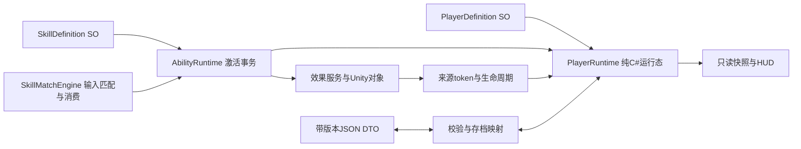

# 玩家数据设计：从技能训练场到可保存的玩家状态

> 文档定位：架构基线与设计约束；文内早期方案不是自动实施指令。当前操作以[移动指南](../guides/ENCOUNTER_LOCOMOTION_ZH.md)、[火球指南](../guides/FIREBALL_TUNING_ZH.md)和[腕饰指南](../guides/WRIST_MENU_INTERACTION_DESIGN_ZH.md)为准；功能是否完成须核对源码、场景与带版本的验收。

> **2026-10-30 当前方向：** 采用[线性 RPG 最小方案](LINEAR_RPG_DESIGN_ZH.md)，固定解锁、轻量等级/货币/升级和检查点优先。`Rpg/Data` 的玩家运行态、版本化存档及新场景接线已通过 Unity 检查，[实际使用](../guides/LINEAR_RPG_QUICKSTART_ZH.md)。下文保留2026-10-29的长期设计；拟用类名与通用事务不代表已实现，当前实现类为 `RpgPlayerState`、`RpgProgressData`、`RpgSaveStore`。
>
> 当前数据边界改为：共享 SO 定义 → 角色永久成长（解锁/等级/货币）＋冒险进度（关卡/检查点/隐藏奖励领取）→ 玩家运行态（HP/MP/CD/护盾）。临时识别缓存、导航驻留、短划基线和画符轨迹不进存档。完整装备界面、全部解锁/装备迁移和通用效果账本按实际需要后续扩展，不作为首片前置。
>
> 本轮采用最大 HP/MP 100、成功耗费后延迟 2 秒按 5 MP/秒恢复、火球 20 MP、护盾 15 MP 的初值；现有 3 秒 CD 不自动改旧资产。成功生成手持物/加持才扣 MP/CD，识别失败、生成失败和待施法取消不扣；成功后收起不退款。CD 按技能组跨换装保留，沿用一个共享手持槽和时限。同步回调接线不等于下文完整的通用 `Prepare/Commit/Rollback` 已落地。
>
> 新 `LinearRpgTest` 的普通取消只清待施法、未完成笔画和未发射物，保留已生效护盾/飞行物；旧训练场取消可结束护盾是历史兼容。数据归属、操作冲突和本轮待验收项以新方案为准。

以下正文是2026-10-29的设计基线。当时尚无玩家运行态和存档；2026-10-30已落地的最小实现以上方说明及线性RPG文档为准。完整装备系统、通用效果事务与网络账本仍未实现。

多人扩展约束见 [局域网方案与接口预留](MULTIPLAYER_LAN_PLAN_ZH.md)。本文的同步激活事务、可暂停游戏时钟首先描述离线运行态；多人由房主拥有数值、冷却与战斗时钟，客户端只读快照。本地暂停不能暂停房间，持久 profileId、本局 actorId 和网络连接 ID 不能混用。

最新优先级为 **Quest 单机各系统先落地，多人仅设计，未来暂定同房间 PvE**。后续 PICO 比赛适配见 [设备兼容方案](QUEST_PICO_COMPATIBILITY_PLAN_ZH.md)。玩家定义、效果账本、资源与存档不引用 OVR/PXR/网络类型；输入、头手锚点和环境能力由场景适配器提供。个人手印标定单独按提取器/设备运行方式版本管理，玩家档案只保存标定引用，不把骨骼或厂商数据写进生命/能量存档。同房坐标标定属于会话状态，不作为通用玩家位置跨设备恢复。

选用轻量的三层结构：**ScriptableObject 保存共享定义，纯 C# 对象保存当前玩家状态，带版本的 JSON DTO 保存可恢复数据。** 沿用当前技能匹配与效果实现，不引入大型属性框架。匹配器判断输入，玩家运行态管理数值和权限，效果服务负责世界中的对象与表现。

## 1. 已实现的边界（2026-10-30 源码核对）

| 当前代码 | 已有行为 | 尚未提供的能力 |
|---|---|---|
| `Core/SkillDefinition.cs` | 技能 ID、三种单印模式、窗口、效果、左右手、冷却、`manaCost`、`cooldownGroup` | 多效果定义列表、通用装备资格规则 |
| `Core/SkillMatchEngine.cs` | 骨骼/评分缓存、双向匹配、消费、取消代次；`ExternalCooldownAuthority` 支持 RPG 外部冷却所有者 | 网络 Pending/Committed 请求链；当前同步回调仍为 `Func<SkillDefinition,bool>` |
| `Rpg/Data/RpgPlayerState.cs` | 玩家 HP/MP、按组 CD、回蓝、激活/伤害 ID 去重、失败退还本次预扣 MP | 通用来源效果账本、多人权威事务 |
| `Rpg/Data/RpgProgressData.cs`、`RpgSaveStore.cs` | 解锁/成长/货币/进度、检查点快照、版本化 JSON、验证及备份恢复 | 完整装备/惯用手偏好、云存档与任意战斗帧恢复 |
| `Effects/SkillEffects.cs` | 单个数值护盾、共享手持槽、火球投掷；`AbsorbDamage` 后由 RPG 承接生命伤害 | 多来源效果账本、多效果原子提交 |
| `Effects/SkillTrainingTarget.cs` | 训练靶生命、受击、击破及恢复 | 通用敌人 AI、属性/硬直 |
| `Effects/SkillProjectile.cs` | 火球碰撞；在伤害前锁定一次命中，避免同一火球重复伤害 | 通用玩家/敌人伤害接口、多人权威结算 |
| `SkillTestController.cs`、`Rpg/LinearRpgController.cs` | 本地接线、资源资格、外部冷却权威、`GameTime`、进度与存档入口 | 通用 UI 输入仲裁、网络命令端口；正式头显教学菜单 |

玩家受伤链已由 `LinearRpgController.ReceiveDamage` 接通护盾→生命和伤害 ID 去重；训练靶仍是另一类目标，不与玩家生命混用。已有轻量数值实现，不代表全部长期属性/装备设计落地。

护盾仍是 `SkillEffects` 中一个数值与到期时间，多来源 token 尚未做。RPG 的冷却由 `RpgPlayerState` 按 `GameTime` 管理，效果通过 `GameClock` 回调使用同一游戏时间；旧训练场无 RPG 接线时保留匹配器内部冷却与 realtime 缺省。应用暂停仍清效果，不能把“已接游戏时间”误认为已实现暂停后保留护盾 token。

历史技能验收见[架构重构验收](../guides/VALIDATION_ZH.md)；当前 RPG 自动检查与真机缺口见[交互手感验收](../guides/ENCOUNTER_LOCOMOTION_ZH.md)。通用事务、来源账本和多人不在已完成范围。

## 2. 数据归属与读取方向



图为长期职责图。当前已落地 `RpgPlayerDefinition`、`RpgPlayerState`、`RpgProgressData`、`RpgSaveStore`；`AbilityRuntime` 和通用效果 token 账本仍为设计。后续不再新建同职责的第二套玩家运行态。

| 层 | 负责的内容 | 写入规则 |
|---|---|---|
| `PlayerDefinition` SO，拟新增 | `definitionId`、生命/能量上限、能量恢复速度与延迟、护盾总上限、起始解锁与装备 | 编辑器配置；运行时只读，不在资产中写玩家剩余值 |
| `SkillDefinition` SO | 已有 `manaCost`、`cooldownGroup` 和效果引用；叠加/生成手策略后续扩展 | 共享配方与效果参数，不存本局冷却截止点 |
| `RpgPlayerState`＋`RpgProgressData` | 已有生命/能量/CD 与解锁/成长/进度；效果账本、装备和惯用手仍待扩展 | 通过受控方法修改；不给 UI、识别器或效果表现任意 setter |
| `AbilityRuntime`，拟新增 | 激活检查、准备、扣费、提交、回滚和激活记录 | 唯一激活事务入口；在主线程一次完成 |
| `PlayerSaveData`，拟新增 | 可序列化的版本化值、稳定 ID 和剩余时长 | 从已提交的运行态快照生成；先校验再恢复 |

首版只有一个本地玩家，`playerId` 仍保留稳定标识，供伤害来源、日志和未来 NPC 复用。MonoBehaviour 只负责场景绑定、时钟推进和生命周期；纯 C# 运行态不持有 Transform、Collider、材质、麦克风或追踪对象。

## 3. 首版字段与约束

| 数据 | 运行态表示 | 是否保存 | 约束 |
|---|---|---|---|
| `health` | 当前生命；上限来自定义及合法属性修正 | 是，保存安全检查点值 | 有限数，范围 `[0, maxHealth]`；0 表示不能激活技能，重生由显式流程处理 |
| `energy` | 当前能量及下一次允许恢复的游戏时刻 | 是；恢复等待保存为剩余秒数 | 有限数，范围 `[0, maxEnergy]`；扣除不能为负，暂停和死亡时不恢复 |
| `shield` | 活跃护盾 token 的剩余量之和 | 首版不保存 | HUD 的 `ShieldPoints` 是派生读数；伤害修改对应 token，不能另存一个可独立写入的总数 |
| `cooldowns` | `skillId → readyAtGameTime` | 保存剩余秒数 | 成功提交才建立；结束只代表可接受下一次新输入，不自动施法 |
| `unlockedSkillIds` | 稳定技能 ID 集合 | 是 | ID 必须能在技能目录解析；不能用中文显示名或资产路径作为持久 ID |
| `equippedSkillIds` | 有序 ID 列表，首版最多 3 个 | 是 | 是解锁集合的子集；无重复；更换后重新检查印配方及口令冲突 |
| `dominantHand` | `Left` / `Right` 玩家偏好 | 是 | 默认 Right；不等同于当前手追踪有效，也不代表允许自动换手 |
| `activeEffects` | token 对应的效果数值、来源和到期时间 | 首版不保存 | 只保留本次会话有效效果；对象与表现另由效果服务绑定 |
| `revision` | 每次已提交状态变更递增 | 不作为跨会话权威值保存 | 用于只读快照、事件顺序和检查事务是否使用了过期状态 |

能量恢复首版采用“最后一次成功扣费后等待 2 秒，再按每秒 5 点恢复”，使用游戏时钟的增量推进。一次失败的输入既不扣费，也不重置恢复等待。数值上限来自配置；旧存档不能把自己声明的上限覆盖配置。

生命受伤顺序为：校验伤害与 ID → 护盾吸收 → 剩余伤害扣生命。当前 RPG 已有本地 `damageId` 去重及火球单次命中保护；完整来源 token、统一结构化结算事件和网络权威伤害端口仍待扩展。

### 3.1 惯用手与技能指定手

当前技能只有 `leftHand`：false 明确表示右手，true 表示左手。新增玩家偏好时不能把现有 false 偷换成“跟随惯用手”。

拟增加 `SpawnHandPolicy = Right / Left / Dominant`。已有资产迁移为对应的固定 Right 或 Left，维持当前火球默认右手；只有显式选择 Dominant 的技能才读取玩家偏好。激活时解析并锁定本次生成手；追踪丢失、偏好变化或另一只手可用都不自动把已持握物切换过去。当前还没有这个枚举和迁移逻辑。

### 3.2 识别分数不是玩家属性

`SealScore.score`、覆盖率、必需特征、保持时间、竞争印分差、语音延迟和输入 `Epoch` 属于识别证据。它们不进入生命、能量或永久成长数据。

首版火球命中仍使用配置伤害 25，不把“80 分手印”变成“80% 伤害”。能量较多也不会自动降低印阈值。组合口令的分数减免继续由技能配方决定，保留现有覆盖率、质量、保持与消歧规则。将来若需要熟练度成长，单独定义可审计的成长规则，不直接累计每帧匹配分数。

## 4. 激活事务与输入消费

当前 `SkillMatchEngine.Attempt` 在调用效果前消费证据并清待选，语音也已去重；失败不恢复旧输入。无外部权威时成功回调后写匹配器冷却；RPG 开启 `ExternalCooldownAuthority`，由 `RpgPlayerState` 记账。这条“一份输入最多尝试一次”的语义保留。

下一阶段将匹配器的 `TryActivate` 回调接到 `AbilityRuntime`。初次集成可以保留现有 `Func<SkillDefinition, bool>` 外观，由适配器创建本次 `activationId`；当前 API 并没有向回调公开完整证据 ID。若需要把 `Epoch`、手势 action 和语音事件逐项写入激活日志，应另增明确的只读 `ActivationRequest`，不能声称现有回调已经提供了这些字段。

这个 bool 兼容外观仅适用于单机同步调用。网络接入必须将匹配事实、请求提交与主机 Committed/Rejected 结果拆开；提交成功不代表施法成功。结果超时视为未知，以同一请求 ID 查询/恢复，不能直接退款或换新 ID 重放。输入 Epoch 变化也不能抹掉主机已提交的冷却和资源状态。

一次激活按以下顺序完成：

1. **登记尝试。** 输入由匹配器消费；运行态为该尝试分配会话内唯一 `activationId`，拒绝重复提交和事务重入。
2. **检查玩家与技能。** 玩家存活，技能已解锁且已装备，配方有效，冷却结束，能量足够；手持技能还要检查当前指定手锚点、共享手槽、材质和所有必需能力。纯咒语自身加持仍无需手部追踪。
3. **准备全部必需效果。** 建立尚未公开的效果计划、token 和禁用状态对象。此时不扣能量、不改护盾、不让对象造成伤害。缺少任一必需效果即释放本次准备产物并失败；明确标为可选的表现可以降级。
4. **主线程提交。** 再检查运行态版本及资源；记账本次能量扣除，提交全部必需效果，建立冷却，更新状态版本和成功激活记录。提交期间不发布会让外部观察到半完成状态的事件。
5. **成功通知。** 所有必需状态提交后发布事件并返回 true。事件订阅者异常单独记录，不能把已经成功提交的技能反向标记为失败或再次退款。

若第 4 步中途失败，按 `activationId` 撤销**本次**效果 token、销毁本次预备对象、退还本次实际扣除的能量，并撤销本次新建的冷却。退款和清理必须幂等；不能通过 `ClearAll()` 把另一个已生效技能一起清掉。输入仍已消费，返回 false 后必须重新输入。

当前 `SkillEffects.TryActivate` 仍直接修改护盾/创建对象。RPG 已用同步适配：`RpgPlayerState.TryActivate` 预扣 MP，效果拒绝/异常退还该次 MP，成功才提交 CD。它适用于现有受控内置效果，**不保证任意多效果副作用能完整回滚**；通用 Prepare/Commit/Rollback 仍是扩展目标。护盾视觉可选，必需火球实体不能由缺省视觉规则代替。

### 4.1 冷却只有一个权威所有者

RPG 已把冷却交给 `RpgPlayerState`，匹配器通过 `ExternalCooldownAuthority` 跳过其内部冷却；旧训练场保留原逻辑。未来联网再将这个权威迁往房主，不能新增第二份独立冷却所有者。

冷却从**激活成功**开始：护盾已经生效，或火球已经生成到手。轻推发射、飞行命中和效果到期均不重新开始该次冷却。准备失败不开始冷却；已在冷却中的新输入会被消费，但不会把原冷却向后延长。

### 4.2 取消和退款策略

| 情形 | 资源 | 冷却 | 输入及效果 |
|---|---|---|---|
| 输入尚未匹配、待补齐时取消 | 尚未扣费，无退款 | 不新增 | 清缓冲/候选并提升 `Epoch`；不取消另一项已生效效果 |
| 当前锚点缺失、槽占用、能量不足或准备失败 | 不扣费 | 不新增 | 本次输入消费；不排队补发 |
| 提交中途发生可回滚失败 | 本次扣费全额退回一次 | 撤销本次新建项 | 只清本次 token；旧输入仍作废 |
| 成功持握后主动收起 | **不退款** | 保留 | 释放本次手持对象和手槽 |
| 成功持握后超时或追踪超过宽限仍未恢复 | **不退款** | 保留 | 当前火球消散；重新施法需要新输入 |
| 成功护盾被主动取消、击破或到期 | **不退款** | 保留 | 只移除对应护盾效果 |
| 火球已经发射或命中 | **不退款** | 保留 | 普通取消不倒转伤害，也不召回已飞行火球 |
| 切场景或退出会话清理 | **不退款** | 按检查点保存规则处理 | 清理临时对象与效果；不把正常清理冒充激活失败 |

新 RPG 普通取消只清待匹配和未发射持物，保留护盾/飞行物。旧训练场才保留按顺序结束持物/可取消加持的兼容规则。上表的主动解除护盾属于未来显式效果操作，不是当前 RPG 普通取消。关闭菜单、退出课程与这些命令分别处理；敌方限制不能由本地 UI 关闭删除。

## 5. 多效果来源、叠加与到期

拟新增的每个效果记录至少包含：

```text
effectToken            会话内唯一且不可复用
ownerPlayerId          被作用的玩家
sourceActorId          施法来源
sourceActivationId     来源激活事务
sourceSkillId          稳定技能ID
effectKind / stackGroup
startSequence          同时到期时的确定性顺序
startedAtGameTime / expiresAtGameTime
cancelPolicy / stackPolicy
remainingShield 或该效果的数值载荷
```

token 是效果所有权，不是 GameObject 名称。视觉、环境请求和移动约束各绑定自己的可释放句柄；结束 token 时只释放它拥有的句柄。同一 token 重复结束无副作用。到期判断统一使用 `gameNow >= expiresAtGameTime`，避免显示已到期但仍吸收一次伤害。

长期效果账本拟把基础加持放入 `player.guard` 效果组，补满刷新、避免旧 token 清掉新 token；该账本未实现。当前 `buff.zi`、`buff.voice` 直接刷新同一个数值护盾，并已共享 **`shield` 冷却组**；隐藏盾用 `shield.hidden` 冷却组。效果叠加组与冷却组是两个概念，不因名字相似合并。

为未来多个护盾来源预留独立组。若允许不同组叠加，新增授予量按护盾总上限截断；吸收顺序固定为最早到期者优先、同到期按 `startSequence`。每次吸收扣对应 token 的剩余量，过期或移除另一个来源不能让已消耗护盾重新出现。其他属性修正从仍活跃的 token 重算，不在结束时写回一个可能过时的“原始数值”。

## 6. 时钟、暂停与会话边界

输入窗口继续使用单调实时时间，保存音频结束时间、到达时间和手部采样时间；暂停、恢复、重定位及追踪来源重连时清上下文并建立新输入代次。骨骼缓存、语音历史、已消费证据和 `Epoch` 都不写进玩家存档。

RPG 的回蓝、冷却和效果时间已接 `LinearRpgController.GameTime`；暂停时不推进。正式时钟接口尚未落地，未来沿用多人文档的 `ICombatClock` 职责，不再平行增加语义重复的 `IGameClock`。暂停后保留数值加持 token/重建表现仍是未来目标。

当前应用暂停/主控停用会清护盾、持握物和飞行物；RPG 冷却由停止推进的 GameTime 保留，旧训练场缺省 realtime 的规则不同。**普通腕部菜单不得调用这套清理生命周期，也不通过全局 `Time.timeScale` 暂停。** 未来联网房间时钟不因一人开菜单暂停；对齐丢失的房间协调暂停另定。

切场景和加载存档是新的战斗会话：旧输入失效，临时效果和世界对象结束；载入允许恢复的玩家值与冷却剩余时间。重生也是显式状态转移：恢复配置生命/能量，清临时效果与输入，保留尚未结束的技能冷却；不能利用旧手印立即补放技能。

## 7. 带版本的 JSON 存档

当前使用 `Application.persistentDataPath` 下由 `saveFileName` 指定的 RPG JSON，已存在 `RpgSaveStore`、版本/ID/数值验证和检查点入口。`SaveCheckpoint` 要求存活、未暂停且允许保存，但**没有“场上无手持/飞行物”的额外门槛**；只保存约定快照，不恢复那些临时物体。下面 `Player/player.json`/装备偏好是长期格式草案，不能用它覆盖现有存档。

下面 DTO 是长期格式示例；当前生命/能量、恢复等待与 CD 快照以 `RpgProgressData` 为准，不能把示例当成可直接加载的文件：

```json
{
  "saveVersion": 1,
  "playerId": "local-player",
  "definitionId": "player.training.v1",
  "health": 100.0,
  "energy": 80.0,
  "energyRegenDelayRemainingSeconds": 1.5,
  "dominantHand": "Right",
  "unlockedSkillIds": ["buff.zi", "buff.voice", "fireball"],
  "equippedSkillIds": ["buff.zi", "buff.voice", "fireball"],
  "cooldowns": [
    {"skillId": "fireball", "remainingSeconds": 2.5}
  ]
}
```

不保存 SO 引用、Unity instance ID、Transform、骨骼、音频、手持/飞行对象或当前护盾。加载后的护盾为零；已经消耗的能量不会因为未恢复临时效果而退款。存档是检查点恢复，不承诺从任意一帧继续飞行或继续握着火球。

冷却和能量恢复等待存**剩余时长**，不存 `Time.realtimeSinceStartupAsDouble` 或游戏时钟绝对值。首次加载按新 `gameNow` 重建截止点。首版不计算离线恢复：退出十分钟后再次载入，检查点里剩余 2.5 秒的冷却仍剩 2.5 秒；系统日历变化不能提前结束它。若今后增加离线收益，应作为新的版本规则单独定义。

加载流程为“读入 DTO → 按版本迁移 → 数值/ID/装备校验 → 构造完整新运行态 → 替换当前运行态并重置匹配上下文”。至少校验：

- 版本可支持，必需字段存在，数值有限，集合数量在界限内；生命/能量按当前定义限制到合法范围。
- 冷却 ID 已知且无重复，剩余值非负；首版无冷却倍率时不超过对应配置时长。恢复等待不超过定义上限。
- 装备 ID 已解锁且不重复；再次运行纯印/组合配方和完整口令冲突检查。未知或失效技能不启用，并给出可见加载诊断。
- 更新版本不能无声覆盖无法识别的旧/新格式。无效正式文件尝试上一份有效备份；都无效则显示恢复选项，不把解析失败直接保存成空进度。

写入时先把快照写到同目录临时文件，完成刷新并重新校验，再替换正式文件并保留上一份有效备份。替换能力需分别在 Windows 和 Quest 文件系统验证；失败时保留原正式文件及错误诊断。保存成功事件只在替换完成后发布。

## 8. 首版参数与事件

以下将当前值和拟新增值分开，便于验收时避免误认已经生效：

| 参数 | 数值 | 状态 |
|---|---:|---|
| 玩家生命上限 / 初始生命 | 100 / 100 | RPG 当前配置 |
| 能量上限 / 初始能量 | 100 / 100 | RPG 当前配置 |
| 能量恢复 / 扣费后等待 | 5 点/秒 / 2 秒 | 已实现，仍需试玩调节 |
| 护盾容量 / 加持时长 | 100 / 10 秒 | 当前值；尚未归入 PlayerRuntime |
| 子印加持 `buff.zi` 能量消耗 | 15 | 已实现 |
| 护体咒加持 `buff.voice` 能量消耗 | 15 | 已实现；与子印共享 `shield` 冷却组 |
| 火球术 `fireball` 能量消耗 | 20 | 已实现 |
| 基础三个技能冷却 / 隐藏盾 | 3 秒 / 8 秒 | 当前资产值，成功激活开始；隐藏盾耗 25 MP |
| 火球伤害 / 持握上限 / 飞行寿命 | 25 / 10 秒 / 4 秒 | 当前默认值 |
| 装备槽 / 起始解锁 | 槽位未实现 / 初始仅火球 | 普通护盾随阶段解锁，隐藏盾后续购买；目录有四种配方不等于开局全部可用 |
| 惯用手偏好 | Right | 拟新增；当前火球资产固定右手 |

拟新增的事件使用只读值和稳定 ID，包含 `revision`、游戏时间及变化原因；UI 订阅事件或读取快照，不修改状态：

| 事件 | 发布时机及必要内容 |
|---|---|
| `VitalsChanged` | 生命/能量/护盾已完成修改后；前后值、原因、来源 token 或伤害 ID |
| `ActivationCommitted` | 全事务成功后一次；activationId、skillId、实际扣费、效果 token、生成手 |
| `ActivationRejected` | 检查或提交失败后；失败原因、是否发生回滚；不能以此重新投递输入 |
| `CooldownChanged` | 成功开始、明确结束或载入后；skillId、剩余时长；不每帧发布相同值 |
| `EffectChanged` | token 建立、刷新替换、被消耗或结束；结束原因与来源 |
| `LoadoutChanged` | 解锁/装备/惯用手更改校验通过后；匹配器以新配置和新输入代次重建 |
| `PlayerDefeated` / `PlayerRespawned` | 状态真正跨过边界时各一次；不能因 HUD 重刷重复发送 |
| `SaveCompleted` / `SaveFailed` | 文件替换完成或明确失败后；存档版本和可读原因 |

当前 `SkillEffects.Message` 和匹配器 `Log` 是字符串诊断，不能拿字符串解析代替这些结构化事件；它们可保留供训练场阅读。

## 9. 环境与移动约束的后续接口

首版玩家数据不直接写透视、雾、相机位置或移动组件。拟通过 `IEnvironmentPresentation` 和 `ILocomotionConstraints` 申请句柄，记录所属 token、优先级、到期时间及取消权限。效果回滚或结束时释放自己的请求，由各管理器重新合成剩余请求。

环境视觉覆盖与移动允许范围分开管理；多个移动允许区按交集判断，矛盾约束在激活准备阶段拒绝，不先扣费再困住玩家。真实身体走出范围不能通过冻结头显或强拉相机解决。当前工程尚未实现这些接口、领域效果或通用移动入口；它们只是未来 `AbilityRuntime` 必需能力检查与效果句柄的扩展点。

## 10. 落地顺序与验收标准

下面是长期完整系统的原规划，不是待办队列现状：其中最小玩家数值、同步激活/CD、版本存档与单机生命周期检查已完成；来源账本、多效果事务、完整装备和网络仍未实现。近期顺序以[文档一致性核对](../research/UI_PLATFORM_MULTIPLAYER_AUDIT_ZH.md)和线性 RPG 文档为准。

1. **纯 C# 玩家运行态。** 新增只读定义快照、PlayerRuntime、可注入游戏时钟和数值事件；先用模拟伤害验证生命/能量/护盾，不接入真实追踪或存档。
2. **效果账本。** 把单一护盾迁入 token 账本，保留两种加持补满刷新语义；表现对象只跟随 token。测试旧 token 的迟到结束不会删除新护盾。
3. **激活事务和冷却迁移。** 拆分效果准备/提交/回滚，加入能量花费；把冷却统一迁到运行态，移除双份时钟来源；匹配器继续负责一次性消费。
4. **解锁、装备和惯用手。** 加入目录、配置冲突验证和明确的生成手策略；切换装备时重建输入上下文，保留仍有效的玩家冷却。
5. **存档与迁移。** 加入 DTO、校验、备份、原子替换与检查点入口；只恢复明确定义的字段，再接 HUD 和保存状态提示。
6. **生命周期与场景验收。** 一起迁移暂停时钟、临时对象清理、恢复隔离、重生和切场景；最后再扩展环境与移动约束。

必须通过的新增检查：

- 生命、能量、护盾不会为负、超过上限或接受 NaN/Infinity；护盾 40 承受 55 点伤害时先清盾，再从 100 生命扣到 85。
- 到期边界不再吸收伤害；护盾补满刷新总量仍为 100；旧来源撤销不影响新的 token；重复伤害 ID 不重复扣血。
- 能量 19 时火球被拒绝，能量 20 时成功后为 0；失败不启动恢复等待；成功扣费后的等待和恢复量符合游戏时间。
- 缺手锚点、槽占用、未解锁、未装备、冷却中及能量不足均不扣费、不新增冷却；所有失败仍消费输入且不会稍后补发。
- 强制让第二个必需效果提交失败：第一个效果完整回滚、能量只退一次、其他激活的效果不被删除；无伤害在提交前发生。
- 同 activationId 不能扣两次，事件回调异常不能导致成功后退款；同帧匹配和重复口令仍最多一次尝试。
- 冷却从持握生成开始，发射和命中不重置；主动收起、超时消散和追踪丢失都不退款；输入取消不抹掉已提交冷却。
- 暂停时能量、冷却和保留的数值 token 不推进；未发射及飞行对象按策略清理，恢复后旧音频/手印不能触发；保持当前 47 项核心和 11 项效果检查通过。
- 装备必须属于解锁集合；重复技能、纯印冲突与口令包含冲突可见地拒绝；固定右手技能不会因惯用手偏好变化而偷偷换手。
- 存档往返保持允许字段，护盾/手持物/骨骼不恢复；冷却和能量恢复等待按剩余时长重建，离线时间及日历回拨不改变首版规则。
- 旧版迁移、未知新版本、未知技能、重复 ID、损坏 JSON、写入中断和备份恢复都有确定结果；失败不覆盖最后一份有效检查点。
- 在实际 Unity 场景验证：玩家受到伤害时 HUD 与运行态一致；两种加持刷新、火球扣费、取消、暂停、重新装备和载入不会留下对象或资源账本不一致。

全部长期目标通过后才能称为完整实现。当前状态是“最小 RPG 玩家数值/存档已实现并通过自动检查；本文通用事务、来源账本等仍为设计”，不能再描述为没有任何玩家数值类或保存文件。
