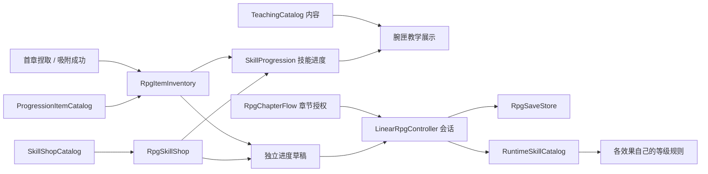

# 教学、成长、物品与章节的职责

2026-11-08，按当前实现整理。`TechniqueProgression` 及其混合配置已删除。教学内容保留为独立目录；成长规则不使用“课程”作为技能身份，也不需要知道首章或铜叶。

## 概念与拥有者

| 概念 | 实现 | 负责什么 |
|---|---|---|
| 技能配方 | `SkillDefinition` / `SkillCatalog` | 技能 ID、输入、资源及效果引用 |
| 教学内容 | `TeachingCatalog` / `TeachingEntry` | 页面标题、配方分组、操作文案；不授予技能 |
| 技能进度 | `SkillProgression` | 了解、永久解锁、等级；不读取教学、物品、章节或磁盘 |
| 成长物品 | `ProgressionItemCatalog` / `RpgItemInventory` | 物品身份、收集、激活与对应奖励；不判断入匣动作或校验门 |
| 商品交易 | `SkillShopCatalog` / `RpgSkillShop` / `SkillShopTransactions` | 目录描述商品，组件接收购买请求，规则在草稿中检查门槛、扣费和等级上限 |
| 一次性奖励 | `RpgRewards` | 奖励 ID 去重、货币及技能授予 |
| 章节许可 | `RpgChapterFlow` 的实现 | 临时授权、永久技能在当前阶段是否允许使用 |
| 会话与提交 | `LinearRpgController` | 调用模块、阶段提交、完整进度校验、保存与失败重试 |
| 磁盘格式 | `RpgProgressData` / `RpgSaveStore` | 纯数据快照，以及版本、白名单、备份、原子替换 |
| 技能副本 | `RuntimeSkillCatalog` | 每名玩家的技能/效果副本及生命周期；按各自 ID 应用等级 |
| 训练设施 | `TrainingTargetGroup` | 训练靶引用、各阶段靶生命、复位时间和状态汇总 |

“已了解”表示能查看内容；“永久解锁”表示获得资格；“当前可施放”还需章节许可，实际施放继续检查生命、度力、冷却与输入占用。教学页可配置展示未了解的配方，这只改变可见性。

## 首章作为具体实现

1. `OpeningTrialChapter.initialDiscoveries` 配置初始了解的三个配方；护盾的两个配方在教学目录中合并为一项。
2. 首章每段的 `trialSkills` 给出临时许可，不授予永久技能。
3. 真实拾取成功调用 `RpgItemInventory.Collect(itemId)`，物品奖励开放新的技能知识。
4. 列表吸附完成后调用 `Activate(itemId)`。物品模块授予永久技能；首章交互再固定铜叶并推进台词。
5. `OpeningTrialChapter.permanentSkillGate` 决定何时允许永久技能施放。物品模块与技能进度模块均不知道校验座。

物品查询返回 `ProgressionItemState`，交互方拿不到可修改的物品记录。物品的独占技能必须与实际激活记录双向一致；同一技能不能同时由阶段奖励、初始授予或商店解锁绕过该物品。

## 进度变更与失败处理

`CreateProgressDraft()` 生成独立快照。物品和商店在草稿中计算奖励或扣费，然后调用 `CommitProgressChange()`。主控检查字段、技能目录、当前阶段和扩展模块规则；草稿不得变更阶段完成记录或阶段奖励记录。只有章节的 `CompleteChapterObjective()` 能提交阶段。

提交结果区分 `Rejected`、`Saved` 和 `PendingSave`。拒绝时不应用草稿；写盘失败时，本轮成功交互继续生效并保留最新待保存快照。后续有效交易替换较早快照；恢复检查点优先使用待保存快照，避免丢掉已经成功的物品或扣费。磁盘重试成功不能把运行状态回滚到旧快照。

`IRpgProgressConstraint` 供实际存在的物品和商店模块检查配置/候选进度。增加新模块时把它挂在 RPG 同一对象，不向主控添加新的物品类型判断。

## 本轮同时修正的问题

- `RpgProgressData` 原先同时计算购买、升级和奖励；现在只保存数据，规则迁入各自模块。
- 主控与调试面板原先写死隐藏术式和火球价格；现在由商店资产生成商品按钮。
- 原先用火球等级增强所有投射物；现在效果副本按自己的技能 ID 应用等级，重复应用不累乘，也不修改原资产或另一玩家。
- 腕匣原先判断铜叶已取、入匣和校验状态；现在显示通用知识/解锁/许可状态。具体入匣说明留在首章引导。
- 腕匣原先把所有投射物都描述成火球；现在操作说明来自教学条目的 `actionHint`。
- 通用阶段原先存放靶生命，主控持有靶列表和自动推进时间；现在分别归训练设施与训练章节。
- 原先只有铜叶写盘失败会保留待重试快照；现在物品、购买、升级和阶段保存共用通用提交与重试路径。

## 配置与存档

| 场景 | 教学 | 物品 | 商店 | 训练设施 |
|---|---|---|---|---|
| Chapter01_Awakening | 首章术式教学 | 首章成长物品 | 首章技能商店，只有火球升级商品 | 两靶，按首章阶段配置生命 |
| LinearRpgTest | 按技能目录显示，允许查看未了解条目 | 无 | 训练场技能商店 | 三靶，60/90/120 生命 |
| KaogongP1Trial | 按技能目录显示，允许查看未了解条目 | 无 | 训练场技能商店 | 单靶，3 秒复位；房间接管战斗 |

存档格式为 **v2**，新增 `discoveredSkillIds`，以通用 `items[{itemId, activated}]` 替代旧铜叶专属字段。三个场景分别使用 `kaogong-chapter01-v2.json`、`linear-rpg-v2.json`、`kaogong-p1-trial-v2.json`。首次使用这些文件从新角色开始；原磁盘文件未删除，运行时不做旧格式迁移。

## 阅读与验证

源码中新增模块的类型、公开接口、配置字段和关键生命周期使用中文 `///` 注释。建议按“TeachingCatalog → SkillProgression → RpgItemInventory → RpgSkillShop → LinearRpgController 的提交方法 → RuntimeSkillCatalog → OpeningTrialChapter”阅读。

隔离检查入口为 `ChapterFlowChecks.RunBatch`（含 `ProgressionModuleChecks`）、`TrainingChapterChecks.RunBatch`、`ProgressionIntegrationChecks.RunBatch`。它们仅接受 D:/Temp 下的 batchmode 工程，并使用唯一 probe 存档。本轮实际结果见 [模型交火交接](../模型交火/代码审阅交接.md) 的 `RESPONSIBILITY-SPLIT-20261108`；证据在本机 `Logs/responsibility-refactor-20261108/`。桌面测试中的直接模块请求或注入门槛状态不代表真实手势、完整剧情通关或 Quest 视觉验收。

2026-11-08，Unity 6000.3.10f1 隔离检查结果：

| 检查 | 结果与覆盖 |
|---|---|
| 普通章节 | 24 项通过；不挂商店、物品和训练设施，移除首章教学目录后仍可完成目标、保存和恢复 |
| 成长模块 | 21 项通过；知识与解锁分离、物品来源双向校验、交易去重、效果副本隔离、v2 文件校验 |
| 训练场 Play | 12 项通过；手动/自动推进、阶段靶复位、奖励去重及完成态读档 |
| 首章模块联动 Play | 24 项通过；真实锁文件造成写盘失败、最新快照重试、物品恢复、独立章节许可和商店升级 |
| 既有回归 | 数据 15、腕匣菜单 35、点腕 26、交互表现 7、房间遭遇 22 项通过；最后一次代码同步后再次通过腕匣 35 项 |

批处理仍出现 Unity SearchDatabase 启动索引异常、Package Manager 路径提示和无头显环境提示；上述检查没有 C# 编译错误或业务断言失败。没有占用正式 Unity 编辑器，也未验收并行修改的外景与天空。
