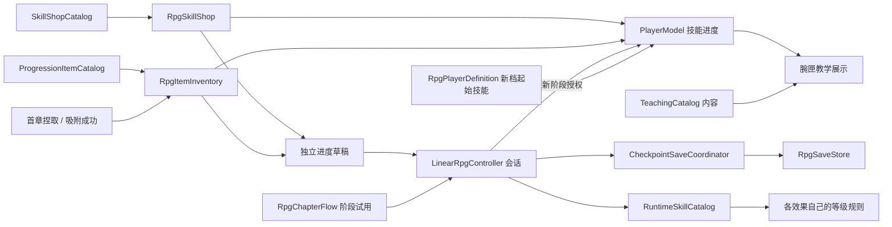

# 教学、成长、物品与章节的职责

2026-11-10 按玩家模型与 v2 持久层更新。`TechniqueProgression` 及其混合配置已删除。教学内容保留为独立目录；成长规则不使用“课程”作为技能身份，也不需要知道首章或铜叶。

## 概念与拥有者

| 概念 | 实现 | 负责什么 |
|---|---|---|
| 技能配方 | `SkillDefinition` / `SkillCatalog` | 技能 ID、输入、资源及效果引用 |
| 教学内容 | `TeachingCatalog` / `TeachingEntry` | 页面标题、配方分组、操作文案；不授予技能 |
| 技能进度 | `PlayerModel` / `IPlayerReadModel` | 模型保存知识、永久技能和等级，会话内另存当前阶段授予的技能。施法和腕匣共用玩家许可 |
| 成长物品 | `ProgressionItemCatalog` / `RpgItemInventory` | 物品身份、收集、激活与对应奖励；不判断入匣动作或校验门 |
| 商品交易 | `RpgSkillShop` / `ProgressionController` | 对候选模型检查商品、余额、阶段及等级上限 |
| 一次性奖励 | `PlayerModel.ClaimStage` / `ChapterModel` | 在同一候选对象写阶段、奖励收据、货币与永久解锁 |
| 起始永久技能 | `RpgPlayerDefinition.startingSkills` | 用技能定义引用配置新角色，读档时使用角色已保存的永久技能 |
| 阶段试用 | `RpgChapterFlow` 的实现 | 提供当前阶段追加的技能 ID，切换、通关或禁用时收回旧阶段的授权 |
| 会话与提交 | `LinearRpgController` / `CheckpointSaveCoordinator` | 会话核对实际节点、玩家技能目录与施放资格，保存协调器保留最新有效快照并重试 |
| 磁盘格式 | `RpgProgressData` / `RpgSaveStore` | 纯数据快照，以及版本、白名单、备份、原子替换 |
| 技能副本 | `RuntimeSkillCatalog` | 每名玩家的技能/效果副本及生命周期；按各自 ID 应用等级 |
| 训练设施 | `TrainingTargetGroup` | 训练靶引用、各阶段靶生命、复位时间和状态汇总 |

“已了解”表示能查看内容；玩家目录中的技能只要永久解锁或获得临时授权，就有施放资格。实际施放还检查生命、度力、冷却与输入占用。教学页可配置展示未了解的配方，这只改变可见性。

## 首章作为具体实现

1. `OpeningTrialChapter.initialDiscoveries` 在当前两个首章场景中实际配置了 **6** 个标识（`fireball`、`shield.left`、`buff.voice`、`thunder.sword`、`breath.burst`、`breath.stream`）；其中护盾的手印与口令配方在教学目录界面中合并呈现。
   - 注：按资产实际状态，[默认玩家.asset](../../Assets/ScriptableObjects/玩家定义配置/默认玩家.asset) 的 `startingSkills` 当前已预置 `breath.stream`、`thunder.sword`、`breath.burst`；`GATE_CHECK.asset` 实际配置的 `unlockSkillIds` 为 `[fireball, buff.zi]`，[首章成长物品.asset](../../Assets/ScriptableObjects/成长物品配置/首章成长物品.asset)（`leaf.fangyuan`）实际配置的 `unlockSkillIds` 为 `[buff.voice]`，存档文件为 `kaogong-chapter01-v2.json`。
2. 首章每段的 `trialSkills` 给出临时许可，不授予永久技能。
3. 真实拾取成功调用 `RpgItemInventory.Collect(itemId)`，物品奖励开放新的技能知识。
4. 列表吸附完成后调用 `Activate(itemId)`。物品模块授予永久技能；首章交互再固定铜叶并推进台词。
5. 入匣授予的永久技能即时可用。后续校验座负责开门和推进章节。

物品查询返回 `ProgressionItemState`，交互方拿不到可修改的物品记录。物品的独占技能必须与实际激活记录双向一致；同一技能不能同时由阶段奖励、初始授予或商店解锁绕过该物品。

阶段切换成功后，会话通过事件中心发布 `PlayerEvents.StageExited`、`PlayerEvents.StageEntered`。通知带有玩家实体和阶段资产，监听者在回调内即可读取对应的玩家许可。`PlayerModel.AvailableSkills` 枚举去重后的可用术，`CanUseSkill(id)` 查询许可。试用期间永久解锁同一技能，退出阶段时会保留永久资格。检查点只保存永久技能，恢复时依据落地成功的阶段重建授权。

## 进度变更与失败处理

`ProgressionController` 接收领取、购买与授予命令。每次命令在独立玩家模型上计算。玩家核对阶段前缀和奖励收据，会话核对章节配置，物品模块核对独占解锁。通过后，会话采用该模型并生成 v2 快照。读档先校验磁盘格式，再将数据映射回玩家模型，复用相同的业务检查。只有章节完成入口能结算阶段奖励。UI 可获取只读玩家接口，诊断导出的检查点是独立副本。

提交结果区分 `Rejected`、`Saved` 和 `PendingSave`。拒绝时不应用草稿；写盘失败时，本轮成功交互继续生效并保留最新待保存快照。后续有效交易替换较早快照；恢复检查点优先使用待保存快照，避免丢掉已经成功的物品或扣费。重试只确认实际写出的那一份快照。读档落地、提交以及发布通知共享同一条命令边界，监听者重入保存或恢复时会被拒绝。主档为未知版本时，临时角色从本轮内存检查点恢复。

`IRpgProgressConstraint` 供物品和商店模块检查配置及候选进度。会话装配时收集自己及子物体上的实现，每个实现归最近的上级 `LinearRpgController` 管理。三个 RPG 场景把这些组件放在「RPG 会话与玩家 / 成长与物品」。

## 本轮同时修正的问题

- `RpgProgressData` 原先同时计算购买、升级和奖励；现在只保存数据，规则迁入各自模块。
- 主控与调试面板原先写死隐藏术式和火球价格；现在由商店资产生成商品按钮。
- 原先用火球等级增强所有投射物；现在效果副本按自己的技能 ID 应用等级，重复应用不累乘，也不修改原资产或另一玩家。
- 腕匣原先判断铜叶已取、入匣和校验状态；现在显示通用知识/解锁/许可状态。具体入匣说明留在首章引导。
- 腕匣原先把所有投射物都描述成火球；现在操作说明来自教学条目的 `actionHint`。
- 通用阶段原先存放靶生命，主控持有靶列表和自动推进时间；现在分别归训练设施与训练章节。
- 原先只有铜叶写盘失败会保留待重试快照；现在物品、购买、升级和阶段保存共用通用提交与重试路径。

## 配置与存档

| 场景 | 教学 | 物品 | 商店 | 训练设施 | 备注 |
|---|---|---|---|---|---|
| `Chapter01_Awakening` | 首章术式教学（`衡印` 盾、`律印` 火） | 首章成长物品（`leaf.fangyuan` 解锁 `buff.voice`） | 首章技能商店，只有火球升级商品 | 两靶，按首章阶段配置生命 | Build #0；`青灰薄云.mat`；门庭 `SceneTravelGate` 留空关闭 |
| `Chapter01_Courtyard` | 同上（另含 `CourtyardTaskGuide` 与 `QuestGuideRoute`） | 同上 | 同上 | 同上 | Build #2；`MountainCloudSky.mat`；含 `StoryCameraSequence`「醒来」；门庭已直连 `Chapter02_SuspendedPath` |
| `SealLab` | 手诀试验台 | 无 | 无 | 原始追踪、特征提取与评分 | Build #1 |
| `Chapter02_SuspendedPath` | 几何与双吊篮实景已搭毕；全章玩法流待接入 | 待接入 | 待接入 | Zone 03 失衡工坊含 `ForgeRoofPost` / `ShedRoofPost` | Build #3；`TenonConsole` 与工坊清场/插榫契约已在独立切片 `Chapter02_WorkshopTenon_Slice.unity` 验证 |
| `LinearRpgTest` | 按技能目录显示，允许查看未了解条目 | 无 | 训练场技能商店 | 三靶，60/90/120 生命 | 单场独立回归 |
| `KaogongP1Trial` | 按技能目录显示，允许查看未了解条目 | 无 | 训练场技能商店 | 单靶，3 秒复位；房间接管战斗 | 语音与房间战斗集成 |

存档格式为 **v2**，新增 `discoveredSkillIds`，以通用 `items[{itemId, activated}]` 替代旧铜叶专属字段。三个场景分别使用 `kaogong-chapter01-v2.json`、`linear-rpg-v2.json`、`kaogong-p1-trial-v2.json`。首次使用这些文件从新角色开始；原磁盘文件未删除，运行时不做旧格式迁移。

## 阅读与验证

源码中新增模块的类型、公开接口、配置字段和关键生命周期使用中文 `///` 注释。建议按“TeachingCatalog → SkillProgression → RpgItemInventory → RpgSkillShop → LinearRpgController 的提交方法 → RuntimeSkillCatalog → OpeningTrialChapter”阅读。

隔离检查入口为 `ChapterFlowChecks.RunBatch`（含 `ProgressionModuleChecks`）、`TrainingChapterChecks.RunBatch`、`ProgressionIntegrationChecks.RunBatch`。它们仅接受 D:/Temp 下的 batchmode 工程，并使用唯一 probe 存档。本轮实际结果见 [模型交火交接](../模型交火/代码审阅交接.md) 的 `RESPONSIBILITY-SPLIT-20261108`；证据在本机 `Logs/responsibility-refactor-20261108/`。桌面测试中的直接模块请求或注入门槛状态不代表真实手势、完整剧情通关或 Quest 视觉验收。

2026-11-08，Unity 6000.3.10f1 隔离检查结果：

| 检查 | 结果与覆盖 |
|---|---|
| 普通章节 | 24 项通过；不挂商店、物品和训练设施，移除首章教学目录后仍可完成目标、保存和恢复 |
| 成长模块 | 21 项通过；知识与解锁分离、物品来源双向校验、交易去重、效果副本隔离、v2 文件校验 |
| 训练场 Play | 12 项通过；手动/自动推进、阶段靶复位、奖励去重及完成态读档 |
| 首章模块联动 Play | 24 项通过；真实锁文件造成写盘失败、最新快照重试、物品恢复、独立章节许可和商店升级 |
| 既有回归 | 数据 15、腕匣菜单 35、点腕 26、交互表现 7、房间遭遇 22 项通过；最后一次代码同步后再次通过腕匣 35 项 |

批处理仍出现 Unity SearchDatabase 启动索引异常、Package Manager 路径提示和无头显环境提示；上述检查没有 C# 编译错误或业务断言失败。没有占用正式 Unity 编辑器，也未验收并行修改的外景与天空。
