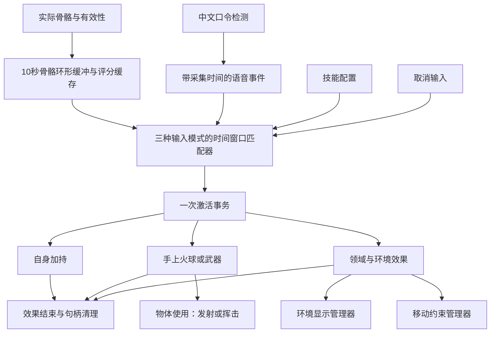

# 技能框架与释放交互：确定方案及调研依据

> 文档定位：架构基线与设计约束；文内早期方案不是自动实施指令。当前操作以[移动指南](../guides/ENCOUNTER_LOCOMOTION_ZH.md)、[火球指南](../guides/FIREBALL_TUNING_ZH.md)和[腕饰指南](../guides/WRIST_MENU_INTERACTION_DESIGN_ZH.md)为准；功能是否完成须核对源码、场景与带版本的验收。

> 当前 RPG 操作统一见[移动指南](../guides/ENCOUNTER_LOCOMOTION_ZH.md)、[火球指南](../guides/FIREBALL_TUNING_ZH.md)和[腕饰指南](../guides/WRIST_MENU_INTERACTION_DESIGN_ZH.md)。腕饰与输入仲裁已接入；多印、画符、领域及通用多效果事务仍未完成。下文保留技能架构与早期设计，不能将旧场景取消/前推规则套用于 LinearRpgTest。

日期：2026-10-29。状态：设计基线；已落地首个可运行切片，尚未完成本轮真人头显验收。适用于 NarutoVR 当前 Unity 工程。

2026-10-30 补充：实现状态统一见 [开发索引](../README.md)；摄像头演出采用[独立观众 Cinemachine＋Timeline 方案](CAMERA_PRESENTATION_DESIGN_ZH.md)，目前仍是设计。演出读取玩法结果，不接管玩家 XR 头姿或承担伤害/冷却结算。文中的早期目录规划不是待执行的重复建目录指令，现有配置从 [README](../../README.md) 进入。

三种触发模式、10 秒骨骼/评分缓存、双向 8 秒组合窗口、取消、手持火球和自身护盾已有实现。右手持有的雷光剑使用独立测试目录。它在挥动时创建一个直击 ID，供可选的剑身判定和头向剑波共用。剑波实际触敌后通过施法者冷却检查，再结算独立的落雷。多印序列、统一激活事务、领域、环境遮罩和移动约束仍处于设计阶段。[技能配置与雷光剑试用](../guides/CONFIGURATION_GUIDE_ZH.md#雷光剑与可选近战判定)

本方案依据用户最新要求修订：技能支持纯结印、纯咒语、二者组合；输入条件满足立即激活；加持直接生效；火球、武器默认生成到右手；技能可影响环境外观、遮挡和游戏移动范围。本文件取代《VOICE_GESTURE_RESEARCH_ZH.md》中统一“就绪后确认才施法”的旧提案，旧文件保留作调研记录。

## 1. 选定的框架

采用项目内的轻量、数据驱动技能框架：**ScriptableObject 技能配置 + 有界时间窗口匹配器 + 运行时技能实例 + 可撤销效果句柄**。沿用现有 Meta / XR Hands 骨骼与特征计算，不在本轮引入大型战斗框架、ECS 或第二套交互 SDK。

技能配置描述“怎么触发、对谁、做什么”；匹配器只决定一次输入是否满足配置；效果执行器负责生成物体、属性变化、环境和移动限制；效果实例负责持续、命中和清理。不同题材共用这套流程。



**激活与使用区分清楚：** 组合匹配成功即完成激活。加持已经作用自身、领域已经出现、火球已经生成到手里；火球之后发射是这个手持物的使用行为，不要求重新念咒或结印。所有技能不再统一增加推手、额外保持或确认按钮。单印识别本身仍保留去抖保持时间，不能把“立即”理解为任意单帧达标。

  ## 2. 三种触发模式

| 模式 | 完整触发条件 | 满足后 |
|---|---|---|
| `GestureOnly` 纯结印 | 完成该技能合法印序列，通过分数、覆盖率、歧义和保持检查 | 立即激活，无须等待语音 |
| `VoiceOnly` 纯咒语 | 检测到完整且唯一的技能口令 | 立即激活，不要求双手追踪；手上生成类仍须有当前可用的生成锚点 |
| `VoiceAndGesture` 组合 | 对应口令与合法印序列在时间窗口内匹配，两者先后不限 | 第二部分确认时立即激活 |

配置中的印可以是一个，也可以是短序列。先使用子、丑、寅已标定模板，不因引入咒语而把另外九个未标定印视为可用。

每技能只有一个明确的触发模式。以后若同一效果支持两套配方，可配置多个 Recipe，但都指向同一个 skillId，且同一批证据最多激活一次。首版不增加第四种含糊的“任意模式”。

### 2.1 输入冲突必须在配置阶段解决

纯结印 A 使用 `[子]`，组合 B 使用 `[子]+咒语B` 时，用户要求的“子完成立即触发 A”与“稍后再把这个子交给 B”存在意图冲突。系统无法预知之后是否会念咒。

首版决定：同一套已装备技能中，**禁止纯结印配方成为另一个技能合法印路径中可独立命中的连续片段**（包括前缀、结尾及相同整条路径），也禁止两个纯结印技能使用相同配方。K/N 配方先展开其合法短路径再检查。纯咒语口令同样禁止重复和完整口令包含冲突；例如完整口令 A 已包含在 B 中时，不能假装 A 会知道等到 B 说完。发现冲突在编辑器报错并禁止启用冲突配置，不能依赖列表顺序偷偷选一个。不同组合技能允许同印不同咒语。

如果未来一定要共享前缀，必须增加明确的技能选择上下文或接受等待窗口；那属于交互规则变更。当前保持立即触发的要求。

同一输入造成多个合格候选且仍无法区分时，显示“技能冲突，未释放”，不随机激活。按时间接近选择只能用于同一技能的多份候选证据，不能替代不同技能之间的消歧。

## 3. 骨骼缓冲与双向匹配

### 3.1 首版参数

| 参数 | 起始值 | 说明 |
|---|---:|---|
| 骨骼保留 H | 10 秒 | 只存在内存，循环覆盖；不是默认持续写文件 |
| 组合时间窗 W | 8 秒 | 用户提出的 5～10 秒范围内选定的默认值 |
| 最大语音结果延迟 L | 2 秒 | 超出先显示延迟错误并拒绝，不把晚到结果当新指令；需实测修订 |
| 采样上限 | 沿用 60 次/秒 | 按实际数据版本去重；10 秒最多约 600 条常规样本 |
| 单印稳定时间 | 沿用模板，当前通常 0.07 秒 | 始终要求连续新鲜有效样本，不拼接两个断裂片段 |
| 退出印再武装 | 初始 0.15 秒 | 有效追踪下离开该印；追踪丢失不算主动退出 |

这些是设计初值，不是实测最优值。默认满足 `H >= W + L`，让先结印再说话的历史不会在合理的语音延迟内过期。若把 W 调到 10 秒而 H 仍为 10 秒，就不能保证完整的迟到回查；编辑器应提示该配置不满足延迟预算，不能悄悄扩大逻辑时间窗。首版保留 H=10、W=8。

`SealFrame.time` 是应用生成快照时间，`observedAt` 是本地观察到手部版本更新的时间，不冒充硬件精确采集时间。音频事件记录音频样本时钟映射后的短句起止时间，以及回调到达时间。双方映射到同一单调时间基准，记录映射误差与音频设备重连；重连或重定位清空匹配上下文。

### 3.2 窗口定义与先后顺序

使用口令结束时刻 `vEnd` 作为语音匹配锚点；合法印序列有 `gStart`、`gEnd`，覆盖从第一个印的有效保持开始到最后一个印通过。完整短句自身有独立最大时长，首版可试 6 秒。匹配规则为：

```text
max(vEnd, gEnd) - min(vEnd, gStart) <= W
且：整条印序列合法、同一输入代次、未消费、未过期、质量通过
```

这保证整条印序列与语音锚点处在一个不超过 W 的区间，而不是前后各 8 秒拼成 16 秒的序列。语音回调到达时按这个时间关系回查，不能把到达时间充当玩家说话时间。

| 示例（W=8 秒） | 结果 |
|---|---|
| 先在第 0～0.1 秒完成印，第 5 秒说完对应咒语 | 收到合格语音结果时激活 |
| 第 0 秒说完咒语，第 5～5.1 秒完成对应印 | 印通过时激活 |
| 说话同时结印 | 条件全部确认即激活 |
| 第 0 秒说完咒语，第 9 秒才完成印 | 超时，不激活 |
| 第 -7 秒第一个印、第 +7 秒最后一个印，咒语在第 0 秒结束 | 总跨度超过 8 秒，不拼成一次技能 |

先手势：持续写入骨骼与分数；纯结印技能增量匹配立即激活；可用于组合技能的未消费印证据留在缓冲中。先语音：完整口令确定候选，先回查已有证据，若缺印，则等待至 `vEnd+W`。等待期间每个新骨骼样本都推进一次匹配，**不每帧反复反序列化整段 JSON**。

手势缓存保存原始骨骼、特征数值与质量，并缓存全部已标定印的分数；语音确定后按本次阈值重新形成合格区间，不能只回查旧阈值下已触发的识别事件。原始骨骼保留用于解释/重算，实时匹配优先使用数值缓存和有序区间索引。配置版本变化时使旧缓存失效。

### 3.3 只消费一次，不从旧手势无限施法

- 一个持续保持的物理动作是一个 poseEpisode，即使每帧都过线也只有一次完成事件。
- 追踪中断后恢复同姿态不产生新 episode；必须看到有效的主动退出/姿态转换，再允许同印重新进入。
- 区间证据包含 episodeId、样本版本范围和输入代次。降低阈值重算不得把同一个动作换个事件 ID 再用一次。
- 成功激活后消费此次语音和印证据，推进输入代次、清掉其他未完成组合，防止旧印在下一个口令中被重复使用。效果实例继续运行，不受输入缓冲清理影响。
- 冷却或资源不足的尝试明确失败并作废其证据，不等冷却结束后自动补放。失败后需新输入。
- 连续同印序列如 `[子,子]` 要求中间主动退出；`[子,丑,寅]` 的 K/N 匹配保留顺序、不同事件和配置要求的收尾印。
- 一帧出现取消与新激活条件时，先处理已确认的取消。晚到且属于旧输入代次的语音回调丢弃。

## 4. 取消、说错与结错

### 4.1 选定两种免控制器取消方式

1. 语音固定短句 **“取消施法”**，在训练/战斗输入中保留，不可用作技能口令。
2. 备用动作：**双手张开、分开并保持约 0.5 秒**。作为独立取消检测器，初始腕间距下限约 0.35 米；需有效外露手指与双腕数据，并在头显上验证舒适范围。取消动作与技能配方禁止冲突。

PC 调试另提供 Escape；头显菜单提供明确取消按钮作为非语音备用。具体动作阈值待上机，不承诺手部完全丢失时手势取消仍可用。语音取消、应用退出和超时不依赖骨骼可用。

### 4.2 取消按当前状态生效

| 当前状态 | “取消施法”作用 |
|---|---|
| 正在等待咒语/印 | 清空未完成组合和可匹配历史，递增代次；提示“已取消，请重新输入” |
| 已有未发射火球/手中武器且没有待匹配组合 | 收起当前手持技能物体，结束其效果句柄 |
| 无待匹配、无手持物，有自己最近创建且允许取消的持续效果 | 结束该效果；领域恢复显示并撤销自己创建的范围约束 |
| 已造成伤害、已完成瞬时治疗 | 不回滚既成结果；取消只影响尚未完成/可结束的部分 |

多个效果并存时，通用取消顺序固定为“待匹配输入 → 当前手持物 → 最近的可取消自有持续效果”，HUD 显示本次取消的对象。命名指令如“收起武器”“解除领域”可作为后续扩展。玩家不能用取消自己的施法来解除敌方施加的定身或领域；来源与所有权必须保留。

取消输入后即使手还保持原印，也必须主动退出再重新摆印，不会清空后立刻重新激活。取消不退还已成功激活技能的消耗或冷却；匹配阶段没有扣费。开发测试可单独提供重置，不混进正式规则。

### 4.3 错误输入策略

- 分数不足、遮挡、自然过渡：不计步，显示原因，窗口内允许重新摆。不要每个失败帧都取消整次施法。
- 稳定识别到错误印：提示“当前需要寅，检测到丑”，不计为正确步骤；可重摆或取消。多步序列按允许路径重新匹配连续的有效印事件，不能跳过夹在中间的其他已确认错误印；未确认的过渡不算错误步骤。
- KWS 没检测到完整口令：只能提示“未识别到技能口令”，不能编造用户说错了哪个字。需要逐字纠错才另外引入 ASR。[KWS 官方说明](https://k2-fsa.github.io/sherpa/onnx/kws/index.html)
- 已确认组合口令 A、等待印时，又收到另一个完整口令 B：将其视为显式更正，取消 A，建立 B 的新候选，并清除旧手势证据；提示“已切换 B，请重新结印”。首个口令仍支持先印后咒，覆盖旧候选这个特殊路径要求重结，避免旧错误意图被补齐。B 若为纯咒语则按模式立即激活。
- 错念成另一个真实的纯咒语技能，或错印恰好满足另一个纯结印技能，会立即触发那个技能。系统无法从合法输入判断“本来想用另一个”，通过口令/印配方区分、装备配置和清晰反馈降低风险。
- 立即激活与“任何时候都能在生效前反悔”不能同时保证。取消识别晚于瞬时效果时，不伪装可以撤销已经结算的伤害。

## 5. 技能成功后的行为

### 5.1 自我加持

输入匹配成功即给施法者创建 BuffEffect，例如护盾、增伤或移动速度修正。瞬时治疗立刻结算；持续加持有持续时间与可撤销修饰器。相同来源默认刷新持续时间、不重复叠层；需要叠层的技能显式配置层数上限。

属性使用“基础值 + 活跃修饰器列表”计算；效果结束只移除自己的修饰器，不使用“结束时减掉当初加的数”来恢复，避免多个增益重叠后数值损坏。表现与数值绑定同一 effectHandle。

### 5.2 火球：立即生成在手上

默认 `spawnHand=Right`；可在配置中选择 Left，首版不根据左右追踪质量自动换手。

激活先验证当前右手锚点有效、手槽空闲、资源充足；原子提交后创建火球，挂在右手 `CastSocket`，进入 `Held`。生成位置用**当前**手腕/掌部姿态与偏移，不能用 8 秒前的历史坐标。原手印不再需要持续保持。

第一版物体使用方式选定为：**持球手轻推发射，头向准星辅助瞄准**。只观察持球手的新有效动作，左手可以自然放松。生成后重建基线，不把结印时已经发生的移动回放成发射。初始可试 0.15～0.6 秒内前伸 0.12 米，实际阈值与身体运动过滤必须上机调试。提交发射后确定出生点/方向，解除手部跟随，进入 Flying；碰撞或寿命结束后销毁/回收。

```text
技能激活 → Held（手上已出现火球）→ 轻推 → Flying → Hit / Expired
                             └→ 取消 / 持有超时 → Dissolved
```

持有上限初始 10 秒。手部短时丢失时关闭伤害和发射判定、隐藏手持模型；不展示悬停旧位置为真实手位。约 0.5 秒内恢复可重新定位并重建动作基线，超过则消散。发射后的火球不依赖继续追踪手。

纯咒语或历史匹配虽然可在当前手部丢失时完成，但若技能需要生成到手且锚点不可用，则本次激活失败，不扣资源、不使用旧手位、不自动换左手；提示“右手未追踪，请重试”。此处是效果执行前置条件，不要求纯咒语额外做印。纯咒语的自身加持可正常生效。

手槽已占用时新手持技能明确失败，不覆盖原武器、不偷偷排队；提示先收起。非占手加持可以与手持物并存。

### 5.3 武器召唤

匹配即在指定手槽生成并附着武器；首版为手腕锚点驱动的魔法武器，不要求在手追踪中持续捏合。挥动触发的伤害另设攻击窗口与目标去重，不能每个 OnTriggerStay 都扣血。取消收起；释放、双手交换与物理投掷留作后续交互扩展。

这与现有输入能力一致：`SnapshotHand` 的 pinch 接口当前返回固定 false/0，不能假设已经能直接拿它做可靠抓握。

### 5.4 领域与环境变化

匹配成功立即创建一个 DomainInstance，包含固定在世界/房间中的作用范围、视觉效果请求和移动约束请求。领域中心默认取激活时玩家地面投影位置；无有效地面时按技能配置使用训练场固定地面或明确失败，不能跳到任意历史点。

一个技能可同时包含 `EnvironmentEffect + ConfinementEffect + BuffEffect`。生命周期统一，结束、取消、切场景或异常都释放各自句柄。领域不会每帧随玩家平移，否则约束区域会被玩家带走。

## 6. 环境遮罩采用三层设计

用户的“环境遮罩”先同时覆盖以下三种需求，避免一个 bool 承担所有渲染语义：

| 通道 | 改变什么 | 第一版落点 |
|---|---|---|
| 透视外观 | 真实环境画面的亮度、饱和度、整体透明度 | `IEnvironmentPresentation` 的 Quest 原生适配器调用当前 SDK 的公开接口 |
| 虚拟领域 | 领域壳体、天空/雾、替换环境、特定区域可见性 | 独立渲染对象、材质/遮罩参数；按实际 Shader 和渲染路径验证 |
| 真实物体遮挡 | 真实墙、桌子、手是否遮挡虚拟物体 | 可选深度遮挡与 MRUK 场景几何，独立于透视外观 |

本地 Meta Core 207.0.1 中 `OVRPassthroughLayer.textureOpacity` 与 `SetBrightnessContrastSaturation()` 已存在，但这不证明当前 SteamVR 运行时支持相应功能。当前 manifest 未声明 MRUK 或 XRI；不为写方案擅自安装它们。

官方 MRUK 样例有房间换肤、EffectMesh、透视光照等，可作为环境实现参考。[MRUK 官方仓库](https://github.com/oculus-samples/Unity-MRUtilityKitSample)

Depth API 的深度遮罩可让指定网格不再参与遮挡；**它不会从透视画面擦掉真实墙壁，也无法显示真实墙后景象**。虚拟领域覆盖、真实图像外观和深度遮挡必须分别设计。[Depth API 官方深度遮罩示例](https://github.com/oculus-samples/Unity-DepthAPI#11-depth-masking)

旧 `AddSurfaceGeometry` / `projectionSurfaceType` 路线不选：Meta 已把 surface-projected passthrough 标记为 SDK v83 起弃用。新方案围绕当前支持的透视层和虚拟表现适配，不照搬旧教程。[Meta 官方弃用说明](https://developers.meta.com/vr/documentation/unity/unity-customize-passthrough-surface-projected-passthrough/)

### 6.1 多技能叠加与恢复

只有 `EnvironmentEffectManager` 写最终环境状态。每效果登记 `{handle, owner, channel, priority, startSequence, parameters}`，结束只撤销自己的请求。

- 首版同一视觉通道采用确定性的最高优先级覆盖，同级以较新实例优先；不支持无限材料叠加。
- A 改暗环境，B 展开领域，B 结束时重新计算仍活跃的 A，不恢复到 B 启动前保存的一个旧快照。
- 真实深度遮罩由管理器按网格引用计数合并；撤销一项不能误移除另一技能仍在使用的网格。
- 地面定位提示、边界提示和暂停反馈高于玩法视觉覆盖。
- 不支持所需平台能力的技能：可选视觉效果走显式降级；标为必需的效果在激活前拒绝。不能先扣费再留下无视觉边界的限制区域。

Steam Link 首先验证虚拟训练场环境替换；真实透视和深度遮挡以 Quest 原生包实测为准。官方 Passthrough over Link 文档描述的是 Meta Horizon Link，不能由它推导 Steam Link 支持相同功能。[官方 Link 说明](https://developers.meta.com/vr/documentation/unity/unity-passthrough-use-over-link/)

## 7. 范围限制的确定规则

`LocomotionConstraintManager` 统一校验所有游戏位移请求，包括连续移动、传送、冲刺、技能位移和击退。范围采用世界空间圆柱/多边形区域；连续移动检测运动路径并停在边界，传送落点须在允许区。需要防穿越的领域还检查传送路径/入口规则，不能只判断落点。约束适用目标、来源和有效时长明确记录。

多个允许区域同时作用时取交集；交集为空不能强拉相机或不断瞬移。首版拒绝新加的矛盾约束，并报告区域冲突。环境视觉可以按优先级覆盖，但移动约束不能因看不见就失效。敌方领域的范围规则不可由玩家“取消施法”解除。

**真实走动与游戏移动分别处理。** 玩家真实身体仍可越过虚拟边界；不冻结相机、不停止 HMD 跟踪、不用强制反向移动镜头假装墙挡住身体。越界后显示边界与返回方向，暂停战斗交互；MR 能力可用时减弱玩法遮罩露出现实环境。玩家回到合法范围后恢复。系统安全边界不是技能可改写的游戏区域。

这一区分与 XRI 对 XR Origin 位移请求的管理、XR Origin 下相机真实追踪的结构一致；采用约束入口思想，不代表本项目已安装 XRI。[Unity Locomotion](https://docs.unity.cn/Packages/com.unity.xr.interaction.toolkit@3.1/manual/locomotion.html)、[Unity XR Origin](https://docs.unity3d.com/Packages/com.unity.xr.core-utils@2.2/manual/xr-origin-reference.html)

## 8. 代码模块与数据契约

建议新增目录 `Assets/`。以下名称为设计接口，不表示现有实现：

| 模块 | 输入/输出与职责 |
|---|---|
| `SkillDefinition` SO | 稳定 skillId、Recipe、资源/冷却、EffectDefinition 列表；仅共享配置 |
| `HandEvidenceBuffer` | 深拷贝骨骼与紧凑特征/分数，固定容量环形缓冲；记录配置版本/追踪原点代次 |
| `GestureEpisodeMatcher` | 把有效评分区间形成一次物理动作证据；支持按技能阈值重判和序列路径 |
| `VoiceIntentSource` | 完整口令事件、采集起止/到达时间、utteranceId；队列回主线程，保留取消指令 |
| `SkillInputMatcher` | 三模式匹配、时间窗口、单个待补齐语音候选、冲突/超时/取消 |
| `AbilityRuntime` | 当前玩家资源、冷却、手槽、激活事务与一次性消费账本；不放到共享 SO |
| `EffectInstance` / `EffectHandle` | 来源、目标、持续时间、取消权限、句柄和清理；支持幂等结束 |
| `HandSpawnService` / `HeldSkillObject` | 当前左右手锚点、物体生成、手槽占用、持有/使用/消散 |
| `EnvironmentEffectManager` | 统一仲裁透视、虚拟环境、深度遮挡的请求与恢复 |
| `LocomotionConstraintManager` | 所有游戏位移统一经过约束判定；真实越界提示与暂停 |
| `CastHUD` / `CastTraceRecorder` | 输入历史时间条、当前技能与拒绝原因、效果清单和结构化日志 |

核心数据：

```text
InputRecipe: mode, phraseIds, allowedSealPaths, matchWindow,
             perSealThresholdFloor, voiceDiscount, requiredFinalSeal
Evidence: actorId, inputEpoch, sample/episode/utteranceId,
          timeStart, timeEnd, arrivedAt, quality, scores, configRevision
Activation: activationId, skillId, actorId, evidenceIds, committedAt,
            selectedHand, currentSpawnPose, effectHandles
EffectInstance: handle, sourceActivation, sourceActor, target,
                startTime, endTime, stackPolicy, cancelPolicy, lifecycle
```

`TryActivate` 先校验当前状态、资源、冷却、能力支持、手槽和当前锚点；预备全部必需效果成功后，同一主线程事务提交消费/扣费/冷却并激活效果。预备或提交失败则回收临时对象和注册请求、撤销该事务的资源变更，显示明确失败；失败输入作废，避免恢复后突然补放。伤害等不可逆结算只允许在成功提交后发生。

同一 activationId 不能提交两次；效果结束和场景卸载清理可以重复调用但只能移除一次。持有阶段的正常取消不退款；事务执行失败与玩家取消分开。

时间分两类：输入窗口使用单调实时时间；加持、领域与冷却使用统一游戏时钟。首版单机暂停时清除待匹配输入与未发射手持物，冻结游戏时钟，暂时让暂停/现实环境提示覆盖领域视觉；恢复时按仍有效的效果实例重新合成环境。暂停不等于移除敌方状态。切场景或销毁整场战斗时再统一结束全部实例并释放句柄。未来联网时暂停与效果时间须由权威战斗端重新定义，不能直接沿用本地冻结。

### 8.1 对现有代码的最小改动

| 已核对代码 | 事实 | 接入要求 |
|---|---|---|
| `SealLab.cs:66–90,113–149,192–199` | 有 Frame/Features/Scores；事件只给 SealProfile | 增加采样完成输出和稳定 sampleId，发布只读快照；原实验台保留 |
| `SealRecognizer.cs:23–52` | 重算列表、保持与拒绝；拒绝清空候选 | 不直接拿识别恢复事件计新印；会话事件去重在上层完成 |
| `SealProfile.cs:97–119` | passes 使用模板全局阈值，required 仅检查缺失 | 将评分事实与本次通过策略分开；不改模板资产来临时降分 |
| `HandSnapshot.cs:8–47` | 姿态数组、逐关节有效性、版本、时间 | 环形缓存深拷贝数组；保存原点代次，历史姿态不用于当前生成 |
| `HandSnapshot.cs:101–107` | Pointer/PalmLocal/Pinch 部分接口未实现 | 不据此假定已支持抓握、捏合与射线 |
| `SealRecording.cs:9–44` | JSONL 流式写盘和离线读取 | 继续作为主动录制/回放，不用于每帧实时窗口匹配 |
| `SealRecognitionTest.cs:34–60` | Awake 创建并配置运行时模板副本 | 战斗场景配置入口统一，避免两个组件反复替换 lab.profiles |
| `Packages/manifest.json` | Meta 207.0.1、OpenXR 1.15.1、XR Hands 1.7.2、URP 17.3.0；未声明 MRUK/XRI | 新能力后续逐项验证，不重装现有追踪栈 |

当前原始数据格式按项目实际 Meta IHand 关节数读取，不假定外部统一 26 关节就等于本地数组布局。内存估算按关节数、两套姿态数组、质量标记和分数缓存计算并用 Profiler 验证；不直接保存 600 份带字符串的大型对象图。热路径采用预分配/池化槽位，消费者不能在槽位覆盖后继续持有其可变数组。

### 8.2 阈值规则

沿用 `effectiveThreshold = max(floor, baseThreshold - voiceDiscount)`，仅组合技能中已确认的对应语音有效。纯结印不获得无来源减免；纯语音不计算无意义的印分数。子印保留基础 75 分、禁用中指的现状。

覆盖率、真实追踪有效性和竞争印分差不因咒语自动降低；历史证据按当时的有效性评价，不能用当前姿态来“修复”过去缺失数据。联合模式同时保留其他已标定印的原始分数作消歧。界面展示匹配分数，不宣称它是正确概率。

## 9. UI 与调试

战斗 UI：当前口令/技能名、缺少的印或咒语、剩余等待时间、手上物体及使用提示、加持/领域剩余时间、冷却、取消结果。纯结印或纯咒语成功时直接提示生效，不显示不存在的第二输入要求。

调试 UI：最近 10 秒时间条（印区间、口令位置、已消费/取消区间）、原始分与本次阈值、覆盖率/歧义、语音延迟、输入代次、activationId、手槽占用、环境覆盖栈、当前移动约束。失败原因分为 Recognition、Matching、Activation、Effect 四层。

示例输出：

```text
[匹配] 火球术：口令已确认；命中 4.2 秒前的寅印，得分 78 / 阈值 75。
[激活] #42：右手生成火球，进入持有状态。
[使用] #42：轻推确认，已发射。
[未通过] 护盾：子印 69 / 75；主要扣分：双腕前后偏移。
[取消] 等待中的领域已清除；旧印缓存不可继续匹配。
[激活失败] 火球术：右手槽已占用；未扣资源，请先收起武器。
```

按状态变化和限频打印，不在每帧刷相同失败。录制保存骨骼 JSONL 与配套施法事件日志，记录配置版本；默认不自动持久化麦克风音频。回放应在不访问真实麦克风/手追踪的情况下复现同样匹配结果。

## 10. 参考调研与采用范围

| 一手来源 | 核查事实 | 本项目采用/限制 |
|---|---|---|
| [Unity ScriptableObject](https://docs.unity3d.com/6000.1/Documentation/Manual/class-ScriptableObject.html) | 可作为共享配置资产，构建中可读已保存配置 | 技能定义用 SO，运行时状态用实例；不把 SO 当玩家存档 |
| [sjai013 Unity GAS](https://github.com/sjai013/unity-gameplay-ability-system) | Ability 静态配置/运行实例、Effect、Tag 分工；2022-08-13 已归档 | 借鉴职责与生命周期，不作为本项目必须安装的依赖，也不声称 Unity 6 已验证 |
| [QuickSet 多模态论文](https://aclanthology.org/P97-1036/) | 讨论独立识别后按语义与时间约束整合输入 | 借鉴事件层融合；8 秒窗口是本项目玩法选择，不是论文证明的通用最优值 |
| [sherpa KWS](https://k2-fsa.github.io/sherpa/onnx/kws/index.html) | 检测配置中的词句，支持触发参数 | 技能/取消口令入口；不承担任意句子的逐字纠错 |
| [MRUK Sample](https://github.com/oculus-samples/Unity-MRUtilityKitSample) | 房间可视化、换肤等；当前 README 要求 Unity 6000.0.66f2+ | 作为 Quest 原生环境功能参考；需对齐 SDK，并验证本项目渲染管线 |
| [Depth API](https://github.com/oculus-samples/Unity-DepthAPI) | 硬/软遮挡和深度网格排除 | 作为可选遮挡适配器，不等同擦除现实图像 |
| [Meta 透视弃用说明](https://developers.meta.com/vr/documentation/unity/unity-customize-passthrough-surface-projected-passthrough/) | surface-projected passthrough 自 v83 在 SDK 层弃用 | 避开旧几何投影接口 |
| [Unity XRI Locomotion](https://docs.unity.cn/Packages/com.unity.xr.interaction.toolkit@3.1/manual/locomotion.html) | 位移 Provider 经中介对 XR Origin 施加变换 | 借鉴统一约束入口，不冻结真实头部追踪，不要求当前安装 XRI |

公开资料证明能力与设计先例，不构成本项目组合兼容性、延迟、帧率或设备支持的验收。本轮未克隆/导入上述项目，也未运行它们。

## 11. 落地顺序与验收

1. 实现骨骼环形缓存、带时间的模拟语音输入、三模式匹配与取消；用现有录制回放验证，不接真实伤害。
2. 新建独立技能训练场，配置纯结印加持、纯咒语加持、组合火球、武器召唤四个测试配方；自动检查触发冲突。
3. 加入右手默认生成、持球单手轻推、手槽占用、取消消散；检查资源和事件只结算一次。
4. 接入真实中文 KWS 与取消口令，测先后顺序和延迟；支持倒计时测试，用户双手不必操作电脑。
5. 加入一个虚拟领域验证环境覆盖栈与移动约束，随后在 Quest 原生验证透视/深度遮挡能力。

必须通过的情形：

- 三种模式分别成功，纯咒语自身加持不因双手丢失而拒绝。
- 先印后咒、先咒后印、同时输入；窗口边缘、迟到超预算、重复回调、样本掉帧。
- 降阈值能找回原本低于全局阈值的有效历史区间，但不能把短暂过线/低质量数据算成功。
- 同印持续保持、追踪恢复、冷却结束和取消后旧语音均不重复激活。
- 同一动作或语音不被多个技能重复消费；同印配方/口令前缀冲突在配置阶段报错。
- 窗口内结错可重试；中间稳定错误印不被当作可任意跳过的噪声；新口令覆盖旧候选行为与 UI 一致。
- 取消优先级和对象明确；不能取消敌方约束，也不假装回滚已发生伤害。
- 右/左手配置正确；当前锚点缺失、手槽占用不扣费、不偷换手、不引用旧位置。
- 自身增益重叠/刷新/结束正确；两层环境效果以不同顺序结束仍正确恢复。
- 约束涵盖传送、冲刺、连续移动；真实走出范围不冻结相机；矛盾区域明确失败。
- 效果预备失败、场景退出、暂停、重连和重定位不会遗留物体、环境覆盖或约束句柄。
- 投射物路径命中不穿墙，武器/范围多个 Collider 不导致重复伤害。

本轮交付仅为文档和来源核对。父代理完成本地源码核对、架构及验收条目；后台研究代理仅查公开资料，父代理已复核关键出处。Antigravity 本地源码委派被自动审批拒绝，未执行该外部代码核对。
