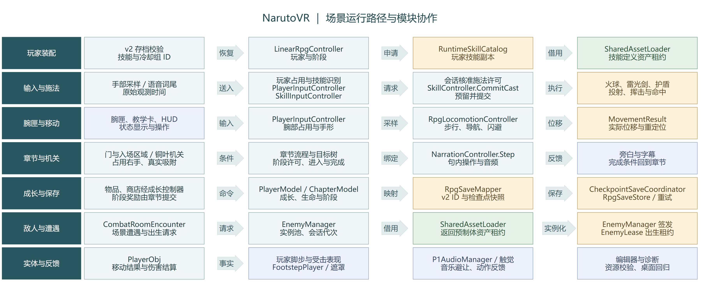
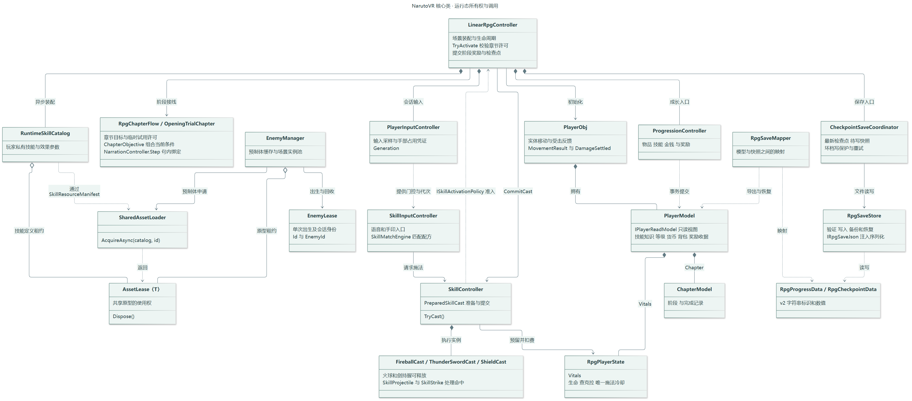

# NarutoVR 目标模块图与核心类图

图中列出正式首章、训练场和敌人池实际使用的模块与核心类型。首章从 v2 恢复玩家状态，按稳定 ID 取得配置引用，就绪后开放输入。章节目标与旁白的绑定顺序见[章节接线图](FULL_MODULE_MVC_REFACTOR_PROPOSAL_20261109_ZH.md#首批实施的章节模块图)。

## 一、模块图

[打开矢量模块图](diagrams/TARGET_MODULES_20261110.svg) · [可编辑图源](diagrams/TARGET_MODULES_20261110.mmd)

图中的实线表示提交请求、读取或装配，虚线表示报告已经发生的事实。按职责分组后，图中只保留读懂主要路径所需的连线。各模块可以通过会话装配取得依赖。

模块之间有三种会影响玩法的交互。输入提交“想做什么”，拥有状态的模块同步返回“是否成功”，其他模块消费“已经发生什么”。例如玩家用雷光剑击中训练靶，技能模块负责识别挥动，目标结算伤害，章节依据有效命中推进，视听模块播放相应反馈。腕匣读取可见技能和许可原因，资源加载完成只表示相应内容可供使用。

### 在 Unity 中找到这些模块

在 `Chapter01_Awakening`、`KaogongP1Trial` 和 `LinearRpgTest` 展开 **RPG 会话与玩家**。根上保存两个业务脚本。选中 `LinearRpgController` 可以查看当前章节、技能、导航及玩家基础定义的绑定。选中 `PlayerObj` 可以找到玩家实体入口。运行时会话还会创建受击接收器等组件。

| 子物体 | Inspector 中的组件和内容 |
|---|---|
| 移动与导航 | 三个场景各有一个 `RpgLocomotionController` 和 25 个庭院导航点。首章还在此配置玩家脚步 |
| 章节与训练 | 三个场景的 `TrainingTargetGroup` 管理练习靶。P1 与训练场在此挂 `TrainingChapterFlow`。训练场另挂红圈攻击 `RpgTrainingHazard`。首章的 `OpeningTrialChapter` 由会话直接引用，也显式引用本组训练靶 |
| 成长与物品 | 三场景都配置 `RpgSkillShop`。首章的 `RpgItemInventory` 由铜叶机关和章节共同引用 |
| 界面与交互反馈 | `RpgSessionView` 和 `RpgInteractionFeedback` 共用此物体，世界状态面板在其下 |
| 场景音频与触觉 | 首章和 P1 在此配置 `P1AudioManager`、`HapticFeedbackService`。训练场仅配置前四组 |

各章节通过 `RpgChapterFlow.sceneGuidance` 选配 `ChapterSceneGuidance`。提示组件读取阶段 ID 和当前目标，管理场景物体显隐及高亮。普通目标章节可按阶段指定目标，首章则在击靶台词开始时指定目标。[章节配置与首章旁白位置](../guides/CHAPTER_FLOW_ZH.md#配置章节场景提示)

## 二、核心类图

[打开矢量类图](diagrams/TARGET_CLASSES_20261110.svg) · [可编辑图源](diagrams/TARGET_CLASSES_20261110.mmd)

Core、Persistence、Runtime 和 Editor 分别编译。场景中的 UI 和控制器同属 Runtime，HUD、腕匣经只读玩家接口查看进度与数值。图中区分共享原型、每个玩家的状态和一次施法或出生的实例。沿着持有关系可以找到负责释放的对象。

正式施法从 `SkillInputController` 进入 `SkillController.Cast`，由 `LinearRpgController` 实现的 `ISkillActivationPolicy` 检查当前章节和玩家许可，再调用 `SkillController.CommitCast`。后者准备效果、向玩家状态预留查克拉和冷却，确认后才执行效果。会话也协调阶段奖励和检查点提交。

| 设计问题 | 唯一负责方 | 对调用方意味着什么 |
|---|---|---|
| 这个 ID 对应哪份资产，何时能释放？ | 共用加载器按选定内容目录解析，消费者持有租约 | 参数是类型及稳定字符串，如技能定义和 `thunder.sword`。共享原型可复用，本玩家的等级参数在装配时派生 |
| 玩家拥有或能试用什么？ | PlayerModel 持有已了解、已解锁、等级、物品及冷却。ChapterModel 提供阶段事实，RpgChapterFlow 判定当前许可 | 两个玩家可引用同一份技能定义，但拥有不同等级和施法资格。试用结束后仍可有其他模块持有该资产 |
| 谁管理施法、命中与清理？ | SkillController 接收请求，具体 Cast 管理动作和在途实例，目标实体结算受击 | 投出火球即可释放手部。球仍可命中、被墙挡住或随场景退出回收。玩家自身脚步和受击反馈由 PlayerObj 接线 |
| 谁提交奖励、写档和恢复？ | 章节完成用例协调 ChapterModel 与玩家成长的一次提交。RpgSaveMapper 导出 v2，CheckpointSaveCoordinator 管理最新快照与重试，RpgSaveStore 负责 v2 文件 | UI 和机关提交意图，内存成功后才发布事实。写盘失败重试最新快照，恢复时重新绑定资源引用 |
| 同一个敌人 ID 能否对应多只活怪？ | 加载器共享敌人原型，EnemyManager 持有实例池和每次出生租约 | `canjiou` 选原型，出生租约识别这一次出现的敌人。回收某只怪后仍可复用模型 |

## 三、用三条路径检查依赖

1. **玩家进入首章。** 会话先选择正式目录，准备玩家上限、合法技能及冷却组元数据，再验证 v2。已了解但尚未永久解锁的雷光剑，可以由当前阶段的试用许可加入本次装配。玩家拿到引用、应用等级、绑定匹配器后才接受新输入。正式场景中途加载失败可重试，原档保持可恢复。可在已有玩家对象上完成这套装配，也可在新生成对象上使用同一入口。[当前启动顺序](../../Assets/scripts/logic/Rpg/LinearRpgController.cs:124) · [试用规则](../../Assets/scripts/logic/Rpg/OpeningTrialChapter.cs:228)
2. **玩家收剑后切场。** 收剑时还回手部占用并关闭刃轨，已发出的剑波继续使用自己的飞行数据。离开场景时才终止该场景的在途实例、监听和租约，核对会话代次以丢弃迟到的加载结果。共享加载器可以继续服务下一个场景，已经消亡的对象不再接收回调。[收剑与清场](../../Assets/scripts/logic/Skills/Effects/ThunderSwordCast.cs:277) · [现有加载保护](../../Assets/scripts/logic/Enemies/Spawning/EnemyManager.cs:128)
3. **铜叶入匣并获得奖励。** 机关识别真实吸附，成长与章节规则核对当前阶段、物品 ID 和奖励收据，提交后再更新教学卡、旁白及存档。若资源准备期间玩家换了场景，迟到的预览图可以丢弃，已提交的奖励仍按保存协调者记录恢复。[成长与章节职责](PROGRESSION_RESPONSIBILITIES_ZH.md)

## 四、全局评估与落地次序

**共享加载器管理查找、等待和释放。** 正式目录与历史配置中均有 `fireball`。首章按当前清单解析类型与 ID，编辑器还会检查对应地址是否唯一、能否随包发布。v2 的合法技能范围由完整元数据确定，首版因语音匹配需要取得全部五份配方。更换资产文件名、显示名或打包地址时可以保留业务 ID。[资源设计与参考工程对照](FULL_MODULE_MVC_REFACTOR_PROPOSAL_20261109_ZH.md#81-全局异步资源目录与玩家装配)

Unity 6000.3.10f1 隔离 Play 覆盖旧 v2、正式试用、火球与护盾、两只敌人池共享原型以及首章 20 段与通关态的恢复。Quest/PICO 冷启动、切场峰值和首次施法帧耗时留待设备测量。[可复用的验收入口](../../Tools/Validation/run_skill_assembly.py)
