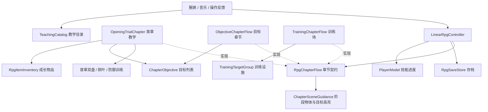

# 章节流程接入与首章解耦

所有 RPG 场景都显式绑定 `RpgChapterFlow`。章节通过这个入口接入阶段目标、临时技能许可和场景提示。本文同时列出普通目标章节的配置方法和正式首章的旁白位置。

## 职责

- `LinearRpgController` 负责角色、技能输入、阶段奖励、检查点和保存；从玩家基础定义初始化新角色的永久技能，从章节读取目标、阶段试用技能和最终检查点。
- `OpeningTrialChapter` 保留首章逐句教学、双盘解谜和入匣事件。专属接线检查移入其 `ValidateChapter()`，RPG 不再读取 `puzzle.leafId`。
- `ObjectiveChapterFlow` 给普通章节组合目标，不要求训练靶、铜叶、特定火球配方或首章旁白。
- `TrainingChapterFlow` 负责训练靶汇总、等待计时、推进落点及靶复位。首章与普通章节不会执行这条规则。
- 教学目录、技能进度、成长物品、商店、章节许可分别拥有自己的数据和规则，见[成长职责说明](../architecture/PROGRESSION_RESPONSIBILITIES_ZH.md)。

## 直接开场、从传送门入场与读档

| 入口 | 玩家状态和落点 |
| --- | --- |
| 通过首章庭院传送门 | 门接受切场时，采集当前玩家的气血、度力、剩余冷却、货币、永久技能和物品。二章沿用这份状态，从本章第一阶段和第一个检查点开始。目标场景已有的二章档不会抢占这次传送；成功落地后保存这次入章进度。 |
| 直接打开场景并进入 Play | 在玩家的 `LinearRpgController` →「进度与存档」中选择「默认读档来源」。勾选「直接开场时读取默认存档」会在开场时读取；取消勾选从当前场景第一检查点开始。若要专测二章又保留自动续玩，选「当前场景的存档」。 |
| 游玩中主动读档 | 桌面调试面板的「读取默认存档」及控制器组件菜单的「运行时读取默认存档」使用同一选择。若存档属于另一场景，先切到该场景，再恢复存档里的玩家状态和检查点。 |

正式章节支持本场景、最近正式存档、指定首章或二章。最近存档仅比较正式章节。训练场和专项样板的直接启动继续使用自己的存档。新存档记录完整场景路径，因此可以区分共用同一文件的首章苏醒与庭院。较早的首章存档没有写入场景身份，两景还共用相同的检查点；已在首章时留在当前首章场景，从其他章节读取旧首章档时回到苏醒。

## 配置普通章节

1. 保留通用 RPG 所需的玩家、技能、移动、手部和腕匣接线。在 `LinearRpgController.route`（阶段路线与检查点）按实际通关顺序配置，每行选择阶段资产和对应检查点。多个阶段可以共用一个检查点。RPG 的「玩家手部观测来源」引用实际手追组件，技能匹配、移动、腕匣和机关共用这份观测。正式 RPG 的技能输入组件将「独立场景骨骼来源」留空。
2. 添加 `ObjectiveChapterFlow`，其 `rpg` 指向该控制器，控制器的 `chapter` 指回流程组件。
3. 流程的 `stages` 每行选择一个路线中的阶段资产，再挂该阶段的目标。运行时以资产的稳定阶段 ID 对应路线，目标表行可以重排。每阶段至少一个目标，全部满足才过关，同一目标组件只能属于一处。
4. 到达目标使用 `ReachAreaChapterObjective`，绑定 `BoxCollider`。它检测脚底点是否在盒体局部范围内，支持旋转区域，不要求玩家碰撞器触发事件。
5. 机关或剧情信号使用 `SignalChapterObjective`，从实际成功事件调用 `Complete()`，也可通过 Inspector 的 UnityEvent 绑定。目标未运行或玩家不能行动时的信号会被忽略。
6. 在控制器「玩家基础定义」引用的资产中，向「起始永久技能」拖入本场景目录已收录的技能定义。这个列表只用于新建角色。章节的 `initialDiscoveries` 配置初始教学知识，每阶段的 `trialSkills` 配置临时追加的技能 ID。离开阶段会收回该阶段的试用，同时保留玩家已永久解锁的术。
7. 按需求设置最终检查点、阶段完成是否恢复生命/度力、探索脚步和世界导航刻线。无需物品、商店或教学资产也可正常运行。
8. 每个独立战役使用自己的 `saveFileName`，避免不同阶段目录互相覆盖。v2 存档核对已经完成的路线前缀和当前检查点。编辑已发布阶段的顺序、ID 或检查点前，需为受影响的旧档定义迁移。重排教学表或靶生命表的行不改变路线。

通用目标章节不需要添加训练靶组，但技能目录仍须满足技能系统自身的有效性校验。目标章节的阶段推进独占：旧的击破训练靶自动推进和手动 `TryAdvanceStage()` 不会绕过目标。

## 配置章节场景提示

在章节物体上添加 `ChapterSceneGuidance`，将其拖入章节流程的「章节场景提示」。这份配置引用场景中的物体，本章没有视觉提示时可以留空。

1. 在「按阶段显示的物体」添加提示牌、地纹或机关，填写它可见的阶段 ID。一个提示牌可以跨多个阶段显示。阶段 ID 对应 `RpgStageDefinition` 中的「稳定阶段标识」。
2. 在「可高亮的目标」中指定目标物体。要显示箭头或准星，填写「瞄准标记」。要改变外观，填写渲染器、高亮和常态材质。两种效果可以组合。
3. 普通章节在 `ObjectiveChapterFlow` 对应阶段的「本阶段高亮目标」拖入已在「可高亮的目标」登记的物体，或留空。接线时会检查两处引用是否对应。进入阶段、恢复检查点时会恢复这套显示，通关时收起提示。例如，两个阶段共用一块路牌，可以只配一次路牌，再让各阶段分别高亮入口和终点。

## 为阶段或教学步骤配置光点和手势

打开院落场景，选中「第一章 · 初醒校验室」。在 `OpeningTrialChapter → Sections` 展开一个阶段，「本段视觉引导」和超时语音的 `Hints` 在同一层。只想在一句台词要求操作时触发，就展开该阶段的 `Lines → 对应句 → 本句视觉引导`。本句可以单独覆盖路线或手势，留空的那一项沿用阶段配置。普通目标章节在 `ObjectiveChapterFlow → Stages → 本段视觉引导` 配置。新场景还需添加 `CourtyardTaskGuide`，拖入章节、光点材质、示范手模型、默认手形和手部材质。[院落场景](../../Assets/Scene/Chapter01_Courtyard.unity)

1. **铺路线。** 给场景物体添加「任务引导 / 光点路线」，把空物体放在可通行的地面和拐角，依次拖进「依次经过的地面点」。已有传送点的 Transform 也能复用。在阶段或本句的「光点路线」拖入这条路线，再指定「路线终点」。终点须是路线上的点，留空会走到末点。只有一个地面点时，光点会沿可通行的直线指向它。「开始指路前等待」填 0 即时显示，填秒数可延后出现。玩家需要先抵达区域才能开始对话时，把路线配在阶段上。
2. **放手势。** 在「手势提示」新增一项，把场景中希望指尖碰到的位置拖到「交互接触点」，选择动作预设。每项可以单独设触发距离、首次等待、演示时长和重复间隔。多个提示同时符合条件时，使用列表中靠前的一项。把正在运行的关卡目标拖进「等待完成的目标」，该目标完成时便会收手。双盘和铜叶另外指定自己的「交互状态条件」，用来选择当前该操作的部件。
3. **配一个按钮。** 在按钮表面放一个空物体，让它的本地正 Z 朝按入方向，同时拖入「交互接触点」和「位移参考系」，选择 `PressButton`。示范手会伸出食指，沿这个方向点按。这个例子可用于任意按钮。转动手柄时用 `TurnHandle`，另指定「旋转中心」。取物用 `LiftObject`，送入槽口用 `InsertObject`。要做新的动作，在 Project 中用「Create → 任务引导 → 手势动作预设」，可编辑手形动画、接触部位、位移、转角和手的朝向。[动作预设目录](../../Assets/ScriptableObjects/手势示范)

## 在首章定位旁白与提示

在 `Chapter01_Awakening` 的 Hierarchy 展开 **第一章 · 初醒校验室 → 教学步骤与旁白**。选中 `ROOM_WAKE` 可以编辑开场，`ROOM_WRIST` 是腕匣教学。每个阶段物体有自己的 `NarrationController`，Inspector 的「逐句配置」包含台词 ID、说话者、正文、音频文件名和推进条件。首章共有 20 段，`OpeningTrialChapter.sections` 将每个阶段与对应旁白关联。

在 **第一章 · 初醒校验室 → Inspector → Chapter Scene Guidance → 按阶段显示的物体** 中，`第二面侧靶` 的阶段 ID 为 `opening.ROOM_FIRE2`。要让副靶在其他阶段也出现，在同一项中追加阶段 ID。主靶在场景中默认启用。地纹、手印板、发射器、两个室外指引标记和巡逻角色也在这张表配置。

「可高亮的目标」配置主、副靶的准星和材质。击靶台词指定当前目标，换句时只更新准星和材质。靶体是否启用由阶段显隐表控制。

三扇实体门在各自解锁阶段的 `OpeningSection.doorOpenedOnCompletion` 配置。完成该阶段后，门在后续阶段和通关时保持打开，读档按已完成的阶段还原。把同一扇门再拖进阶段显隐表、目标标记或其他阶段的开门字段，会在配置校验时报告冲突。

## 实现新目标

继承 `ChapterObjective`，实现只读 `IsComplete`。需要订阅敌人或机关事件时，在 `OnBegin()` 注册，在 `OnEnd()` 解除。在事实改变时调用 `NotifyStateChanged()`。消费者先订阅 `StateChanged`，启动目标，再读取一次当前值。进入下一句、读档和停用时释放旧监听。

| 目标 | 状态来源和寿命 |
|---|---|
| `CompletedStageChapterObjective` | 查询玩家进度里的阶段 ID，已开内闸等阶段事实可从存档重建。 |
| `ClearedEncounterChapterObjective` | 读取指定遭遇本轮的清房结果，监听开启前已清房也能即时识别。 |
| `ReachAreaChapterObjective` | 每次读取都判定玩家当前脚底是否仍在局部盒内。越界、区域禁用或角色无法行动会使它失效。 |
| `SignalChapterObjective` | 本轮一次性成功，在 Begin 时清空。即时输入可调 `Complete()`，延迟来源在启动时通过 `CaptureCompletion()` 捕获属于本轮的回调。 |
| `CompositeChapterObjective` | `All` 要求全部子目标当前满足，`Any` 要求其中之一满足。开始时接管子目标监听，结束时逐个释放。配置验证拒绝空列表、空引用、循环和重复拥有同一组件。 |

入口条件只决定能否开始播放。首章进入残机偶试炼间使用组合，依据开内闸阶段的存档记录和玩家脚底是否在房内。句内操作也能绑定同一目标抽象，正式清房句只绑定遭遇目标。目标本身不需要知道一段旁白有几句。

一个目标可以有多个观察者。`StateChanged(ChapterObjective source)` 报告发生变化的那个目标，章节和 UI 均可订阅同一实例。只有绑定方管理它的 Begin / End，其他观察者读状态并在离场时解除自己的回调。组合监听自己的子目标，向外发送组合自身的状态变更。业务层已知目标实例时即可直接订阅。需要通过现有事件中心传递旁白操作时使用捕获的 `Step`，使排队的旧消息在重听或读档后失效。

只有当前绑定、启用且属于本 RPG 的章节能通过 `CompleteChapterObjective()` 提交。章节还须确认自己的运行阶段与 `StageIndex` 一致。保存与发奖集中在 RPG，目标实现不应自行追加完成阶段或发奖励。

## 现有场景的直接接线

| 场景 | 必填 chapter | 专属接线 |
|---|---|---|
| Chapter01_Awakening | OpeningTrialChapter | 段入口设在 `sections[].startCondition`，句内目标设在 `lines[].operationTarget`。试炼间接原有房间盒和清房遭遇，教学目录在腕匣。 |
| LinearRpgTest | TrainingChapterFlow | 同对象训练靶组、显式初始技能及自动推进配置 |
| KaogongP1Trial | TrainingChapterFlow | 同对象训练靶组；房间遭遇模式不通过练习靶推进 |

阶段切换与读档通知章节 `OnStageEntered()`，章节通过 `TrainingTargetGroup.ResetForStage()` 重建训练靶。手动推进统一委托章节，目标章节默认拒绝跳过目标。

通用 `RpgStageDefinition` 保留身份、阶段说明、战斗配置和奖励，训练靶生命在 `TrainingTargetGroup.stageHealth` 的每行按阶段资产填写。进入阶段时按 ID 取值。首章的 `sections` 和普通章节的目标表使用相同的身份规则。物品实际持有/激活来自通用 `items` 记录，阶段仅用于机关、门和导航状态。存档已改为 v2 和独立文件名，原文件保留、不自动迁移；详见成长职责说明。

## 中文注释阅读顺序

1. `RpgChapterFlow.cs`：章节必须提供什么，以及各能力的默认含义。
2. `ChapterObjective.cs`：Begin / End 生命周期，事件注册与释放的约束。
3. `ObjectiveChapterFlow.cs`：阶段、目标 AND 判定、读档重置及统一提交。
4. `TrainingChapterFlow.cs`：训练靶规则独立实现，落点确认后再提交。
5. `PlayerModel.cs`、`ProgressionController.cs` 与 `RpgItemInventory.cs`：通用知识/解锁和物品奖励；教学内容另见 `TeachingCatalog.cs`。
6. `OpeningTrialChapter.cs`：首章独有的逐句教学与机关协调。

核心类型、公开契约、配置字段和生命周期均有中文 XML `///` 文档注释，继承实现使用 `inheritdoc` 引用契约。

## 范围与后续

这是章节扩展入口与成长配置的拆分。首章内部的 `OpeningAction`、逐句事件和专属机关仍保留；普通目标章节不自动提供字幕、旁白压低或逐句教学。需要这些能力时可实现契约中的 `Speaking`、`ReplayGuidance()`，或复用 `NarrationController` 做专门章节流程。

商店现由 `RpgSkillShop` 和商品目录提供，RPG 无具体火球升级/隐藏术式购买入口。没有引入跨场景连续战役迁移或通用剧情编辑器。

## 验证入口

`ChapterFlowChecks.RunBatch()`、`TrainingChapterChecks.RunBatch()` 和 `ProgressionIntegrationChecks.RunBatch()` 仅在 D:/Temp 下的隔离 Unity 工程以 batchmode 运行。分别覆盖普通章节（含模块规则检查）、训练场及首章物品/商店/授权的协作。使用唯一 probe 档，不运行在正式编辑器中。

可用 `Tools/Validation/run_skill_assembly.py` 的 `--phases fight-entry` 在隔离工程复验双靶至试炼间的正式路径。单目标、组合、停播、重听和连续条件用 `NarutoVR.SealCombat.Editor.ChapterObjectiveBindingChecks.RunBatch`。2026-11-10 的桌面报告位于 `Logs/chapter-flow-canal-20261110/`，2026-11-08 的职责拆分基线位于 `Logs/responsibility-refactor-20261108/`。头显双目和真人全章通关待验。

四处室外段入口已使用各自的 `ReachAreaChapterObjective`。句内目标勾选“首次达成即记住”时，玩家到达一次就能保留已完成的操作，随后可以离开。试炼间的持续条件在音轨结束前仍会复查。双盘的转角、松手及稳定时长由 `DiscAlignmentState` 计算。
