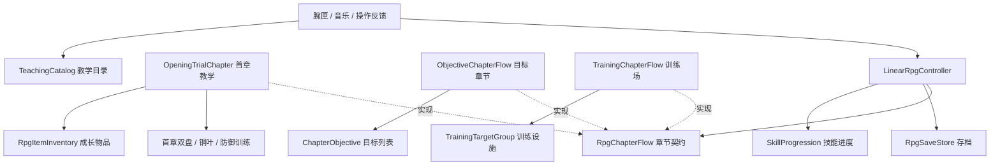

# 章节流程接入与首章解耦

2026-11-08。所有 RPG 场景必须显式绑定 `RpgChapterFlow`。现有场景、独立教学/物品/商店资产及生成器已经直接迁到新结构；运行时不保留旧字段别名或成长兼容壳。验证结果以本任务最新交接记录为准。

## 职责

- `LinearRpgController` 负责角色、技能输入、阶段奖励、检查点和保存；通过 `chapter` 获取当前目标、临时技能、初始技能、最终检查点和章节能力。
- `OpeningTrialChapter` 保留首章逐句教学、双盘解谜和入匣事件。专属接线检查移入其 `ValidateChapter()`，RPG 不再读取 `puzzle.leafId`。
- `ObjectiveChapterFlow` 给普通章节组合目标，不要求训练靶、铜叶、特定火球配方或首章旁白。
- `TrainingChapterFlow` 负责训练靶汇总、等待计时、推进落点及靶复位。首章与普通章节不会执行这条规则。
- 教学目录、技能进度、成长物品、商店、章节许可分别拥有自己的数据和规则，见[成长职责说明](../architecture/PROGRESSION_RESPONSIBILITIES_ZH.md)。

## 配置普通章节

1. 保留通用 RPG 所需的玩家、技能、移动、手部和腕匣接线。在 `LinearRpgController.stages` 配置阶段，在 `checkpointNodes` 配置同数量检查点。
2. 添加 `ObjectiveChapterFlow`，其 `rpg` 指向该控制器，控制器的 `chapter` 指回流程组件。
3. 流程的 `stages` 与 RPG 阶段顺序对应，每阶段至少放一个目标。多个目标必须全部满足才过关；同一个目标组件不能重复用于不同阶段。
4. 到达目标使用 `ReachAreaChapterObjective`，绑定 `BoxCollider`。它检测脚底点是否在盒体局部范围内，支持旋转区域，不要求玩家碰撞器触发事件。
5. 机关或剧情信号使用 `SignalChapterObjective`，从实际成功事件调用 `Complete()`，也可通过 Inspector 的 UnityEvent 绑定。目标未运行或玩家不能行动时的信号会被忽略。
6. 设置 `initialSkills`（永久初始技能）、`initialDiscoveries`（初始了解的技能），按阶段设置 `trialSkills`（临时授权）。教学目录单独绑定在腕匣；物品与商店按需添加独立组件。
7. 按需求设置最终检查点、阶段完成是否恢复生命/度力、探索脚步和世界导航刻线。无需物品、商店或教学资产也可正常运行。
8. 每个独立战役使用自己的 `saveFileName`，避免不同阶段目录互相覆盖。保持已发布阶段 ID 和初始技能配置稳定，修改时需要明确存档迁移策略。

通用目标章节不需要添加训练靶组，但技能目录仍须满足技能系统自身的有效性校验。目标章节的阶段推进独占：旧的击破训练靶自动推进和手动 `TryAdvanceStage()` 不会绕过目标。

## 实现新目标

继承 `ChapterObjective`，实现 `IsComplete`。需要订阅敌人或机关事件时，在 `OnBegin()` 注册，在 `OnEnd()` 解除；`OnEnd()` 必须可以重复执行。开始和恢复阶段都会重新 Begin，运行状态不写进存档。

异步操作的实现需要自行取消旧请求或检查本轮令牌，不能把旧一轮迟到的回调直接当成新一轮的完成。`SignalChapterObjective` 只检查当前是否运行，不能识别外部异步事件属于哪一轮。

只有当前绑定、启用且属于本 RPG 的章节能通过 `CompleteChapterObjective()` 提交。章节还须确认自己的运行阶段与 `StageIndex` 一致。保存与发奖集中在 RPG，目标实现不应自行追加完成阶段或发奖励。

## 现有场景的直接接线

| 场景 | 必填 chapter | 专属接线 |
|---|---|---|
| Chapter01_Awakening | OpeningTrialChapter | 物品模块、训练设施及永久技能校验门槛；教学目录在腕匣 |
| LinearRpgTest | TrainingChapterFlow | 同对象训练靶组、显式初始技能及自动推进配置 |
| KaogongP1Trial | TrainingChapterFlow | 同对象训练靶组；房间遭遇模式不通过练习靶推进 |

阶段切换与读档通知章节 `OnStageEntered()`，章节通过 `TrainingTargetGroup.ResetForStage()` 重建训练靶。手动推进统一委托章节，目标章节默认拒绝跳过目标。

通用 `RpgStageDefinition` 保留身份、阶段说明、战斗配置和奖励，训练靶生命已移至 `TrainingTargetGroup.healthByStage`。物品实际持有/激活来自通用 `items` 记录，阶段仅用于机关、门和导航状态。存档已改为 v2 和独立文件名，原文件保留、不自动迁移；详见成长职责说明。

## 中文注释阅读顺序

1. `RpgChapterFlow.cs`：章节必须提供什么，以及各能力的默认含义。
2. `ChapterObjective.cs`：Begin / End 生命周期，事件注册与释放的约束。
3. `ObjectiveChapterFlow.cs`：阶段、目标 AND 判定、读档重置及统一提交。
4. `TrainingChapterFlow.cs`：训练靶规则独立实现，落点确认后再提交。
5. `SkillProgression.cs` 与 `RpgItemInventory.cs`：通用知识/解锁和物品奖励；教学内容另见 `TeachingCatalog.cs`。
6. `OpeningTrialChapter.cs`：首章独有的逐句教学与机关协调。

核心类型、公开契约、配置字段和生命周期均有中文 XML `///` 文档注释，继承实现使用 `inheritdoc` 引用契约。

## 范围与后续

这是章节扩展入口与成长配置的拆分。首章内部的 `OpeningAction`、逐句事件和专属机关仍保留；普通目标章节不自动提供字幕、旁白压低或逐句教学。需要这些能力时可实现契约中的 `Speaking`、`ReplayGuidance()`，或复用 `NarrationController` 做专门章节流程。

商店现由 `RpgSkillShop` 和商品目录提供，RPG 无具体火球升级/隐藏术式购买入口。没有引入跨场景连续战役迁移或通用剧情编辑器。

## 验证入口

`ChapterFlowChecks.RunBatch()`、`TrainingChapterChecks.RunBatch()` 和 `ProgressionIntegrationChecks.RunBatch()` 仅在 D:/Temp 下的隔离 Unity 工程以 batchmode 运行。分别覆盖普通章节（含模块规则检查）、训练场及首章物品/商店/授权的协作。使用唯一 probe 档，不运行在正式编辑器中。

当前证据位于本机 `Logs/responsibility-refactor-20261108/`，实际结果见最新模型交火记录。早期 `chapter-generalization-20261108` 和 `chapter-full-refactor-20261108` 是历史快照，不代表此次结构的验收结果。Quest 和完整首章真人逐步通关需另行验收。
