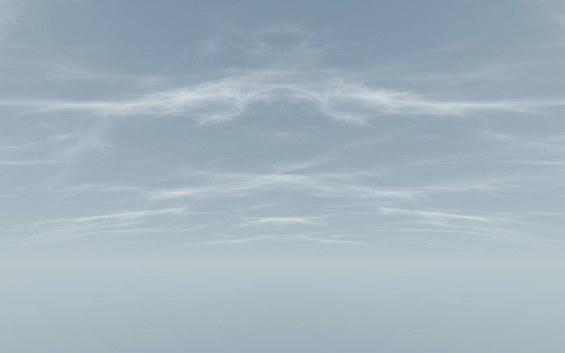

# 青灰薄云天空：预览、参数与设备验证

状态：独立天空原型，桌面实际渲染和 Android 资源包 Shader 编译已验证；正式首章未应用，A1/A2/A3 全景候选尚未由用户选定。天空底色用程序渐变，薄云使用内置 image_gen 生成的独立灰度密度图，不把参考全景直接滚动。画面、代码验证与真机性能分别验收。

## 打开看效果

1. 等待 Unity 完成导入，从 `Tools → NarutoVR → 环境 → 青灰薄云预览` 打开独立窗口。
2. 左键拖动画面调整方向，滚轮调整仰角。按钮切换纯底色、静态薄云、动态薄云；可以关闭第二层。
3. 点击“选中材质调整参数”，在 Inspector 中改颜色、云浓度和速度。预览窗口内部使用副本，调整视角、时间与模式不会改源材质；直接在材质 Inspector 编辑才会保存资产。
4. 持续运动使用窗口的“动态薄云”模式。重复的 `SkyboxPreview` 场景已清理，预览入口统一为这个独立窗口。

预览窗口限制为最高约 20 次刷新/秒，并在 Play 时暂停渲染，关闭时销毁其相机、材质副本和 RenderTexture。正式性能测试前仍应关闭窗口和额外 Scene 视图。

## 参数

材质：[青灰薄云.mat](../../Assets/Art/Environment/Opening/Skybox/青灰薄云.mat)。Shader 所有公开字段为中文。

| 字段 | 用途 |
|---|---|
| 天顶颜色、地平线颜色、下半球雾色 | 三段稳定底色，不随云转动；下半球不是场景中的实际体积雾。 |
| 天空渐变曲线、整体亮度 | 调整颜色过渡和亮度；首版不依赖 HDR 或 Bloom。 |
| 启用薄云 | 关闭使用无纹理采样变体，是性能对照和最低档。 |
| 薄云密度图 | 线性灰度数据；黑色无云，亮色云密度较高。 |
| 薄云颜色、不透明度、云纹增强 | 决定云的颜色、可见程度与覆盖强度。 |
| 主层纹理尺度 | 大值意味着纹样重复更密，云块看起来更小。 |
| 主层风向、主层流速 | 风向是纹理坐标角度，速度单位为纹理格/秒，不是世界米/秒。默认低速。 |
| 启用第二层、相对尺度、强度、相对速度 | 两层共用一张纹理，用不同采样位置叠合。关闭第二层省一次采样。 |
| 地平线消隐高度 | 云接近地平线逐渐淡出，避免远处纹样密集闪烁。 |
| 云层流动 | 关闭固定在初始云相位；仍然采样云图，不能当作性能降级。 |

采用镜像平铺以避免生成贴图边界不完全匹配时产生硬接缝；局部图案会镜像重复，并非宣称 AI 原图天然完美无缝。大尺度和错开的第二层用于减轻重复感，仍需从头显视野检查。

## 接入正式 VR / MR

用户选定样式后，在目标相机添加 Unity `Skybox` 组件并指定材质，同时确认相机 Background Type 为 Skybox；或者在场景的 Lighting / Environment 设置中指定天空材质。前者可局部覆盖，后者是场景级设置，本工具均不自动替用户应用。

天空 Shader 使用 Unity 的实例化与双眼宏，不读取 Meta 专属 API。Quest 原生、SteamVR/OpenXR 和未来 PICO 可以复用同一材质逻辑；每种实际 XR 模式仍需双眼验收。主场景相机若使用纯色清屏，看不到天空不代表材质损坏。

MR 透视模式需要由现有环境/相机切换逻辑停用 VR 天空，并恢复透视需要的背景透明设置。此 Shader 输出不透明背景，不应覆盖透视层。本次没有更改 MR 模式或接管全局环境状态。

天空移动只影响背景像素，没有实时云影、体积云、额外相机、实时反射探针更新或逐帧环境光重算。不要为了让薄云动而每帧调用 `DynamicGI.UpdateEnvironment()`。

## 纹理与性能预算

- 单张纹理导入尺寸 1024×1024，线性数据、Trilinear、完整 mip、关闭 Read/Write。
- Android ASTC 6×6 的纹理块数据含 mip 约 **0.60 MiB**；桌面 BC4 约 **0.67 MiB**。这不是 Unity 对象和驱动的完整内存占用。两层共用纹理，不额外复制第二份。
- 一个天空 Pass；纯底色零采样、单层一次采样、双层两次采样。双眼具体提交数取决于 XR 渲染模式，不能仅凭一个 Pass 就声称两眼只画一次。
- 先前的 **0.3～0.5 ms/帧是 GPU 开发预算，不是本机或 Quest 实测值**。当前编辑器截图也不能证明达到该预算。
- 真机固定设备、刷新率、渲染分辨率、注视点和场景。分别采集纯底色、单层、双层，比较稳定运行后的 GPU 帧时间和掉帧；另采室外仰头的大片天空视角。语音、手势和战斗负载保持相同。
- Steam 串流的 GPU 时间属于电脑渲染，网络/编码/解码延迟单独统计，不能替代 Quest 原生测量。

## 源文件与验证入口

- [天空 Shader](../../Assets/Art/Environment/Opening/Skybox/KaogongThinCloudSky.shader)
- [密度图](../../Assets/Art/Environment/Opening/Skybox/CirrusDensity.png)、[原始生成词](../../ArtSource/Environment/Opening/Skybox/CirrusDensity.prompt.txt)、[源图](../../ArtSource/Environment/Opening/Skybox/CirrusDensity.source.png)
- [预览窗口](../../Assets/scripts/logic/Editor/Environment/ThinCloudSkyPreview.cs)、[缺失资源创建工具](../../Assets/scripts/logic/Editor/Environment/ThinCloudSkyAssets.cs)。创建工具保留已有材质和场景，但会重设这张云图的专用导入参数。
- [隔离验证脚本](../../Tools/Skybox/ThinCloudSkyChecks.cs)：仅在 `D:/Temp/NarutoVR-Skybox-*` 运行，不在正式项目加载；检查实际渲染、冻结、运动、无平移视差及副本隔离。输出在验证工程的 `Logs/skybox-check`。

启动隔离 Unity 时，若命令环境缺少 `ALLUSERSPROFILE`，按现有 `Tools/Start-Unity.ps1` 处理：在子进程环境补为 Windows CommonApplicationData。无需更改系统变量、重装 SDK 或停止正式编辑器。

2026-11-08 验证使用 Unity 6000.3.10f1、URP 17.3.0，隔离工程 `D:/Temp/NarutoVR-Skybox-20261108`。Direct3D11 实际渲染覆盖纹理导入、云层运动/冻结、单层/双层切换、相机平移不产生天空近景视差、四向/天顶/地面和独立 PreviewScene；源材质与全局天空保持不变。图像见上，记录在主工程 `Logs/skybox-20261108/final-render/report.txt`。Android 资源包构建验证了 GLES3 与 Vulkan 的纯色/单云/双云 Shader 变体；记录为 `android-final-report.txt` 与 `unity-android-final.log`。这不是 APK、头显双眼、MR 透视或 GPU 帧耗时测量。

桌面编辑器的 `Profiler.GetRuntimeMemorySizeLong` 对这张 BC4 贴图报告约 1.33 MiB，包含编辑器/引擎统计开销，与约 0.67 MiB 的压缩纹理块大小不是同一口径。未将它写成 Android 实测内存。交付文件与隔离实测副本的 SHA256 对照保存在 `Logs/skybox-20261108/delivered-hashes.json`。

参考：[Unity 双眼 Shader 宏](https://docs.unity.com/en-us/engine/6000.3/manual/xr/graphics/stereo-rendering/single-pass-instancing)、[URP 单相机渲染请求](https://docs.unity.com/en-us/engine/6000.0/manual/cameras/urp/multiple/user-render-requests)、[纹理格式](https://docs.unity3d.com/6000.0/Documentation/Manual/texture-formats-reference.html)。
