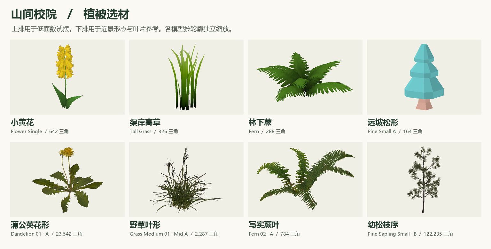

# 首章外景植被选材与 Quest 风动

首章已有分级山松和水渠花岸，优先补渠边的高低差、石底的蕨叶和能从草里辨认出来的小黄花。第一处试摆建议选玩家走得到的渠岸拐角。用原有细草铺底，在水线外侧插两簇高草，背阴石脚放一株蕨，转角留一株黄花。四件新增样件合计 1,582 个三角形。作为尺度参照，现有整段花岸长 2.70 米、宽 1.25 米，共 2,117 个三角形，含 38 簇草与 10 株花。若需要连续铺岸，优先复用现有花岸，在拐角加单株。[现有花岸与草地样板](CHAPTER01_GRASS_REFERENCES_20261118_ZH.md) · [首章外景布局与山松 LOD](../guides/CHAPTER01_EXTERIOR_VISUALS_ZH.md)

[下载 13 个 CC0 模型或模型组，约 28.1 MiB](../../ArtSource/Environment/Opening/FoliageResearch_20261123/Foliage_CC0_Samples.zip)。解压后可用 Blender 等支持 glTF 的工具打开。Quaternius 和 Kenney 为独立 GLB，Poly Haven 每个目录的 `preview_cutout.gltf` 已把作者单独提供的透明遮罩合入底色，使用同一份原始网格。包内保留原文件、作者、来源页和校验值。上图由样件离线渲染，尺寸各自归一，项目内光照与佩戴头显时的观感需另行确认。

## 素材怎么选

表中数字来自下载文件的三角索引。独立 GLB 按完整模型统计，Poly Haven 按一组中单个变体统计。三个来源均以 CC0 发布，可用于商业项目和改作。[Quaternius 作者说明](https://quaternius.com/packs/stylizednaturemegakit.html) · [Kenney 2.1 原发布页与授权](https://opengameart.org/content/nature-kit) · [Poly Haven 授权](https://polyhaven.com/license)

| 位置 | 候选与每株三角形数 | 用法 |
| --- | --- | --- |
| 渠岸高草 | Quaternius Tall Grass，326，一个不透明材质 | 优先试。叶片有清楚的外轮廓，适合少量成簇轻摆。[高草原件](https://poly.pizza/m/JSIYtscPmP) |
| 林下和背阴石缝 | Quaternius Fern，288，一个透明混合材质。Poly Haven Fern 02，784–2,384 | 优先试前者，在近手距离可对比后者最轻的 A 株。蕨叶向外展开，比再次加高草更容易读出前后层次。[风格化蕨](https://poly.pizza/m/jqcanvH7D6) · [扫描蕨](https://polyhaven.com/a/fern_02) |
| 作坊门边、渠岸拐角 | Quaternius Flower Single，642，两个透明混合材质。Kenney 小黄花，76 | Quaternius 的黄色穗状花适合做近处单株；若想增加花点密度，可先用原花岸或 Kenney 简化花测试远观效果。[单株黄花](https://poly.pizza/m/GvfHo0roi3) · [Kenney Nature Kit](https://kenney.nl/assets/nature-kit) |
| 中景孤松、远坡林线 | Quaternius Pine，3,648，树皮不透明、针叶透明混合。Kenney 两株松形，164 和 206 | 玩家附近以项目原山松为主，已有 2,022 / 1,750 / 1,484 三级。Quaternius 可试作一株异形树；Kenney 轮廓棱角明显，更适合远坡小剪影比较。若剪影仍跳风格，可由现有山松烘出远景树片。[Quaternius 松树](https://poly.pizza/m/Zt62gceKXZ) · [Kenney 2.1](https://opengameart.org/content/nature-kit) |
| 写实形态参考 | Poly Haven 蒲公英 2,080–23,542、野草 28–6,422、幼松 122,235–142,506 | 蒲公英用来参照贴地叶盘，野草按单株选轻量变体。幼松适合观察枝序或离线烘焙成低模树片。此处的 1K 指贴图分辨率，几何量见左栏。[蒲公英](https://polyhaven.com/a/dandelion_01) · [野草](https://polyhaven.com/a/grass_medium_01) · [幼松](https://polyhaven.com/a/pine_sapling_small) |

样件还含 Kenney 的 132 三角草簇和 36 三角阔叶，可用于远景轮廓对照。包内 `Sources.json` 逐件列出名称、版本来源和统计，便于单独取用。

## 风动怎样接入首章

1. **沿用现有草地的 GPU 顶点风。** 现有材质每个顶点算一次正弦，沿世界风向偏移，位移乘以顶点柔度的平方。根部写 0、叶尖写 1，中段逐渐过渡。默认频率 0.5 Hz、叶尖最大位移 2.5 厘米。花茎可先试 1 厘米，草尖试 1–2.5 厘米。同一丛共享根点和相位，用相邻草丛的世界位置和少量相位差表现风扫过渠边。现有材质的传播系数默认是 0，需要成片传播时可在样板材质上调高。整个地块共用观察位置，无需给每株挂 Update、Animator 或刚体。[项目草地着色器](../../Assets/Shaders/OpeningGrass.shader) · [观察点与草块剔除](../../Assets/scripts/logic/Environment/OpeningGrassWind.cs)
2. **导入时补风动数据。** 四个 Quaternius GLB 均带主 UV 和顶点色，实际顶点色 Alpha 全是 1，且缺少现有着色器读取的第二套纹理坐标。给每株补根点、相位和根尖权重，保留用于底色贴图的主 UV。若烘焙光照占了第二套 UV，改用空闲通道并让着色器读取该通道。原草着色器只绘制顶点颜色；带纹理的花、蕨应做共享的 URP 植被材质，把同一段顶点偏移接入其顶点阶段，单独用纹理 Alpha 表示叶片轮廓。合并多株前把每株的根点转换到合并网格的局部空间，包围盒应容纳最大摆幅。[项目草网格写法](../../Assets/scripts/logic/Editor/Environment/GrassPatchMesh.cs) · [草地着色器](../../Assets/Shaders/OpeningGrass.shader)
3. **树与草用不同的距离和权重。** 小草现有风幅在 6–12 米衰减，草叶在 14–18 米收拢。控制器按草块包围盒距离，超出 19 米时关闭绘制，回到 18 米以内恢复。草块很大时，即使部分草已不可见，整块仍可能被提交。树按树冠的屏幕大小切换 LOD，树根、粗树干固定，近树让细枝和冠缘缓摆。中景只留整簇轻摆，远景用静态简化材质。要省掉远景风动的顶点运算，可给远景 LOD 单独编译静态版本，单把风幅调为零仍可能执行原有计算。[草块控制器](../../Assets/scripts/logic/Environment/OpeningGrassWind.cs) · [GPU Gems 的枝干与叶片分层风动](https://developer.nvidia.com/gpugems/gpugems3/part-iii-rendering/chapter-16-vegetation-procedural-animation-and-shading-crysis)
4. **先控制叶片的屏幕覆盖和重叠。** 近处几层大透明叶片叠在双眼前，同一片屏幕会被反复着色。高草宜保留不透明几何。蕨叶、花瓣或松针确实需要孔隙时，测试启用深度写入的 Alpha Clipping 材质，让叶卡外形尽量贴合叶缘，减少空白与交叠。裁切本身也要取样并判断，需观察细针叶闪烁与真机耗时。小草可关闭实时投影，保留投影或深度通道的近树应在相关通道使用一致的顶点位移。相邻草合小块、共享材质，按区块剔除。[Android 移动端材质与透明绘制指南](https://developer.android.com/games/optimize/materials)

## 怎样判断 Quest 上能铺多少

先做一小段水渠，在同一台 Quest、同一刷新率和光照下保留三个可切换版本。当前 Mobile 配置记录为渲染比例 0.8、4× MSAA、HDR 关闭。每组沿同一路线看俯视脚边、贴地沿岸看重叠草叶、抬头看远坡三个视角。设备预热后每组建议采 3 次、每次 60 秒，交换运行顺序并记录温度和频率。[项目 Mobile 渲染配置](../../Assets/Settings/Mobile_RPAsset.asset) · [Meta OVR Metrics Tool](https://developers.meta.com/vr/documentation/unity/ts-ovrmetricstool/)

| 版本 | 唯一变化 | 判断 |
| --- | --- | --- |
| A 原场景 | 保留已有花岸和山松 | 记录 CPU、GPU 帧时间中位数与 P95，以及丢帧 |
| B 加静态样件 | 加候选网格和最终材质，编译静态顶点版本 | B−A 显示新增几何、材质和像素覆盖的合计成本 |
| C 相同样件开风 | 保持 B 的数量、位置、材质采样与 LOD，只加顶点风 | C−B 估计风动本身的增量；Unity Profiler 或 Frame Debugger 核对批次数和实际绘制的 LOD |

按 72 Hz 举例，每帧有 13.89 ms。若项目以 90 Hz 运行，每帧有 11.11 ms。第一轮可把“同一机位开风后 GPU P95 增量不超过 0.3 ms，且无新增持续丢帧”作为试摆目标，同时核对整场景能否稳住目标刷新率。若 B 已明显变慢，先减草叶覆盖、材质批次或密度；若主要是 C 变慢，再减少参与风动的顶点与距离。本次完成了样件和源码核查，三个版本的真机测量待试摆后执行。
