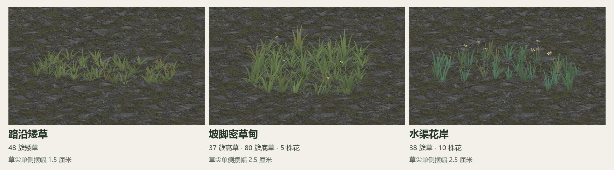

# 首章草地参考：铺多密，风吹多远

2026-11-18 核查。首章可先在院墙脚、坡脚和水渠外岸试一段连续草带，保留石路、石坪与水边轮廓。第一轮保留现有风幅，让人能够直接看出补足覆盖带来的差别。

## 三个游戏各看什么

| 游戏与来源 | 看哪里 | 能带回首章的做法 |
|---|---|---|
| 《Flower》，iPhone / iPad。[iOS 商店图](https://apps.apple.com/us/app/flower/id1279174518) · [开发商官网短片](https://thatgamecompany.com/wp-content/uploads/flower-trailer2.webm) | 短片约 3.5–4.0 秒，前景几乎看不到草间的土，白花仍能从草面上辨认。草尖有轻微的方向变化，整片草保持直立。约 20 秒，石块和浅色路面干净地切开草坡。 | 借鉴草叶轮廓相互遮叠、少数花头露出草面的层次。日常风用短片开头作参照。玩家操纵花瓣飞行时有主动风效，力度应单独看。[发行方对风的说明](https://www.annapurna.com/interactive/flower) |
| 《Across the Valley》，Meta Quest。[开发团队移植复盘](https://developers.meta.com/horizon/blog/across-the-valley-graphics-design-challenges/) | FusionPlay 写明，移植到 Quest 时缩短草的可视距离，草量削减约 95%，再逐簇手工挑选位置，以保住农场周围的覆盖感。这个比例是对其自身原版的比较。 | 先从玩家站位看哪些地段需要连起来，把预算留给这些地段。本案例提供的是摆放和覆盖依据，文中没有给出草尖的摆幅。 |
| 《Minetest Game》，Luanti 有 Android 版。[Android 版本](https://www.luanti.org/en/downloads/) · [草节点配置](https://github.com/luanti-org/minetest_game/blob/5.8.0/mods/default/nodes.lua#L1462-L1466) · [5.10.0 植物着色器](https://github.com/luanti-org/luanti/blob/5.10.0/client/shaders/nodes_shader/opengl_vertex.glsl#L158-L189) | 植物风动打开时，草片上缘移动；相邻位置共享随空间连续变化的波，相位有小幅差异。按源码，X、Z 两轴的单侧位移上界分别是一个方块边长的 8% 和 15%。这是各轴的数学上界，分母是方块边长。[单位换算](https://github.com/luanti-org/luanti/blob/5.10.0/src/constants.h#L56-L61) | 借鉴邻簇依次向同一边倾的节奏。首章的草高、叶形和镜头尺度不同，风幅直接用首章自己的草高校准。 |

## 首章现有的草

- 从现用预制体的八个网格按根锚点计数，每块有 25 簇草、5 株花。每块的水平撒点范围是 2.10 × 2.10 米，折合 **5.67 簇草和 1.13 株花/平方米**。这是草块内部的名义密度。现有东侧近景里，许多相邻草簇间仍能看见完整的地表纹理。[预制体与烘焙网格](../../Assets/Art/Environment/Opening/Grass/) · [撒点范围](../../Assets/scripts/logic/Editor/Environment/OpeningGrassBaker.cs) · [现有东侧近景](../../Logs/grass-20261114-dense/east-close-wind.png)
- 全部 200 个草簇各取最高叶尖，实测高度中位数为 **30.0 厘米**。近处草尖单侧最大位移 **2.5 厘米**，相当于典型草高的 **8.3%**；两端相距 5 厘米，每 2 秒往返一次。根部固定，6–12 米间风幅逐渐降至零。每株有独立的随机起始相位，同簇叶片一起摆，邻簇有时会往相反方向摆。[风动材质](../../Assets/Art/Environment/Opening/Grass/OpeningGrass.mat) · [网格和起始相位](../../Assets/scripts/logic/Editor/Environment/GrassPatchMesh.cs) · [风动公式](../../Assets/Shaders/OpeningGrass.shader)

## 首章样带建议

| 比较项 | 第一轮取值 | 从玩家视角看什么 |
|---|---|---|
| 草带内部密度 | 在同一块 4.41 平方米里，从 25 簇草试到 **35–40 簇草**，约 **8–9 簇草/平方米**。保留约 5 株花，局部聚成小组。 | 沿坡脚侧看，近邻的草尖有交叠，花头仍容易找。沿石路行走，左右能读到延续的草带，路沿清楚。 |
| 日常微风 | 密度选定后，在同一草带比较草尖单侧 **1.5 厘米**和现有的 **2.5 厘米**，都用 **2 秒/周期**。两档约为典型草高的 5% 和 8%。 | 站定看草尖是否能读出风向，再沿草带走过看近景。先让相邻约 1–2 米内的草大致同向、依次起摆，边缘带少量错拍。 |

这些是本项目的样带取值。《Flower》的镜头有透视和机位运动，只用来判断覆盖与相对动感。比较密度时应固定风和机位；比较风幅时应固定草的摆放和相位。样带取值尚待在 Quest / PICO 头显上验证近景观感与帧时。

## 已制作的三个独立预制体

在 Unity 的 Project 窗口打开 `Assets/Art/Environment/Opening/Grass/Samples`，双击任一预制体即可查看。三种样板的轴心都在地面中央，可以直接拖到平地比较；每块只有一个 MeshRenderer，草与花共用一份网格和一个材质。[六秒风动对照](../visuals/20261118_grass_samples/grass-wind.mp4)

| 预制体 | 种植形状与用途 | 草尖单侧摆幅 | 三角面 |
|---|---|---:|---:|
| [ShortVerge · 路沿矮草](../../Assets/Art/Environment/Opening/Grass/Samples/ShortVerge.prefab) | 2.60 × 1.05 米内种 48 簇矮草，最高约 24 厘米，适合石路外缘。 | 1.5 厘米 | 1,940 |
| [DenseMeadow · 坡脚密草甸](../../Assets/Art/Environment/Opening/Grass/Samples/DenseMeadow.prefab) | 2.10 × 2.10 米内种 37 簇较高草、80 簇细矮底草和 5 株花。高草之间的空隙由底草补齐。 | 2.5 厘米 | 4,201 |
| [FlowerBank · 水渠花岸](../../Assets/Art/Environment/Opening/Grass/Samples/FlowerBank.prefab) | 沿 2.70 米长、1.25 米宽的带状区域布置 38 簇青绿窄叶草和 10 株花，草带随岸线轻弯，花集中在两处。 | 2.5 厘米 | 2,117 |

### 烘焙、贴地与风动

1. 首章现用的 `OpeningGrass` 在八个指定位置撒点。在编辑器里向山谷三档 LOD 地面投射，过滤陡坡、遮挡及三档地面高度不一致的位置，再按草块合并网格。运行时直接加载八个烘焙结果。样板也预烘焙，采用平面局部坐标；铺到起伏明显的坡面需要重新投射根点。[首章烘焙器](../../Assets/scripts/logic/Editor/Environment/OpeningGrassBaker.cs)
2. 每种样板在带抖动的网格中撒点，并以固定种子生成叶片弯度、高度和花头。密草甸用第二组点补矮草。每株的根坐标和风相位写入 UV 的第二通道，顶点色的透明度通道保存摆动权重。进入菜单 `NarutoVR → Environment → Rebuild Grass Samples` 可单独重建三个预制体。[样板烘焙器](../../Assets/scripts/logic/Editor/Environment/GrassSampleBaker.cs) · [草叶与花头几何](../../Assets/scripts/logic/Editor/Environment/GrassPatchMesh.cs)
3. GPU 在顶点着色器中沿统一风向移动叶片，根部位移为零，草尖每 2 秒往返一次。样板按各株在世界坐标中的位置错开相位，相邻草簇能先后向同侧倾，即使拼接多个样板也使用同一阵风。首章原材质使用原有的逐株随机相位。草尖风动在 6–12 米内渐停，植株轮廓在 14–18 米内收至零；首章控制器另按整块距离关闭渲染。[风动着色器](../../Assets/Shaders/OpeningGrass.shader) · [首章可见性控制](../../Assets/scripts/logic/Environment/OpeningGrassWind.cs)

Unity 6000.3.10f1 已验证三个预制体的根数、材质、风动和 Android AssetBundle 编译。预览使用相同机位、工程地表贴图及同一尺度；视频以固定相位逐帧渲染一个周期，再按实际周期播放三次。首章场景仍引用原八块草地，样板供比较。头显上的实际帧时和佩戴观感待测。
