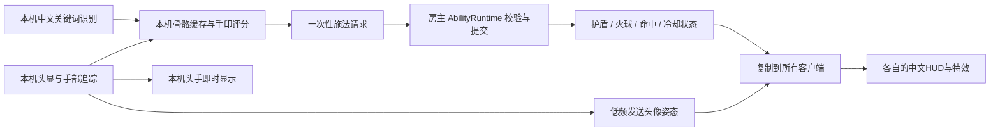

# 局域网多人技术方案与接口预留

> **2026-10-30 当前范围：** [线性 RPG 单机切片](LINEAR_RPG_DESIGN_ZH.md)已实现并通过 Unity 自动检查，真人手感仍待测；多人仍仅文档契约，未来暂定同房 PvE。本轮不安装网络 SDK、不承诺现有场景可联机。首版为全虚拟 VR，MR 后续。
>
> 节点瞬移/闪避是人工虚拟位移，不能写入或冒充真实同房空间对齐。未来命令、虚拟根节点位姿与现实坐标映射需要分别校验；人工位移的多人表现和身体避让规则以后独立设计。玩家 HP/MP/CD 的新本地切片不等于本文件的异步房主事务、效果 token 或权威快照已实现。
>
> 普通取消在新场景只清待施法、未完成笔画和未发射物，保留已生效护盾/飞行物；后文 `CancelEffect` 是未来明确效果契约，不意味着任意输入取消可以解除护盾或所有持续效果。

日期：2026-10-29。状态：**技术调研与接口契约设计；尚未安装联机 SDK、创建联网场景或改动现有运行代码。** 最新用户决定：先做好 Quest 单机各系统，多人目前仅预留接口；未来暂定两人同房间 PvE，再考虑四人。本文据此更新原“各自区域合作靶场”的产品方向；独立区域仍可用于后续网络调试，但不是最终同房间验收。官方资料与候选对比见 [调研来源](MULTIPLAYER_SOURCES_ZH.md)，设备和同房坐标设计见 [Quest/PICO 兼容方案](QUEST_PICO_COMPATIBILITY_PLAN_ZH.md)。

## 1. 本项目的选择

暂定 **Unity Netcode for GameObjects（NGO）＋ Unity Transport（UTP），Host/Client 模式，局域网 IP 直连**。一个玩家兼任房主和权威服务器，另一个玩家连接它。未来同房 PvE 关闭友伤，准备阶段必须分别完成网络连接和现实坐标对齐；暂不做竞技 PvP、自动房主迁移或公网匹配。当前不启动网络实现，也不让网络成为单机玩家/技能系统的开发前置条件。

这是基于本工程已有 GameObject/MonoBehaviour、两至四人和合作玩法做出的工程选择，不是所有 VR 游戏的统一最优解。NGO 的官方定位覆盖这类已有 GameObject 工程的小规模多人；UTP 提供设置连接 IP、端口和监听地址的 API。[Unity 网络方案说明](https://docs.unity.com/multiplayer/netcode/netcode)、[UnityTransport API](https://docs.unity.cn/Packages/com.unity.netcode.gameobjects@2.13/api/Unity.Netcode.Transports.UTP.UnityTransport.html)。

| 首版决定 | 理由与边界 |
|---|---|
| 两人同房间 PvE 作为未来目标 | 复用火球、护盾与敌人/训练靶；网络、空间标定分阶段验证；同房对齐是最终模式必需能力 |
| Host 权威 | 房主统一生成、伤害、护盾、冷却和目标恢复；客户端负责本地操作与显示 |
| 手输房主 IP＋端口 | 最小可测试连接流程；发现房间、二维码加入可以之后加 |
| 游戏数据直接走 LAN | 本层不引入 Relay、Lobby 或云账号依赖；不等于 Steam Link、商店授权等外部软件也已验证完全离线 |
| 保留目前 Quest/Steam Link 追踪路线 | 联机处理游戏状态，不负责把头显画面串流到电脑；每个玩家需要独立运行的游戏客户端 |
| 暂不导入完整多人模板 | 借鉴官方示例的网络层，不替换已调通的 Meta/XR Hands、录制工具和玩家 Rig |

当前 manifest 只有 `com.unity.multiplayer.center`，没有 NGO/UTP。Multiplayer Center 不代表游戏已经具备联机功能。安装阶段应选 Package Manager 中适用于 **6000.3.10f1** 的 released 版本，再锁定 manifest/lock；不能因为文档能打开就认定版本组合通过。本次访问的 [6000.3 包列表](https://docs.unity3d.com/6000.3/Documentation/Manual/com.unity.netcode.gameobjects.html) 把 2.13.3 标作 pre-release，故本轮不直接指定 latest 安装。

Mirror 是可用备选，特别是已有 Mirror 经验或强依赖现成 LAN 发现时。FishNet、Photon Fusion 也列入调研，但这轮不同时接多套框架。若之后核心目标变成高强度竞技 PvP，再针对预测、回滚、命中补偿重新评估；NGO 的 anticipation 不能等同于完整预测回滚系统。[NGO anticipation](https://docs.unity3d.com/Packages/com.unity.netcode.gameobjects@2.7/manual/advanced-topics/client-anticipation.html)。

## 2. 什么留在本机，什么交给房主



| 数据/逻辑 | 负责人 | 是否同步 |
|---|---|---|
| IHand/XR Hands 原始骨骼、追踪质量、5～10秒缓存、各印特征评分 | 玩家本机 | 默认不发送完整骨骼历史 |
| 口令与印的先后匹配、三种触发模式、握持松手投掷（旧场景保留轻推） | 玩家本机 | 发送匹配后的技能请求、发射意图；原始音频不作为技能网络输入 |
| 头、双腕、虚拟玩家根节点、追踪有效位 | 本机采样，房主校验后转发 | 其他玩家插值显示；本人的头手不等待网络 |
| 技能可用性、资源、冷却、持握槽、效果实例 | 房主 | 同步已提交状态；本地资源模块已有，仍需命令/权威快照接线，完整装备尚未实现 |
| 火球运动、命中对象、训练靶血量/恢复、护盾吸收 | 房主 | 客户端显示结果，不能各自扣血 |
| 火焰粒子、音效、屏幕反馈 | 每个客户端 | 同步效果类型、种子/起点/结束等必要参数，不同步每颗粒子 |
| 多人语音聊天 | 独立未来功能 | 不等同于现在的中文技能关键词识别；首版可以不做 |

首版采用可信朋友间的合作测试：**信任客户端“已做对输入”的结论，但不信任客户端给出的伤害/资源/冷却结果。** 主机校验发送者、技能、频率、状态和姿态范围，不宣称能够证明对方真的完成了结印。传全量骨骼也不能自然解决客户端伪造输入，竞技反作弊是另一层需求。

同一技能仍支持纯印、纯咒、印咒组合；联机不会把现有组合窗口变成服务器等待十秒骨骼包。匹配在本机完成后只提交一次。每人自己的标定阈值可不同，游戏技能数值、效果和协议版本则要在加入时核对一致。

## 3. 结合现有代码，需要预留的真正接口

目前已经分开的 Catalog、效果 SO 和 View 可以继续使用。以下为**拟建接口**，名称是设计契约，不代表项目已存在同名 C# 类。

| 契约 | 作用 | 接入位置 |
|---|---|---|
| `IMatchSession` | 单机/Host/Client 生命周期、房间状态、连接代次、加入失败原因 | 独立场景入口，不塞进手印算法 |
| `ICombatCommandPort` | 提交施法、发射、取消请求；异步得到提交/拒绝结果 | 匹配器与拟建 AbilityRuntime 之间 |
| `ICombatStateSource` | 当前权威快照、版本化变化；供 HUD 和表现读取 | PlayerRuntime、技能效果表现、View |
| `ICombatClock` | 房主战斗 tick/时间；客户端只读取估计值 | 冷却、持续时间、目标恢复、投射物模拟 |
| `IActorPoseSource` | 按 Actor 获取头手/根姿态、有效位、采样序号 | 替代效果直接依赖唯一 lab/Camera.main |
| `IWorldFrameMapper` | tracking-local、玩家空间、会话空间的转换及 origin revision | 重定中心、远端角色、后续同房 MR |
| `ISpatialAlignmentProvider` | 标定状态、sessionFromTracking 刚体变换、校准 revision、质量与失效原因 | 未来同房准备流程；同品牌锚或人工共同参考点实现；不是网络传输层 |
| `IHitResolver` | 权威侧处理一次命中，护盾→生命，按 damageId 去重 | 替代投射物直接找 SkillTrainingTarget 扣血 |

只在网络适配层使用 NGO 的 `NetworkBehaviour`、`NetworkVariable`、RPC 和连接 ID；SkillCatalog、手印评分、玩家定义与主要战斗规则不引用 NGO。不是给每个小类都套接口：第一步由 AbilityRuntime 对接命令/结果/状态/时钟，再由场景适配器提供姿态与 Collider→Actor 映射。

接口外观草案如下，DTO 约定见下一节；本轮仅保存在设计文档中：

```csharp
interface ICombatCommandPort
{
    EnqueueResult Submit(CombatCommand command); // 仅“入队/发送失败”，绝非施法成功
    event Action<CommandResult> ResultReceived;  // Committed / Rejected / ResyncRequired
}

interface ICombatStateSource
{
    CombatSnapshot Current { get; }
    event Action<CombatChange> Changed;
}

interface ICombatClock
{
    long Tick { get; }
    double Now { get; }
}

interface IActorPoseSource
{
    bool TryGetPose(ActorId actor, out ActorPoseSample sample);
}

interface IHitResolver // 只交给权威模拟侧，不向客户端暴露扣血入口
{
    DamageResult Resolve(AuthoritativeHit hit);
}
```

单机用 `LocalCombatCommandPort`，多人用 `NgoCombatCommandPort`，都经过相同战斗服务。单机结果也统一在后续主线程更新分发，避免本地立即回调、远端稍后回调导致状态机顺序不同。当前同步适配可以暂时保留在单机场景，**真正接入网络前必须完成异步边界拆分**。

具体不能直接照搬的代码：

| 当前位置 | 现在的行为 | 联机必须改成 |
|---|---|---|
| `SkillTestController`、`Core/SkillMatchEngine.Attempt` | `TryActivate` 同步返回 bool；RPG 已通过 `ExternalCooldownAuthority` 交由 `RpgPlayerState` 记 CD | 匹配事实只消费一次；请求 Pending 与权威 Committed 分开，不能把“已发送”当成功 |
| `Core/SkillMatchEngine`、`Rpg/Data/RpgPlayerState` | 旧训练场保留内部冷却；RPG 使用外部玩家冷却，两个模式不能叠加 | RPG 冷却权威迁往房主；本地仅显示/预测，不新增第二份独立权威 |
| `Effects/SkillEffects.cs:119,272` | 缺省 Camera.main/head.root，直接读本地腕骨 | 显式 Actor、所有者、追踪源；远端角色不回退绑定本机头显 |
| `Effects/SkillEffects.cs:361`、`SkillProjectile.cs:91` | 本地发射并直接对训练靶 ApplyHit | 房主投射物状态机、统一伤害入口；远端副本只表现 |
| `SkillProjectile.cs:33`、`SkillEffects.cs:348` | 排除整个 Player 层 | 自己/队友/敌人由 Actor 与队伍规则决定；不能导致所有玩家永久不可命中 |
| `SkillTestController.cs:172`、`SkillEffects.cs:467` | 本地暂停/禁用 ClearAll，包括飞行物 | 本地输入暂停不删除房主的共享世界；离开、取消、会话结束有不同清理范围 |
| `Voice/SkillVoiceReceiver.cs:98` | 每个接收器独占 Loopback 端口 | 只给本地玩家启用；同机多进程分别配置端口/语音服务，远端玩家不启动麦克风接收器 |

行号为本轮核对位置；以后代码移动时以方法名为准。`SkillEffects` 当前护盾只是数值吸收与无碰撞护腕视觉，不是会物理拦住火球的盾墙。不要因加了网络组件就把这两种机制混为一谈。

## 4. 请求、结果、取消和时钟契约

| 消息/状态 | 关键内容与约束 |
|---|---|
| `CombatCommand` | matchId、连接代次、commandSequence、inputEpoch、skillId、类型。发射引用已存在的 projectileId；`CancelPending(originalRequestKey)` 取消未确认请求，`CancelEffect(castId/effectId)` 取消已确认效果。发送者 Actor 必须由连接映射取得，不能相信包内自报的玩家 ID |
| `CastRequest` | 本地匹配完成事实、输入类型/摘要、选定手、姿态序号。伤害、速度、资源花费、技能资格由房主查自己的目录和玩家状态 |
| `LaunchRequest` | 属于此 Actor 且仍 Held 的对象 ID、有效姿态、方向、originRevision；房主检查归属、时序、追踪状态和位置范围，拒绝 NaN/过期姿态 |
| `CommandResult` | 原请求键、Committed/Rejected、原因码、房主 tick、state revision、生成的 cast/effect/projectile ID；结果已淘汰时返回 ResyncRequired/ResultExpired，不冒充当初失败。中文理由由本地 UI 映射 |
| `ActorPoseSample` | 序号、空间/originRevision、根/头/双手姿态、追踪有效位；本地时间通过网络时钟映射，不能直接跨机器比较 realtimeSinceStartup |
| `CombatSnapshot` | matchId、权威 revision、玩家/目标数值、当前护盾、Held/Flying对象、冷却截止 tick；状态恢复依据，不靠重放 Log 字符串 |
| `AuthoritativeHit` | damageId、来源 Actor/cast/projectile、目标 Actor、房主 tick；同一命中重复到达只能结算一次 |

去重键至少由“会话＋连接代次＋发送者＋请求序号”组成。主机维护有上限的结果账本与过期序号边界；保留期内重复请求返回原结果，不能重新生成对象或重复扣费。低于过期序号边界的请求永不重新执行，结果已淘汰则返回 `ResyncRequired`（原因 `ResultExpired`），以快照恢复当前状态；快照不一定能证明一个已经结束的技能当初是否成功。客户端自己的 inputEpoch 只管理识别证据，不能代替跨机器请求身份。跨会话的消息必须拒绝；同一会话里旧输入代次的已提交结果仍要更新权威状态。

本地请求状态为 `Matched → Submitted/Pending → Committed 或 Rejected`。超时进入 **结果未知**，不视为失败、不自动退款，也不换新请求 ID 再施法。保留期内用相同请求 ID 查询/重发；收到 ResyncRequired 则恢复当前权威快照，不重放这份旧输入。玩家本地可先看到无碰撞、无伤害的蓄力预览，主机确认后绑定正式实例；预测视觉从不扣血或作为技能已成功的凭据。

取消分三类：

1. **还在组合匹配中**：本地清缓存并增加 inputEpoch，保持现有“退出旧印后再结印”的规则。
2. **施法请求已发出但未确认**：发针对原请求的取消意图；先到的取消需留拒绝标记，晚到的取消若已提交则按普通效果取消处理。最终顺序由房主决定，不能只在客户端隐藏火球。
3. **已经生效**：请求取消指定 cast/effect；Held 火球可收起，已飞行火球不召回，已结算伤害不撤销；成功后取消不退款，冷却仍保留。

同一玩家的战斗命令走一条有序可靠通道，并保留显式序号/状态校验。不能假设多个网络对象、所有 RPC 与状态更新之间存在全局先后顺序。客户端即使已经取消输入，也必须接收主机已提交的冷却/能量变化；只是不能由迟到结果恢复旧手势或重复生成预测物体。

三个时间域分开：本地单调时钟用于手印/口令匹配；语音服务的时钟握手仅连接本机 Python 和 Unity；房主 tick 用于共享战斗。不要把语音 ended_at 或本机 Unity 启动时间直接当房间时间。初版火球碰撞按房主当前模拟，不伪装成已实现延迟回溯命中。

## 5. 同步粒度、空间与生命周期

起步同步根/头/双腕及追踪有效位，手指先用识别印标签或少量弯曲值驱动远端视觉。若确实需要观察精确结印，再增压缩指骨姿态；每个关节都挂 NetworkTransform 不是起步方案。远端渲染数据不能反过来当本机手印识别的证据。

以下频率是试验起点，尚未测量：房主模拟30Hz、姿态发送20～30Hz、远端显示插值约50～100ms，之后依据抓包和体验调整。本机头手按 XR 更新即时显示，不给自己额外加插值延迟。仅头和双腕的三组位置/四元数为 `3×7×4=84` 字节，30Hz为2520字节/秒原始载荷；实际还包含根位姿、有效位、序号、包头、服务器转发和可靠消息，不能把此数当总带宽。Steam Link 的视频流又是另一笔负载。

姿态用可丢弃旧包的带序号更新；生成、发射、取消、伤害结果可靠传输；生命/护盾/目标状态需快照支持。NGO 的 NetworkVariable 会为晚加入者同步当前值，而一次性 RPC 不提供历史状态，因此不能只广播“刚才放过护盾”来表示仍然生效的护盾。[官方状态同步说明](https://docs.unity3d.com/Packages/com.unity.netcode.gameobjects@2.7/manual/basics/networkvariable.html)。首版可以只允许在准备阶段加入，战斗中断线则回房间重新加入；快照结构仍先留好，随后再做中途加入。

每个玩家单独拥有 tracking-local → actor/session-space 映射。同房模式由共同现实参考确定站位，房主可指定准备位置但不能任意平移虚拟出生点来冒充现实同伴的位置；玩家重定中心要增加 originRevision、重新对齐映射并清旧组合证据、投掷/轻推历史和 UI 点击驻留，不能让重定中心成为一次发射。不要网络驱动本机 HMD 相机位置，也不要为阻止越界而冻结真实头部追踪。

房主管理 `Held → Flying → Hit/Expired/Cancelled`。正式实例均有归属和稳定 ID，粒子只是它的表现。客户端摘头显/打开系统菜单时停本地输入并通知主机；房主按规则处理其 Held 对象，但已发射火球继续模拟，不能让一人暂停停止全房间。房主进程挂起或退出时首版直接结束会话、显示断开原因；不承诺自动房主迁移。

后续个人腕菜单/教学卡默认本机显示；队友可见的腕饰属于角色外观，勿同步个人菜单的逐帧布局。普通菜单只处理本地输入，不改 `Time.timeScale`、不停用战斗主控、不删除共享效果。购买/装备/施法按钮提交既有命令契约，区分 Pending 与 Committed；关面板不能取消已提交事实或退款。只读速查卡与独占练习输入分别管理，见[腕部 UI 方案](WRIST_MENU_INTERACTION_DESIGN_ZH.md)。

领域/环境遮罩预留“权威规则＋本地表现”的分工：主机同步领域中心/范围、受影响 Actor、效果 token、结束 tick和优先级；各端通过 `IEnvironmentPresentation` 绘制各自画面。移动约束由主机校验虚拟移动、本地提供边界提示；不能强拉用户的真实相机。同一现实房间的 MR 共享坐标需要独立空间对齐模块，不能由 LAN 发现或 NetworkTransform 自动解决。

同房空间模式采用 `Unaligned/Calibrating/Aligned/Relocalizing/Lost` 状态。未对齐或失效时禁止空间施法；未来 PvE 默认请求协调暂停并重新标定，保留真实头部追踪与现实可见性。这是显式房间事件，与普通客户端打开菜单不暂停全房间的规则不同。厂商共享锚作为可选适配器；Meta/PICO 的 UUID 不假定互通，也不假定锚共享能离线。人工共同物理参考的候选、变换公式、漂移和验收见 [兼容方案第 7 节](QUEST_PICO_COMPATIBILITY_PLAN_ZH.md#7-同房间-pve现在只定义坐标契约)。

## 6. 对玩家数据设计的约束

[玩家数据设计](PLAYER_DATA_DESIGN_ZH.md) 的 SO→PlayerRuntime→存档分层继续采用，但新增以下规则：

- `profileId`（长期存档）、`actorId`（本局角色）、网络连接 ID 是三个概念；重连时不能把另一个人的连接号当作原存档身份。
- 多人生命、能量、冷却、护盾账本和技能资格只由主机修改；客户端保留只读快照及可丢弃的预测表现。
- 单机可暂停战斗时钟，多人不能因为一个玩家暂停而停止房间时钟。后台运行与头显休眠需独立验证。
- 护盾刷新/多效果回滚继续依来源 token；退出、取消和迟到清理不能删除另一个玩家或新施法的效果。
- 联机不直接把客户端 JSON 的生命/能量写进房主运行态。首版只在房间开始时使用约定配置；成长进度和联机存档以后单独定规则。
- 装备/技能配置的版本校验与本地手印标定分开：游戏规则一致，个人追踪标定无需逐字相同。

## 7. 分阶段落地与验收

| 阶段 | 交付 | 通过条件 |
|---|---|---|
| 当前 | 只维护命令/状态/空间契约，先开发 Quest 单机各系统 | 文档与现有实现对照；无网络 SDK/联网场景 |
| A：单机系统成熟后 | LocalCombatCommandPort、AbilityRuntime、异步结果/快照、统一冷却与时钟 | 原单机玩法及回归通过；延迟结果、取消交叉、同请求去重不会重复施法 |
| B：未来最小 LAN | 独立 `SkillLanTest` 场景，Host/IP/端口中文 UI，两个客户端、头手代理、共享训练靶 | 双进程先验证通信，再两套客户端；此阶段不宣称同房空间对齐通过 |
| C：未来两人同房 PvE | 准备标定、失效处理、共享场景坐标，再结合头手与本机口令 | 相同现实参考处物体重合，重定中心/漂移不误射；真实同伴可见；双方数值与技能一致 |
| D：扩大 | 四人、重连/中途加入、房间发现、混合品牌 | 以真机数据决定频率；PICO 单机输入/语音/能力验证先于混合房间验收 |

当前语音在电脑 Python 上运行：PC/Steam Link 路线可每台电脑各运行一份；Quest 原生应用的 Loopback 是头显自己，不会自动访问电脑语音服务。Android 首次联网对照可先用纯印/显式模拟输入，再移植本机 KWS 或设计带玩家身份的语音桥。不要把“不联网也能识别手势”误当“原生语音已经可用”。

两个 Quest 的真实测试需要各自的游戏客户端；首轮不依赖一台电脑同时串流两个头显。单机双进程测试用不同语音端口，或只让一个进程接真实语音、另一个使用明确标记的模拟输入。LAN 验证使用同子网、允许客户端互访的网络，房主防火墙放行指定游戏端口；同一 Wi-Fi 名称不保证客户端之间可通。先用 IP 连接排除广播发现问题，不需要为此开放公网端口。

除正常连接，还必须测试：重复/迟到/乱序请求、取消与成功交叉、追踪丢失和重定中心、双方同时打同一靶、冷却与护盾一致、不同配置拒绝加入、客户端暂停、房主退出、丢包/延迟恢复。试验矩阵可用0/50/100ms附加延迟和0/1/3%丢包作为起点，这些不是承诺性能。保留本机识别结果、请求 ID、房主结果、RTT、状态 revision 的中文调试面板，区分“印没过”“请求等确认”“主机拒绝”“网络断开”。

原始调研由两个内置子代理分别核查官方来源与代码耦合，父代理完成接口取舍。后续本次更新将方向调整为同房 PvE 并保持仅设计。没有运行网络双端、断网 LAN、Android 互通或多人头显测试，不能据此宣布工程已支持联机。
