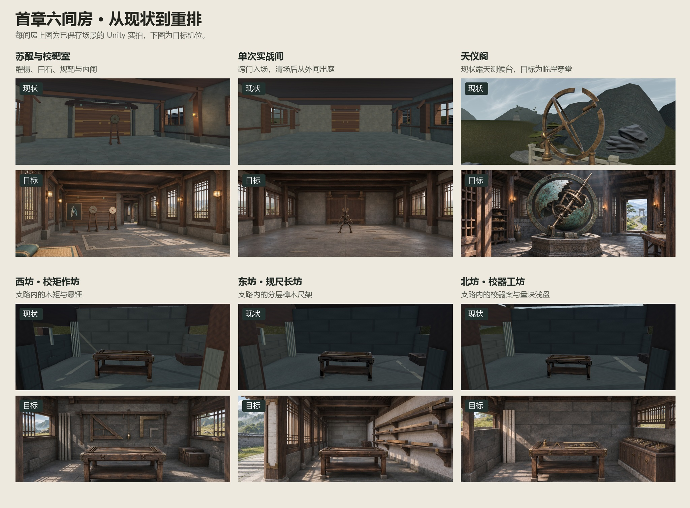

# 首章逐房间图册

## 玩家的行进顺序

苏醒与校靶室 → 校靶内闸与短廊 → 实战间 → 外闸 → 校规庭。院内先看左石刻，转中央双盘，取右侧叶匣内的方圆规印。入左腕槽后，到台后偏右的校验座验腕开闸。过闸后水渠在左、平坦步道在右，低渠承接高处落水。到测候台完成本章。重排把这一站画成天仪阁，阁后石门保留为独立外景。东西北三坊沿支路进出。

[外景四机位](空间机位/00_外景四机位.png) · [试炼短廊](空间机位/07_试炼短廊.png) · [庭院谜台与验腕座](四向特写/08_庭院谜台与验腕座.png) · [现行玩法说明](../../guides/CHAPTER01_AWAKENING_ZH.md)

## 按房间看图

正反机位按上、下阅读。四向特写依次为左上、右上、左下、右下，方向以图册取景为准。实景图取自磁盘保存场景的隔离 Unity 编辑模式，剧情机偶和阶段提示以运行时为准。概念图用于布景，门、靶和机关的操作条件以现行组件为准。

| 房间 | 流程与布置 | 实景 | 目标图 | 陈设 |
|---|---|---|---|---|
| 苏醒与校靶室 | 先见醒榻和脚下白石，再引向近靶、侧靶、护盾承伤和后撤。教学牌装配项目现有手图。 | [实拍](实景核对/复拍_02D38B/01_苏醒朝靶区.jpg) | [正反](空间机位/01_苏醒校靶室.png) · [四向](四向特写/01_苏醒校靶室.png) · [独立镜头](独立镜头/01_苏醒校靶室/) | [造型](陈设造型/01_苏醒室陈设.png) |
| 单次实战间 | 后撤完成后内闸开启，穿过短廊，脚底入室才触发单只残机偶。保持地面空旷；清场才开放外门。 | [实拍](实景核对/复拍_02D38B/05_实战间朝外闸.jpg) | [正反](空间机位/02_单次实战间.png) · [四向](四向特写/02_单次实战间.png) · [独立镜头](独立镜头/02_单次实战间/) | [造型](陈设造型/02_实战间陈设.png) |
| 天仪阁 | 现状 R06 为露天测候台。目标将天仪置于渠末穿堂，左右可绕，后门朝崖端石门。保留 R06 完成节点和完整内环原有运动。 | [实拍](实景核对/复拍_02D38B/11_露天天仪.jpg) | [正反](空间机位/03_天仪阁.png) · [四向](四向特写/03_天仪阁.png) · [独立镜头](独立镜头/03_天仪阁/) | [造型](陈设造型/03_天仪阁陈设.png) |
| 西坊 · 校矩作坊 | 西侧可选支路。保留校器工作台和门柱白石嵌尺，木矩与悬锤挂在侧墙。 | [实拍](实景核对/复拍_02D38B/13_西坊入口看工作台.jpg) | [正反](空间机位/04_西坊校矩作坊.png) · [四向](四向特写/04_西坊校矩作坊.png) · [独立镜头](独立镜头/04_西坊校矩作坊/) | [造型](陈设造型/04_校矩挂板.png) · [FBX 四视](陈设实模/04_木矩与悬锤.png) |
| 东坊 · 规尺长坊 | 东侧可选支路。长尺分层收在墙边，中央留出回转通道。 | [实拍](实景核对/复拍_02D38B/14_东坊入口看工作台.jpg) | [正反](空间机位/05_东坊规尺长坊.png) · [四向](四向特写/05_东坊规尺长坊.png) · [独立镜头](独立镜头/05_东坊规尺长坊/) | [造型](陈设造型/05_规尺架.png) · [FBX 四视](陈设实模/05_五层规尺架.png) |
| 北坊 · 校器工坊 | 从门庭支路进出。分规与量块浅盘放在原工作台上，门口可回望来路。 | [实拍](实景核对/复拍_02D38B/15_北坊入口看工作台.jpg) | [正反](空间机位/06_北坊校器工坊.png) · [四向](四向特写/06_北坊校器工坊.png) · [独立镜头](独立镜头/06_北坊校器工坊/) | [造型](陈设造型/06_校器浅盘.png) · [FBX 四视](陈设实模/06_分规与量块浅盘.png) |

[主线实拍索引](实景核对/复拍_02D38B/主线实拍索引.jpg) · [三坊与外景实拍索引](实景核对/复拍_02D38B/支坊实拍索引.jpg) · [19 个机位坐标、朝向与视场角](实景核对/复拍_02D38B/实拍机位.csv)

## 可拖入 Unity 的资源

整阁使用 [TianyiPavilionSet.prefab](../../../Assets/Art/Environment/Opening/TianyiPavilionKit/TianyiPavilionSet.prefab)，其中嵌套可穿行的阁壳和天仪装置。玩家可从任一侧绕过石座。半径 0.29 米的胶囊沿两条测试路径到装置包围盒的最小水平间隙为 0.988 米。摄影使用工程里的山脊、石门和临时补光。

[从前门看装配效果](../../../ArtSource/Environment/Opening/TianyiPavilionKit/Review/03_入阁看天仪.jpg) · [从后门回望](../../../ArtSource/Environment/Opening/TianyiPavilionKit/Review/04_阁后回看天仪.jpg) · [绕行与嵌套检查](../../../ArtSource/Environment/Opening/TianyiPavilionKit/Review/set-checks.txt)

| 房间 | Prefab | 近／中／远三角面 | 实体对照 |
|---|---|---:|---|
| 天仪阁 | [TianyiPavilion](../../../Assets/Art/Environment/Opening/TianyiPavilionKit/TianyiPavilion.prefab) | 8,980／4,788／2,580 | [阁内 Unity 实拍](../../../ArtSource/Environment/Opening/TianyiPavilionKit/Review/01_阁内.jpg) |
| 天仪阁 | [TianyiDais](../../../Assets/Art/Environment/Opening/TianyiDais/TianyiDais.prefab) | 4,480／1,600／600 | [石座低模](../../../ArtSource/Environment/Opening/TianyiDaisHunyuan/LOD0-preview.jpg) |
| 天仪阁 | [StarShell](../../../Assets/Art/Environment/Opening/StarShell/StarShell.prefab) | 4,100／1,500／550 | [铜壳近档](../../../ArtSource/Environment/Opening/StarShellHunyuan/LOD0-preview.jpg) |
| 西坊 | [PlumbSquareBoard](../../../Assets/Art/Environment/Opening/MeasureRoomProps/PlumbSquareBoard.prefab) | 988／622／334 | [木矩挂板](陈设实模/04_木矩与悬锤.png) |
| 东坊 | [GraduatedRuleRack](../../../Assets/Art/Environment/Opening/MeasureRoomProps/GraduatedRuleRack.prefab) | 868／546／294 | [分层尺架](陈设实模/05_五层规尺架.png) |
| 北坊 | [DividerPartsTray](../../../Assets/Art/Environment/Opening/MeasureRoomProps/DividerPartsTray.prefab) | 896／564／304 | [器件浅盘](陈设实模/06_分规与量块浅盘.png) |

阁壳石坪宽 9.22 米，Unity 胶囊扫掠覆盖穿堂中心线和两侧通道。石座与陈设各档共用烘焙材质。实际装配尺寸、碰撞及三档验收见[阁体](../../../ArtSource/Environment/Opening/TianyiPavilionKit/Review/unity-checks.txt)、[石座](../../../ArtSource/Environment/Opening/TianyiDaisHunyuan/delivery.json)、[三坊](../../../ArtSource/Environment/Opening/MeasureRoomProps/unity-verification.json)。Quest 头显帧时需在最终摆场后采样。

## 复用与模型来源

- 苏醒室继续使用[醒榻](../../../Assets/Art/Environment/Opening/WakeCot/WakeCot.fbx)、[规靶靶面](../../../Assets/Art/Environment/Opening/Interior/TargetGaugeFace.fbx)、[共用靶架](../../../Assets/Art/Environment/Opening/Interior/TargetTrestle.fbx)和[壁灯](../../../Assets/Art/Environment/Opening/Interior/WorkshopWallLamp.fbx)。
- 保留校规庭原双盘、奖励匣、[方圆规印](../../../Assets/Art/Props/Zhunwang/CopperLeaves/方圆规印.prefab)及腕匣校验座。三坊沿用[校器工作台](../../../Assets/Art/Environment/Opening/ArchitectureLOD/A07Workbench/SurveyWorkbench_LOD0.fbx)。
- 量水道沿用[主渠和支流水面](../../../Assets/Meshes/Chapter01/CanalRibbon.asset)。崖端门体可复用[现有门庭模型](../../../Assets/Art/Environment/Opening/PortalGate/PortalGate.fbx)。
- 天仪沿用[固定座与完整转环](../../../Assets/Art/Environment/Opening/ExteriorLOD/ArmillarySeparated.fbx)。[八角石座](陈设造型/08_天仪石座造型.png)为混元单图生成，[固定青铜残壳](陈设造型/07_星图残壳三视参考.png)为混元正、侧、背三图生成。两份高模作为美术源，游戏使用降面并烘焙后的资源。

单独布置天仪时可拖入 [TianyiInstrument.prefab](../../../Assets/Art/Environment/Opening/StarShell/TianyiInstrument.prefab)，其中已含石座。转环沿原斜轴以 7°/秒旋转；三个壳体 LOD 在每 5° 的全周采样中均与转环分离，连续全周净空保守下界为 97.8 毫米。[组合实模](../../../ArtSource/Environment/Opening/StarShellHunyuan/TianyiInstrument-assembly.jpg) · [装配验证](../../../ArtSource/Environment/Opening/StarShellHunyuan/delivery.json)

[交付文件与来源清单](交付文件.csv)
