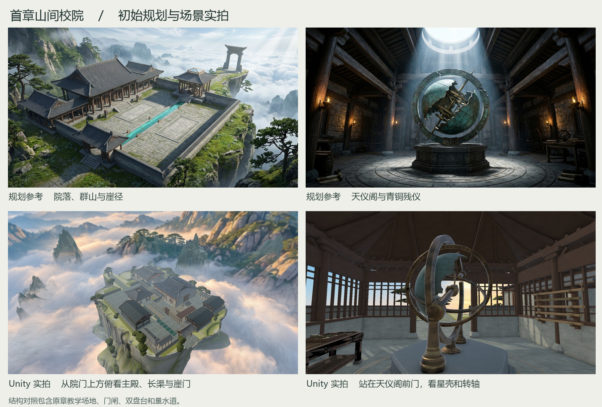

# 首章 · 山间校院

在 Unity 中打开 [Chapter01_Courtyard.unity](../../../Assets/Scene/Chapter01_Courtyard.unity)，按 Play 从当前首章存档继续。新存档从苏醒室开始。新旧场景共用同一套首章进度与检查点 ID。新场景已列入 Unity 构建设置，排列在[原首章](../../../Assets/Scene/Chapter01_Awakening.unity)和 SealLab 之后。

[资产需求与缺口审查工作簿](../../美术需求/首章场景美术资产需求与缺口审查.xlsx) · [逐房间多机位、四向特写与陈设造型](../20261118_chapter01_multiview/逐房间图册.md) · [Unity 实拍机位坐标](实景/实拍机位.csv) · [流程验证原始记录与夹具](验证/流程_验证说明.md)

## 初始规划与场景实拍

水尺旁的水从嵌入渠墙的石槽流进水池，保留原来的入水碎沫。入庭明渠长 11.15 米，透过水面能看到独立的渠底石衬。[出水口修正前后与近景](实景/渠墙出水口_修前修后.jpg) · [早期水面接入实拍](实景/山间校院_水面接入.jpg)。下文 48 张图、发布清单和流程数据对应首次交付快照。

### 手动更新水面倒影

| 在 Hierarchy 里选 | Mesh Renderer 材质 | 材质 Inspector 的「院落倒影」 |
|---|---|---|
| 入庭明渠水面 | 庭院碧水（Element 0） | CourtChannelReflection |
| 量水道流水 | 量水道碧水1（Element 1，水尺近景及出水口） | CourtGaugeReflection |

打开 `Chapter01_Courtyard`，执行 `NarutoVR → Environment → Bake Canal Gauge Reflection`。编辑器临时隐藏两段水，在两个水面上方分别向六个方向拍摄，每面 128 × 128 像素，原位更新两张 Cubemap 后恢复水面。水材质根据视线与动态波纹采样，贴着水面看时倒影更强。改了周围建筑或光照后可重烘。只改水流速度或波幅时，现有倒影仍然适用。[烘焙脚本](../../../Assets/scripts/logic/Editor/Environment/CanalReflectionBaker.cs) · [水面着色器](../../../Assets/Shaders/CanalFlow.shader)

手动摆点可用 `GameObject → Light → Reflection Probe`。把探针放在要捕捉的水面上方，选择 Baked，设置可见层，并给要拍入的静态建筑勾选 Reflection Probe Static。暂时禁用水面 Renderer，点击探针的 Bake 后恢复，再将烘焙得到的 Cubemap 拖到对应水材质的「院落倒影」。当前场景的两段水直接使用各自材质里的贴图。要让水随探针覆盖范围自动选择、混合倒影，需要让水面着色器使用 URP 的探针采样。[Unity 6.3 探针操作](https://docs.unity.com/en-us/engine/6000.3/manual/lighting-overview/reflections/using-reflection-probes)

| 初始规划 | 新场景中的落点 | Unity 实拍 |
|---|---|---|
| 院落位于群山云海之中，从窄崖径抵达石门 | 可行走院台、独立崖舌、近山三维模型、远山云海天空盒。松树沿岩肩落地，石门两侧露出崖缘 | [全景](实景/36_全院与崖舌总览.jpg) · [崖端](实景/35_石门立于崖端.jpg) |
| 主殿、低翼、围墙和门楼围合庭院 | 原苏醒室、短廊和实战间的位置与尺度贯穿新旧场景。新屋盖盖在原房间上方，围墙与回廊连接独立院门和工坊 | [主殿](实景/04_主殿屋脊与山谷.jpg) · [院门](实景/03_院门入庭.jpg) |
| 院内保留水与草，留出石坪可供活动 | 门楼内可见长渠。量水尺、倒流水、渠旁步道和水声跟随玩法新位置。石坪外缘铺草甸与白花，保留谜台操作区 | [水尺](实景/14_水尺与渠面.jpg) · [石坪](实景/38_两方石坪与水道.jpg) |
| 天仪阁位于庭院与石门之间，从两扇门穿行 | 沿渠到阁，绕过仪座，从后门上崖径。断裂青铜壳、轴与承托清晰可辨，内环独立旋转，天窗居中 | [正门](实景/15_天仪阁入门视角.jpg) · [仪器](实景/16_天仪机关与天光.jpg) · [后门望石门](实景/17_阁后望崖端石门.jpg) |
| 房间有可辨识的用途和陈设 | 西坊挂校矩板，东坊挂规尺架，校器坊与天仪阁案上放分规零件盘。三个坊保留工作台和可通过的门洞 | [西坊](实景/19_西坊门望台.jpg) · [东坊](实景/20_东坊门望台.jpg) · [校器坊](实景/21_校器工坊门望台.jpg) |

参考图正殿采用一个高屋面。为容纳原苏醒室、短廊与实战间，实景分为高低三段屋盖。庭中保留了原教学需要的双盘台、验腕座、校验闸和量水尺。崖端石门继续使用首章原有目的地配置。

## 玩家行走路线

苏醒、腕匣教学与双靶 → 短廊 → 单次战斗、清场开闸 → 外门转廊 → 校规庭双盘、取叶入腕 → 校验座开闸 → 沿渠抵达测候台 → 天仪阁前门、绕仪座、后门 → 崖端石门。三座工坊均可进入。

## 模型与复用

资产表保留制作前的 54 项判断，十组缺口分别有交付证据。混元多图生成提供主屋盖、院门、崖台和山峰高模，低翼从门楼高模分离。Blender 制作围墙、回廊、台阶、门冠、渠灯和云层，低模分别配贴图及 LOD。天仪阁、固定青铜残壳、石座、工坊操作台、交互机关和三种专用陈设取自已有资源。后续[七区陈设定稿](../20261119_courtyard_furnishing_concepts/七区陈设.md)与工作簿「七区陈设」页记录本轮增补。

- [主殿与院门](../../../Assets/Art/Environment/Opening/CourtArchitecture) · [崖台与群峰](../../../Assets/Art/Environment/Opening/CourtTerrain) · [围墙、回廊与庭院构件](../../../Assets/Art/Environment/Opening/CourtyardInfill)
- [天仪阁成套预制体](../../../Assets/Art/Environment/Opening/TianyiPavilionKit/TianyiPavilionSet.prefab) · [工坊器具](../../../Assets/Art/Environment/Opening/MeasureRoomProps) · [远档松树与院墙](../../../Assets/Art/Environment/Opening/CourtFarLOD)
- [独立场景铺装、水面、刻度与地被](../../../Assets/Art/Environment/Opening/CourtLayout) · [远山云海天空](../../../Assets/Art/Environment/Opening/CourtAtmosphere/MountainCloudSky.mat)

## 实测与设备范围

桌面 Unity 在 Android Mobile 画质下进行几何统计。玩家视锥包含其后可能被墙遮住的模型，表中数值可用于比较几何负担。

| 玩家机位 | 单眼视锥三角面 | Renderer |
|---|---:|---:|
| 苏醒室出生点 | 116,279 | 259 |
| 院门向里 | 134,669 | 289 |
| 量水道望阁 | 104,793 | 201 |
| 天仪阁入口 | 91,661 | 148 |

四个机位均在本项目 15 万面的粗预算之内。直墙和远松使用轻量末档，地被沿用项目风场并在远处剔除。116 处墙脚与石基衔接。院门三条进出线共 81 处采样连续。[几何与接地验收](验证/美术性能/验收说明.md)

原章节和重排版都在隔离 Unity 工程运行。重排版以桌面模拟输入驱动实际玩法组件，验证投射物命中双靶与试炼战斗清场、开闸顺序、双盘解谜、取叶验腕、最终存档与独立进程读档。完整路线包含 20 个阶段和 86 个导航点。从 R06 穿天仪阁到崖端的 39.35 米分 118 段做移动扫掠，三个工坊也分别从室外走入。[流程说明与逐步日志](验证/流程_验证说明.md)

本次设备列表中没有连接 Quest。头显帧时间、实际 GPU 批次、语音与真人手势仍需在设备上测量。第五版也在移动渲染管线比较过静态遮挡烘焙。桌面 GPU 在出生点和通廊的提交图元增加，最终版采用草簇距离剔除、模型多级 LOD 与远景简模。[遮挡实验数据](验证/美术性能/第五版遮挡开关GPU采样.csv)

[48 张实拍的代表机位](玩家机位对照.jpg) · [正式工程依赖核验](验证/正式工程依赖核验.txt) · [逐文件清单与 SHA-256](验证/发布文件清单.csv)
