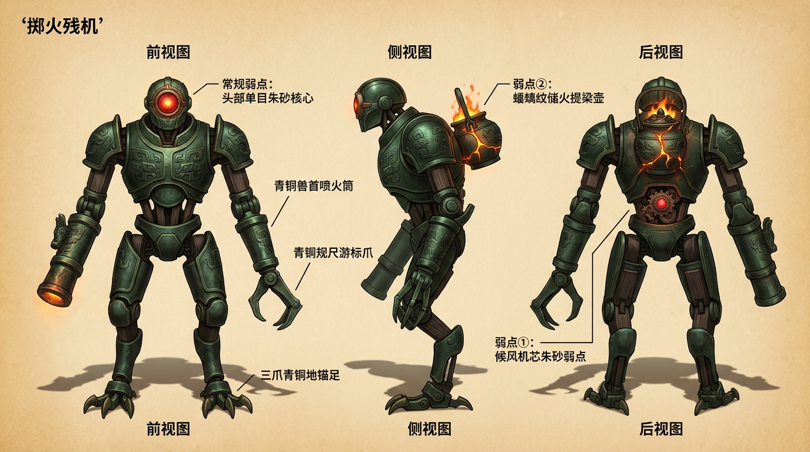

# 《考工律度》远程机偶【掷火残机】概念三视图图鉴与建模指南

> **归档路径**：`docs/visuals/20261121_zhihuo_enemy_turnaround/`  
> **关联设计**：[`docs/architecture/MONSTER_DESIGN_ZHIHUO_ZH.md`](../../architecture/MONSTER_DESIGN_ZHIHUO_ZH.md) · [`docs/world/考工律度_世界观设定白皮书.md`](../../world/考工律度_世界观设定白皮书.md)（第343行）  
> **定稿日期**：2026-11-22  

---

## 1. 概念三视图终稿（V4 三大弱点体系先秦金石终极定稿）

* **文件名称**：`04_掷火残机_三视图_头部常规弱点定稿.jpg`
* **分辨率**：`1376 × 768 px`
* **三大弱点战术矩阵与视觉引导**：
  * **前视图（Front View）**：
    * **【常规弱点：头部单目朱砂核心】**：面部单目嵌有赤红发光朱砂透镜，正面对决时的首选爆头目标。蓄力期间击中可打断发射并造成 1.5x~2.0x 暴击；
    * 武器：右臂**青铜兽首喷火筒**（螭龙兽首，内膛蕴含火核）；
    * 副手：左臂**青铜规尺游标爪**；
    * 抓地：**三爪青铜地锚足**。
  * **侧视图（Side View）**：
    * 35° 前倾姿态，展现背负储火壶与前置火筒的重心配比。
  * **后视图（Back View）—— 背部双特化弱点**：
    * **【弱点②：蟠螭纹储火提梁壶（殉爆弱点）】**：背架上方绑缚的青铜壶布满**炽热金红熔岩裂缝**，壶口喷涌烈焰。击中触发 120 伤害爆轰与高空对地火雨清场；
    * **【弱点①：候风机芯朱砂弱点（瘫痪弱点）】**：腰骶处镂空窗口，显露古青铜齿轮与中心**赤红朱砂核**。击中造成 300% 暴击并坠地瘫痪 4 秒。

---

## 2. 版本演进全纪录

| 版本 | 文件名 | 状态 | 评估与演进依据 |
| :--- | :--- | :--- | :--- |
| **V1 初稿** | `01_掷火残机_三视图.jpg` | **淘汰** | 背部误画为近代工业革命双联金属压力气罐与排气弯管，失真于先秦世界观。 |
| **V2 校正版** | `02_掷火残机_三视图_先秦校正版.jpg` | **过渡** | 成功换装战国青铜方壶与博山炉气孔，但背部火壶未体现“易爆弱点”视觉特征。 |
| **V3 双弱点版** | `03_掷火残机_三视图_双弱点定稿.jpg` | **过渡** | 壶身增加熔岩裂纹与喷火视效，确立背部双弱点，但头部尚未标注常规弱点。 |
| **V4 终极定稿** | `04_掷火残机_三视图_头部常规弱点定稿.jpg` | **当前定稿** | **正式确立【正面头部常规弱点 + 背后双特化弱点】三弱点战术矩阵**，各部件引线标注严谨，先秦金石工官风格完美定稿。 |

---

## 3. 3D 资产建模与材质映射规范

| 部件区域 | 视觉特征与材质语言 | 3D 拓扑与骨骼分配建议 | 材质/贴图通道分配 |
| :--- | :--- | :--- | :--- |
| **头部单目核心** | **常规弱点（爆头点）**：云雷纹青铜面盔，单目嵌赤红发光朱砂透镜。 | 头部主骨（Head）+ 单目调焦骨（Eye_Aim）。**独立碰撞盒 Hitbox_HeadCore**。 | 镜片 Emissive 通道（`#E65100` 朱砂色），蓄力时发光脉冲。 |
| **胸腹躯干** | 冷铸青铜云雷甲片（铜绿与切削刮痕），青冈栎木榫卯躯干。 | 脊椎骨（Spine/Chest）。 | 高粗糙度、带金属度铜绿 PBR。 |
| **右臂主炮** | 青铜兽首喷火筒，外伏辟邪铜兽浮雕，炮口内膛透出火核熔光。 | 右上臂、小臂 + 火筒后坐力骨（Cannon_Recoil）。 | 炮管分寸刻度法线；炮口内圈分配自发光。 |
| **左臂副爪** | 青铜规尺游标爪，肘部外露传动销轴。 | 左上臂、小臂 + 抓爪指骨。 | 栎木榫卯与青铜金属件拼合。 |
| **背部储火方壶** | **弱点②（殉爆点）**：蟠螭纹青铜方壶 + 牛皮交叉背带。表面带熔岩裂缝发光与壶顶火焰。 | 挂接在背部骨骼（Backpack_Root）。**独立碰撞盒 Hitbox_FirePot**。 | 壶身裂缝分配自发光贴图，壶口挂接微型粒子火焰。 |
| **背心候风机芯** | **弱点①（瘫痪点）**：古青铜齿轮棘爪 + 裸露赤红朱砂晶核。 | 发条自转骨（Spring_Rotate）。**独立碰撞盒 Hitbox_CoreGear**。 | 齿轮金黄高金属度，朱砂核分配高亮 Emissive。 |
| **下肢与双足** | 青冈栎木大腿、膝部青铜销轴；双足为三爪青铜地锚。 | 标准双腿骨骼（Thigh, Calf, Foot, Toe）。 | 三爪抓钩底部带耐磨刮痕与泥石风化磨损。 |

---

## 4. VR 性能边界约束

* **面数目标**：全机体控制在 **3,500 ~ 4,200 三角面（Tris）**；
* **材质 DrawCall**：合并为 **单个 Material (1 DrawCall)**，Albedo / Normal / Metallic-Smoothness-Occlusion PBR 贴图合图（2048×2048）。

### Unity 战斗低模

战斗预制体使用 4,110 三角面、1 个身体材质和三张 2048 图。Android 设置为 ASTC 6×6，遮蔽与金属度、光滑度共用一张线性贴图。左脚四枚爪尖沿用原绑定的承重位置与权重。[高低模对照](ZhiHuoCanJi_QuestBake_AB.jpg) · [低模发射实录](ZhiHuoCanJi_QuestBake.mp4) · [可编辑 Blender 源文件](../../../ArtSource/Enemies/ZhiHuoCanJi/ZhiHuoCanJi_Bake.blend) · [烘焙与动作验收记录](../../../ArtSource/Enemies/ZhiHuoCanJi/ZhiHuoCanJi_BakeReport.json)
