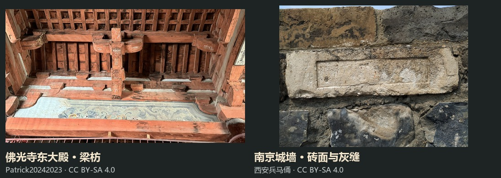
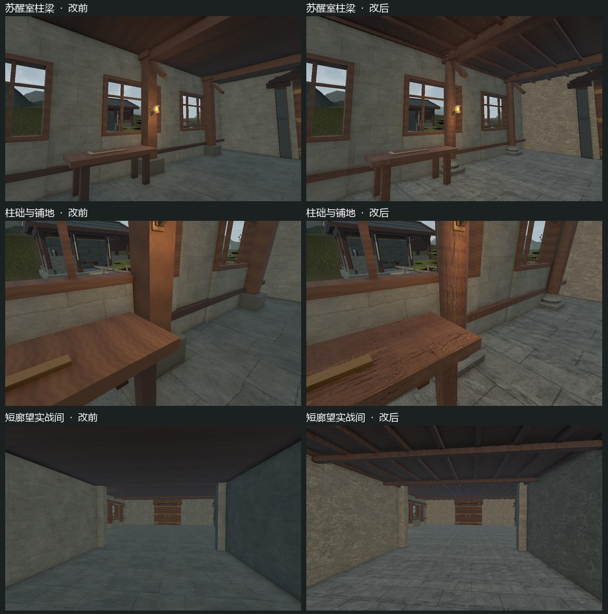
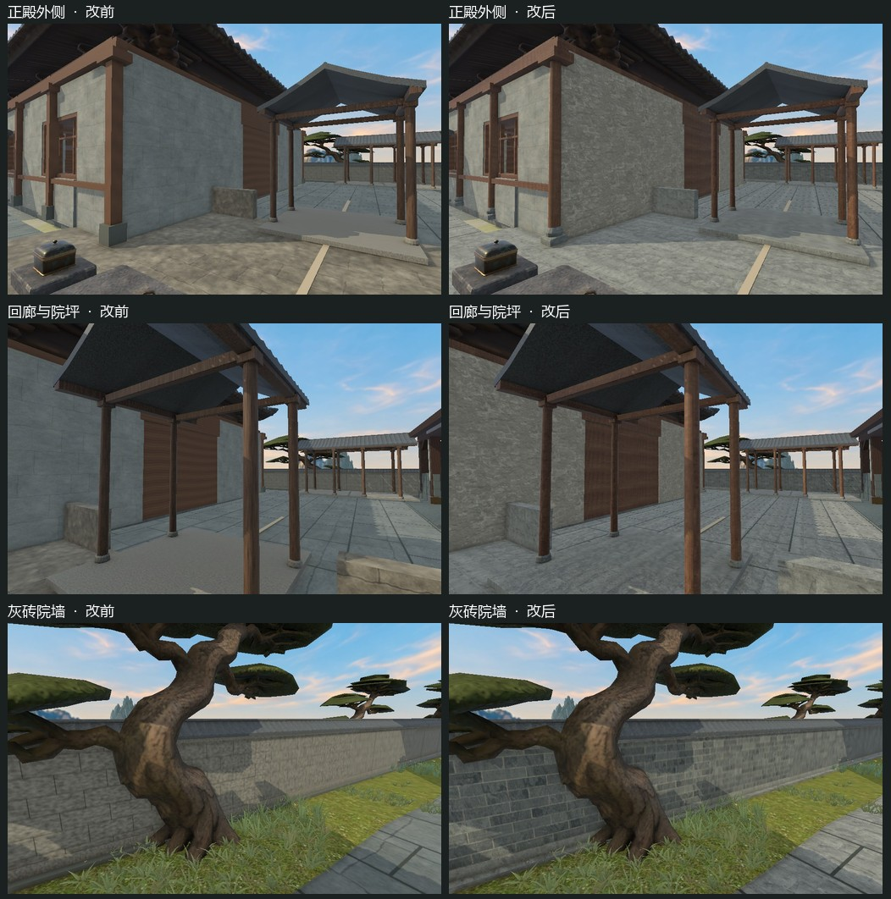

# 首章建筑的实拍取材与场景验收

两份首章场景沿用校器工坊和山间校院的布局。以下是按玩家眼高检查的资产清单，以及对应的替换方式。

| 构件 | 盘点与处理 | 实际覆盖 |
|---|---|---|
| 木柱、石础、柱头 | 从内室的 6 组方柱、方础和方柱头入手，柱身微收分，石础由方座过渡到鼓形承托。外檐合并网格中另识别 22 根直柱与 22 个基础。 | 苏醒室、实战间及正殿外檐，多个实例共用网格 |
| 梁、闸、顶板 | 长向纹理沿构件轴线展开。三段顶面补入浅木椽，短廊下方有三道横向承托。 | 内室、过廊、训练房入口 |
| 墙身与檐廊 | 灰砖从南京城墙照片取样后重新错缝铺排；灰泥保留较小的表面起伏。原有成型瓦件和檐口作为轮廓依据。 | 校验闸砌墙、围院墙 B01 与回廊 B02 |
| 铺地、台阶与渠岸 | 用石面纹理覆盖已有分块铺装，整片地板单独使用错缝地面图。B03 台阶烘回原 UV 图集。 | 内外铺地、崖门步石、渠缘、廊基 |

## 照片和表面来源

- Patrick20242023 拍摄的佛光寺内柱列用于取梁面磨痕与露木色。取样经过透视校正、去除大尺度光照、调色和接缝处理，再与木纹扫描合成。照片和改编贴图采用 CC BY-SA 4.0。[原文件](https://commons.wikimedia.org/wiki/File:佛光寺内柱列南稍间壁画.jpg) · [许可](https://creativecommons.org/licenses/by-sa/4.0/)
- 西安兵马俑拍摄的南京城墙砖用于取表面颗粒。取样避开铭刻，用变化的明暗和位置重排砖面与灰缝。照片和改编贴图采用 CC BY-SA 4.0。[原文件](https://commons.wikimedia.org/wiki/File:南京城墙成砖01.jpg) · [许可](https://creativecommons.org/licenses/by-sa/4.0/)
- Angus Cepka 的佛光寺东大殿檐下照片用于比对柱头承托与梁枋搭接；平遥城墙全景用于对照远处砌体的尺度与颜色。[佛光寺梁架照片](https://commons.wikimedia.org/wiki/File:Foguang_Temple_5.JPG) · [平遥城墙照片](https://commons.wikimedia.org/wiki/File:76668-Pingyao_(49215397373).jpg)
- 木纹、独立石面及灰泥微表面使用 Poly Haven 的 CC0 素材。随包署名收录了对应来源与改编说明。[木纹](https://polyhaven.com/a/wood_table_001) · [石面](https://polyhaven.com/a/old_sandstone_02) · [灰泥](https://polyhaven.com/a/rough_plaster_03) · [随包署名](../../../Assets/StreamingAssets/Chapter01_Architecture_Credits.txt)

## Unity 对照

六组截图使用同一场景光照和固定机位，左侧为修改前，右侧为最终发布文件在隔离 Unity 6000.3.10f1 中重新打开后的画面。

| 场景 | 本次直接换网格的 Renderer | 对应材质槽 | 这些实例的三角面改前 → 改后 | 核对的碰撞体 |
|---|---:|---:|---:|---:|
| Chapter01_Awakening | 46 | 68 | 8,704 → 12,232 | 348 |
| Chapter01_Courtyard | 49 | 70 | 13,500 → 21,540 | 633 |

五种新材质共用 1K 底色和切线法线配置，Android 使用 ASTC 6×6、Mip Map 和各向异性过滤。围墙、回廊和台阶继续沿用原有 LOD 图集。两个场景各对照七处地面射线与七处玩家尺寸的胶囊采样，碰撞结果一致。Quest/PICO 头显帧时间待实机测量。
