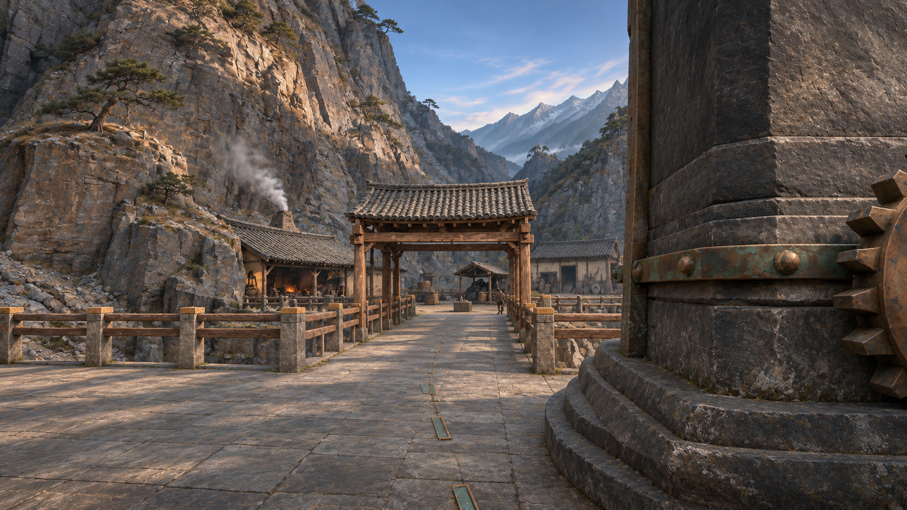
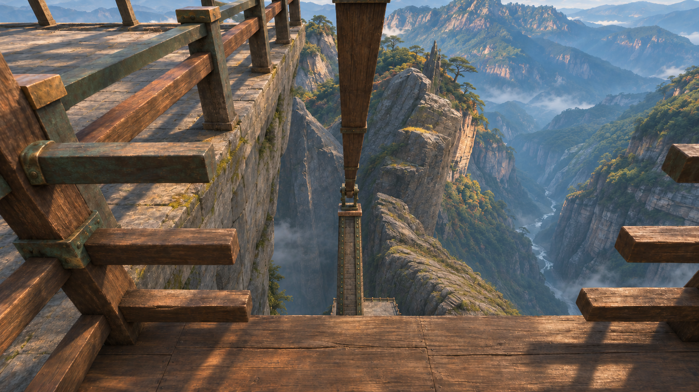

# 断衡悬道 · 群山工坊与衡梁

**制作定稿为中层 A1、上层 A2。** 两张图沿用第二章已存档的 Unity 玩家眼位。中层图看桥口、工坊主次及谷口，上层图沿 A 篮看衡梁与支点。各区复用件、已有场景几何和缺件见[分区资产清单](分区资产清单.md)。

[正式场景同机位实拍、贴图来源与验收](制作验收/README.md) · [工作台看图与批注](http://127.0.0.1:4190/plans/ch02-approved-art.html)

[T-27 锻造房「左炉右案」R3 正式前后实拍、门口通行与材质近照](T27-炉房/README.md)

## 中层 A1 · 桥口望工坊

[原始 Unity 机位](A1-hub-source.jpg) · [候选原图](A1-hub.png)

玩家位于中控平台，眼点 (32.3, 1.62, 15.3)，看向 (27, 5, 68)，垂直视野 58°。底图取自 11 月 23 日群山试验的正式场景对照帧 before-hub。A1 保留右侧塔脚、桥楼正面和进院方向，让视线穿过桥楼后继续伸进两重山脊之间。左侧炉口与烟道交代锻造房的用途，炭棚压低，修械房退后。这里可审批山口轮廓、炉房主次和材质层次。

从底图到概念图，三栋房屋的可见面积增加，地面冰蓝导引也画成了铜色嵌条。房基仍以 V2.4 为准，正式导引保留原有可读性要求。画上的烟气、人物和道具只交代工坊尺度，未列作新生产任务。

## 上层 A2 · A 篮望支点

[原始 Unity 机位](A1-upper-source.jpg) · [A2 候选原图](A2-upper.png) · [A1 初稿](A1-upper.png) · [现有衡梁、吊耳与两端关系](../20261122_chapter02_scene/mountain-craft-hoist.jpg)

眼点 (−8.7, 81.62, 20.75)，看向 (35.6, 48.6, 20.4)，垂直视野 62°。底图取自第二章既有 Unity 构件实拍 after-tower-basket。画面下缘是玩家脚下的 A 篮，左侧是同高停靠台，视线沿木衡梁落到中央支点。B 篮初态在 −80 m，此眼位无法完整看见 B 篮。两侧直索、门向和停靠关系按[既有 V2.4 比例图](../../architecture/第二章_断衡悬道/断衡悬道_V2.4_衡梁吊索与动线.pdf)复核。

上层 A1 把工棚画在支点右侧。A2 将该处还原为岩肩，并补上塔芯铜束带。谷口远处的河线用于交代地势，仅作为氛围提案。

## 审批范围与版本

两张概念图用于选择玩家站在这两个位置时看到的美术方向。楼层、通行面、碰撞与机关位置沿用 V2.4。初审使用的 GorgeRelief 与 GorgeSkyline 属于独立 MountainPreview 样件；正式场景的 ApprovedGorge 使用同一地形研究另行雕刻、贴图和制作 LOD。头显视差及乘篮舒适度待设备实测。

2026-11-25，对“中层 A1『桥口望工坊』和上层 A2『A 篮望支点』都定稿，按这两张开始制作”的确认，用户答复“对，要特别注意纹理贴图 必要的时候可以去搜索网上的真实图片做素材”。此授权覆盖两处机位及其可见环境。生产以石木表面的实际尺度、木纹和端面方向、铜件磨损与岩层接坡为重点。[正式场景](../../../Assets/Scene/Chapter02_SuspendedPath.unity) · [场景距离规格](../../architecture/第二章_断衡悬道/04_场景距离规格.md) · [群山样件对照](../20261123_chapter02_mountain/README.md)
