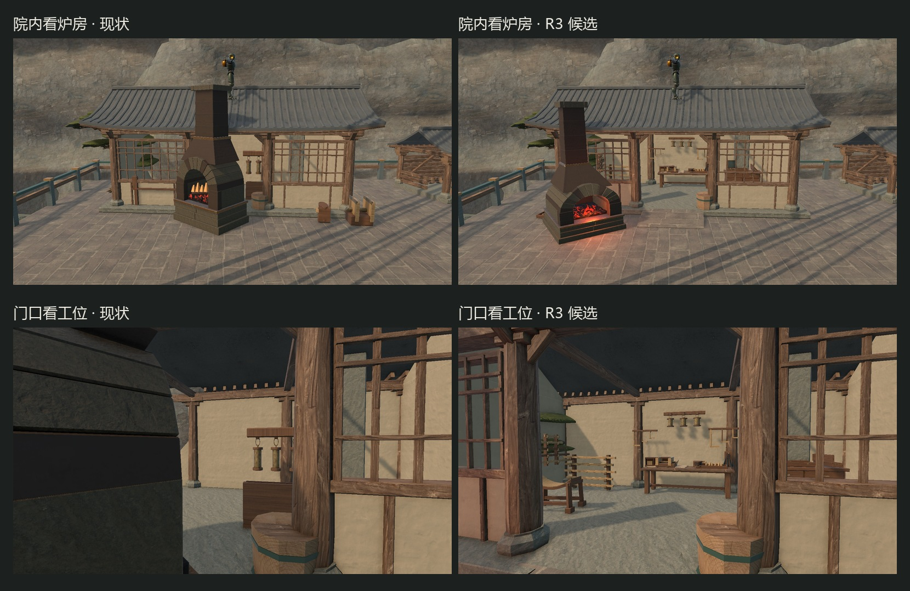

# F1 锻造房「左炉右案」R3

R3 已按聊天确认写入 D 盘正式场景，在主工程冷重开后读回。用户截图中的三开间格窗、门前拱炉和左侧临崖护栏，对应 F1 锻造房。原炉口遮挡门洞，房屋还有一个包住整间屋子的实体碰撞盒。R3 将炉床、烟道和炭槽移到门左，门内左手接热件，后墙长案用于夹持与量测，右后方的矮柜收成件。[正式前后对照](正式落盘/正式前后对照.jpg) · [主工程门口实拍](正式落盘/主工程-entry.jpg) · [工作台正式实拍](http://127.0.0.1:4190/plans/ch02-approved-art.html#t27-final) · [用户原图](用户参考.png)

| 视角 | 现状 | R3 | 拍摄条件 |
| --- | --- | --- | --- |
| 截图方向的院内外景 | [原图](exterior-before-r3.jpg) | [原图](exterior-after-r3.jpg) | 原截图无相机参数。按外墙、屋脊与护栏近似匹配，高 4.08 米，纵向视场 44°。 |
| 门口往里 | [原图](entry-before-r3.jpg) | [原图](entry-after-r3.jpg) | 站在原炉右侧看向后墙。眼高 1.62 米，纵向视场 68°。 |
| 院里平视 | [原图](eye-before-r3.jpg) | [原图](eye-after-r3.jpg) | 眼高 1.62 米，纵向视场 49°。 |
| 工作台和钳口 | [原图](bench-before-r3.jpg) | [原图](bench-after-r3.jpg) | 距房内地坪约 1.62 米，纵向视场 70°。改前屋内为陈设检查机位。 |
| 已定稿的中层 A1 | [原图](A1-before-r3.jpg) | [原图](A1-after-r3.jpg) | 桥头拍摄。RGB 任一通道差值超过 8/255 的像素占 0.9893%。 |
| 已定稿的上层 A2 | [原图](A2-before-r3.jpg) | [原图](A2-after-r3.jpg) | A 篮拍摄，全部像素一致。 |

各组使用相同的改前、改后机位。台面三块木板按板长布置木纹，颜色、平滑度与切线法线采用项目已收录的粗木实拍纹理。夹具接触面复用项目锤纹铜材质。门槛坡道沿用院坪砂岩板材。工位旁的岩片已收进后墙，旧炉炭与示意焰片归入同一层炭床。[木纹及来源记录](../../../../ArtSource/Environment/SuspendedPath/Surfaces/Workshop/sources.json) · [院坪石材来源](../../../../ArtSource/Environment/SuspendedPath/ApprovedWorkshop/Flagstones.source.json)

窗下栏板之间净宽 2.64 米，门槛坡面实宽 2.36 米。直径 0.52 米、高 1.72 米的胶囊沿中间 21 条线、每线 54 个位置通过。屋顶射手的位置与四张导航数据保留，室内仍在敌人地面导航边界以外。独立 Unity 进程重新打开候选场景，六个改后视角均与送审图逐像素一致。[Unity 读数、机位对照和冷启动复核](Unity验收.txt)

炉房发布时，正式场景从 `15779cec…58450` 更新为 `1b4a4e9d8326d6c9372474dc78f807c625dbe8b0e7e7dd0d202ce88d42761a38`。14 个网格位于 `Assets/Art/Environment/SuspendedPath/ApprovedWorkshop/ForgeR3`，主工程重开后均有实际场景引用。炉体世界坐标为 (13.936, 0.010, 41.096)，门槛接坡为 (13.529, 0.000, 44.244)。先前导出的 Android 装配包保留送审前的炉房。[炉房发布时的主工程读数](正式落盘/主工程-冷开.txt) · [独立复核与六机位比对](正式落盘/验收记录.txt) · [统一玩家接入后的主工程冷读](../../../../Tools/Validation/Evidence/Chapter02Assembly/formal-workshop/official-editor.txt) · [独立通行实测](正式落盘/正式场景-通行.txt) · [R3 原始归档](../../../../ArtSource/Environment/SuspendedPath/ReviewCandidates/T27-ForgeR3.zip) · [正式装配记录](../../../architecture/第二章_断衡悬道/06_正式关卡装配.md)
