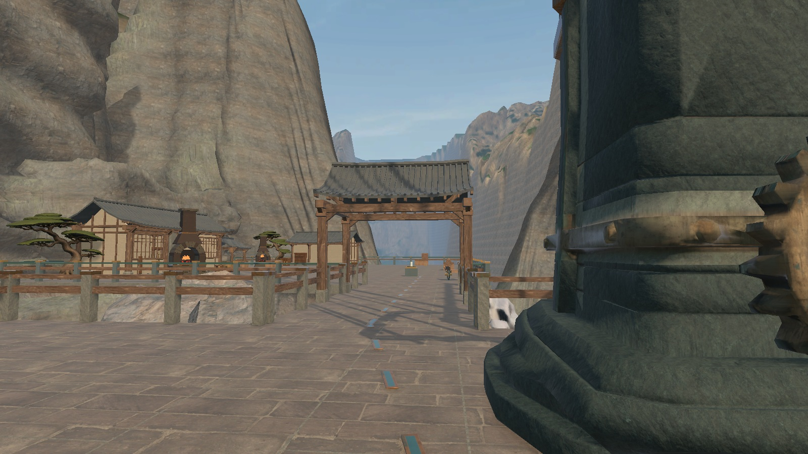
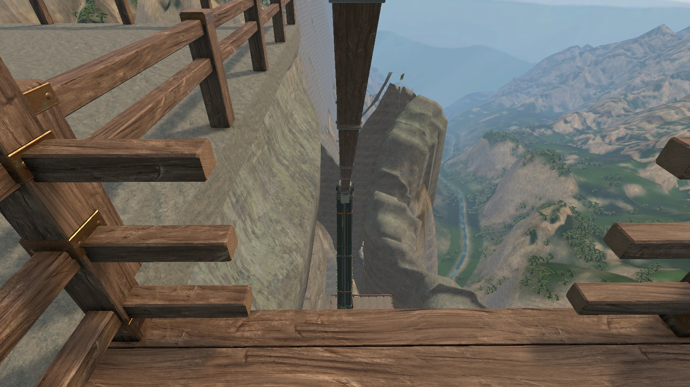

# 《断衡悬道》A1、A2 制作验收

[工作台同机位对照与批注](http://127.0.0.1:4190/plans/ch02-approved-art.html) · [Unity 正式场景](../../../../Assets/Scene/Chapter02_SuspendedPath.unity) · [资产台账](../../../../ArtSource/Environment/SuspendedPath/AssetRegister.csv)

## 中层 A1 · 桥口望工坊

同一眼位、同一视野可对照[A1 定稿](../A1-hub.png)。石券桥楼框住入院方向，中控地坪、桥面与工坊院内采用同尺度的石板。铜边嵌条中保留冷色指引。V2.4 房基使修械房在桥口视角里更接近画面中央，左边的锻造房由炉火与烟道辨认。从院内可以同时辨认三栋建筑。[工坊院内实拍](yard.jpg) · [旋转查看工坊](http://127.0.0.1:4190/scenes/?id=ch02-art-workshop)

## 上层 A2 · A 篮望支点

对照[A2 定稿](../A2-upper.png)可查画面下缘的木框、左侧停靠护栏、梁端和谷内远山。篮体、栏杆和束带各有三档网格。H03 原塔体沿用既有 LOD，塔脚补了石材颗粒与金属表面细节。A 槽沿保留 1.25 米净口，T-25 镇石本体由专项复用。[篮体近照](basket-close.jpg) · [旋转查看 A 篮](http://127.0.0.1:4190/scenes/?id=ch02-art-basket)

## 纹理、地形与可编辑源

| 可见部位 | 素材和加工 | 可编辑来源 |
| --- | --- | --- |
| 桥口与院场石板 | Amal Kumar 的 Poly Haven 红砂岩铺装，2K 底色、切线法线、粗糙度。以 2.15 × 2.15 米为一次平铺，沿通行方向铺设。 | [授权、原图尺寸和下载校验](../../../../ArtSource/Environment/SuspendedPath/ApprovedWorkshop/Flagstones.source.json) |
| 篮体、栏杆、铜接头 | 纵材使用顺纹木材扫描，切口分配独立端木扫描。接头高模细节烘入低模，铜件按受力位置布置。 | [篮体与栏杆 Blender 源](../../../../ArtSource/Environment/SuspendedPath/ApprovedBasket/ApprovedBasket.blend) · [工坊木石素材](../../../../ArtSource/Environment/SuspendedPath/Surfaces/Workshop/sources.json) |
| H03 塔脚、槽沿 | 保留构件原轮廓，在石面与铸件上叠加实物尺度的细节法线、明暗与粗糙度；槽沿分配木、石和铜内衬。 | [金属与采石场扫描来源](../../../../ArtSource/Environment/SuspendedPath/ApprovedBasket/PivotCloseScans.json) · [Unity 材质与槽口读回](../../../../ArtSource/Environment/SuspendedPath/ApprovedBasket/CloseSurfaceReadback.txt) |
| 铜边嵌条、炉膛 | 嵌条单件高模烘低模，35 根合并为两档网格；两座炉共用炉床，分别处理煤块、烟熏内壁与发光炭火。 | [铜嵌条 Blender 源](../../../../ArtSource/Environment/SuspendedPath/ApprovedWorkshop/SurveyInlay.blend) · [炉床 Blender 源](../../../../ArtSource/Environment/SuspendedPath/ApprovedWorkshop/WorkshopHearth.blend) |
| 岩壁、谷口、远山 | 虎跳峡 Copernicus 高程衍生地形，经雕刻形成岩肩、谷口和河线，保留谷底平台。陡壁采用分层的拍摄岩石纹理，中远景以三档地形、林带和山际线建立层次。 | [地形及扫描素材署名](../../../../ArtSource/Environment/SuspendedPath/ApprovedGorge/Attribution.txt) · [Blender 地形源](../../../../ArtSource/Environment/SuspendedPath/ApprovedGorge/GorgeProduction.blend) · [谷底实拍](lower.jpg) |

工作台 GLB 收录正式场景里的静态 LOD0 拆件，内嵌材质预览图上限为 1K。Unity 原图用于检查现场光照、烟气、专用岩石着色和玩家视野。正式贴图分辨率与审阅件分别保存在 Unity 和工作台资产目录。

## 运行核对

Unity 6000.3.10f1 桌面 D3D11 回读，同机位截图为 1600 × 900。组装前后逐个比较碰撞体标识、启用状态与世界包围盒。五段近崖按三角面检查两个战斗区、谷底和双篮运动区。章内旧断桥修复段的栏间净宽为 2.89 米，原规格目标为 3 米。Quest、PICO 上的纹理清晰度、左右眼视差、帧时与乘篮舒适度待实机验证。

[桌面验证记录](UnityReadback.txt) · [本次文件清单](文件清单.tsv) · [七件 Prefab 与 LOD 登记](../../../../ArtSource/Environment/SuspendedPath/AssetRegister.csv)
